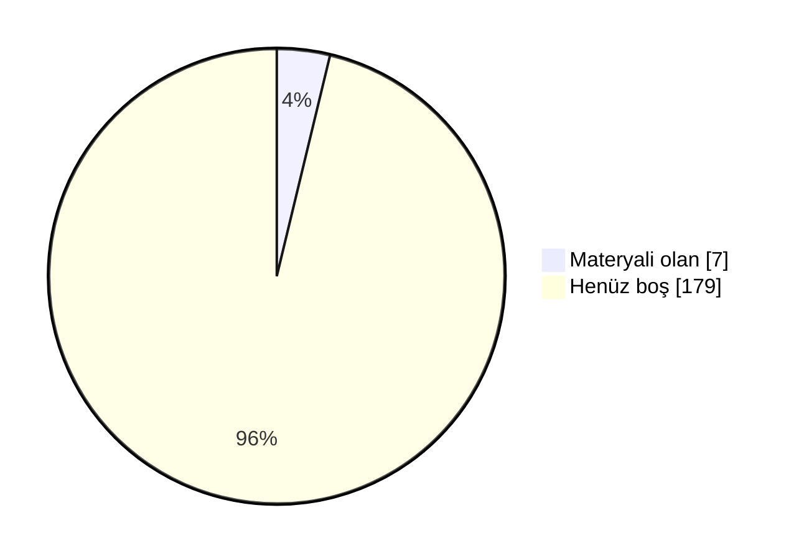

# 📖 Marmara Bilgisayar Mühendisliği Arşiv

Marmara Üniversitesi Mühendislik Fakültesi Bilgisayar Mühendisliği öğrencileri için düzenli, sürdürülebilir ve değer üreten bir akademik arşiv. Ders notları, ödev çözümleri, slaytlar, çıkmış sorular ve çalışma rehberleri tek bir yerde toplandı.

 ## 🗣️ Geri Bildirimde Bulunun

📬 Öğrenciler ve hocalar, derslerle ilgili hakaret içermeyen geri bildirimlerinizi aşağıdaki linkler aracılığıyla anonim olarak paylaşabilirsiniz.

- [✍️ **Hocalar için yorum linki**](https://docs.google.com/forms/d/e/1FAIpQLSf-b3VLnBxONXThFPzdsN5clQreZKEo2mumaLpJlEptHwREOw/viewform)
- [✍️ **Dersler için yorum linki**](https://docs.google.com/forms/d/e/1FAIpQLScu9nj_5qL5cRNtkkgvvHWk0xXZQg_gD07m3BV5C2xEAqjNFA/viewform)
- [⭐ **Dersler için oylama linki**](https://docs.google.com/forms/d/e/1FAIpQLSeBBxR1BHLJmMdIZ9-EEAjqcfpt47G47KdSNDcDXhdBRLjSww/viewform)

## 🤝 Katkıda Bulunun

Elinde ders notu, slayt, çıkmış soru ya da ödev çözümü varsa arşive eklemek çok kolay:

- 📁 **GitHub kullanmıyorsan:** [Google Drive klasörümüze](https://drive.google.com/drive/folders/1KRobMRVHpJxUKcCZdCEippSZ5SmgpkZq?usp=sharing) yükle. Önce BENİOKU dosyasını oku, sonra **Bilgisayar-Mühendislik** klasöründe kendi adınla bir klasör aç.
- 🌐 **GitHub hesabın varsa:** Repoyu fork'la, dosyayı ilgili ders klasörüne yükle ve pull request gönder. Kurulum gerekmez, her şey tarayıcıdan yapılır.
- 📖 **Adım adım rehber:** [CONTRIBUTING.md](CONTRIBUTING.md)

Pull request ile katkıda bulunanların adı sayfanın en altındaki **Katkıda Bulunanlar** listesine otomatik eklenir.

### 📺 Video Rehberler
- 🎬 **Repoya nasıl katkı yapılır?** (~10 dk): *yakında*
- 🎬 **Repo nasıl kullanılır?** Klasör yapısı, ders README'leri ve aradığını bulma: *yakında*

<b>🛠 Repo Kullanımı</b>

## 🛠 Repo Kullanımı

### ⚙️ Açıklamalar:
- 📋 Bölümde bilinen ve güvenilir bir kaynak olmak.
- 📋 Akademik network oluşturmak ve iş birliklerini kolaylaştırmak.
- 📋 Dışarıdan bakan biri için temiz, düzenli ve profesyonel bir imaj sunmak.
- 📋 İçerikler: ders slaytları, kişisel ders notları ve özetler, ödev çözümleri, atölye çalışmaları, çıkmış sorular ve analizleri, proje dosyaları ve örnekleri.

### 📝 Talimatlar:
- 👉 Repo içindeki README.md'leri ders bazlı takip edin.
- 👉 Ödevleri çalıştırmak için ilgili klasörlerdeki .py veya .cpp dosyalarını kullanabilirsiniz.
- 👉 Ders özetleri, kısa ve okunabilir şekilde markdown olarak hazırlanmıştır.
- 👉 Özet ve ödevleri birleştirip kendi öğrenme sürecinize uyarlayabilirsiniz.

<b>🔍 Kavramlar</b>

## 🔍 Kavramlar

📌 Bölümle ilgili sık karşılaşılan terimlerin kısa açıklamaları. Not: tarih/şart gibi somut rakamlar dönemden
döneme değişebilir, kesin ve güncel bilgi için bölüm/fakülte öğrenci işlerine danışın.

- 💡 **Bütünleme Sınavı**
  - 📘 **S: Bütünleme sınavı nedir?** **C:** Final sınavının ardından yapılan, dersten başarısız olanların
    (ve şartlı geçenlerin isterlerse) girebildiği ek bir sınavdır. Bütünlemeye giren bir öğrencinin notu,
    final notunun yerini alır — geri dönüş yoktur.
- 💡 **Çan Eğrisi**
  - 📘 **S: Çan eğrisi nedir?** **C:** Bir sınıfın sınav sonuçlarının ortalama ve standart sapmasına göre
    harf notlarının belirlendiği bağıl bir değerlendirme yöntemidir. Her hoca kullanmak zorunda değildir;
    bazı dersler mutlak (bareme dayalı) notlandırılır.
- 💡 **DC Notu / Şartlı Geçme**
  - 📘 **S: DC nedir?** **C:** Şartlı geçme notudur — dersi geçmiş sayılırsınız ama not ortalamanız
    (GANO) yeterince yüksek değilse dersi tekrar almanız istenebilir. Bütünlemeye isteğe bağlı girilebilir.
- 💡 **GANO / AGNO**
  - 📘 **S: GANO nedir?** **C:** Genel Ağırlıklı Not Ortalaması — o ana kadar alınan tüm derslerin kredi
    ağırlıklı not ortalamasıdır. Mezuniyet, ÇAP/yandal başvurusu gibi şartlarda kullanılır.
- 💡 **YANO**
  - 📘 **S: YANO nedir?** **C:** Yarıyıl Ağırlıklı Not Ortalaması — yalnızca ilgili dönemde alınan derslerin
    kredi ağırlıklı not ortalamasıdır. Her dönem sıfırdan hesaplanır; GANO ise tüm dönemleri kapsar.
- 💡 **Mazeret Sınavı**
  - 📘 **S: Mazeret sınavı nedir?** **C:** Sağlık raporu, resmi belgeli bir mazeret vb. nedenle vize/finale
    giremeyen öğrenciler için düzenlenen, geçerli belgeyle başvurulan ek sınavdır.
- 💡 **ÇAP / Yandal**
  - 📘 **S: ÇAP nedir?** **C:** Çift Anadal Programı — uygun GANO'ya sahip öğrencilerin, okurken ikinci bir
    bölümden de lisans diploması almasını sağlayan program.
  - 📘 **S: Yandal nedir?** **C:** Diploma vermeyen, ikinci bir alanda sertifika niteliğinde daha hafif bir
    program.
- 💡 **Staj 1 / Staj 2**
  - 📘 **S: Staj 1/2 nedir?** **C:** Müfredatta 3. ve 4. yıllarda yer alan, işletmede kısa süreli uygulamalı
    çalışmayı zorunlu kılan derslerdir. Hangi dönemde olduklarını dönem sayfalarında görebilirsin.
- 💡 **Bitirme Projesi**
  - 📘 **S: Bitirme Projesi nedir?** **C:** Son dönemde bir danışman hoca eşliğinde yürütülen, mezuniyet
    şartı olan bitirme çalışmasıdır.
- 💡 **Mesleki Seçmeli / Üniversite Seçmeli**
  - 📘 **S: Aralarındaki fark ne?** **C:** Mesleki Seçmeli dersler bölüm içi teknik derslerdir. Üniversite Seçmeli dersler ise bölüm dışı, daha genel/sosyal
    içeriklidir (örn. Girişimcilik, Osmanlı Tarihi). Bkz. [Seçmeli Dersler](#-seçmeli-dersler).

<!-- DOLULUK_BASLANGIC -->

<b>📊 Arşiv Doluluk Durumu</b>

## 📊 Arşiv Doluluk Durumu

Arşivdeki **186** dersin **7** tanesinde en az bir materyal var (genel doluluk **%4**).

| Dönem | Doluluk | Materyali olan ders |
|---|---|---|
| [1. Yıl Güz](./1-1/) | 🟩⬜⬜⬜⬜⬜⬜⬜⬜⬜ %12 | 1 / 8 |
| [1. Yıl Bahar](./1-2/) | 🟩⬜⬜⬜⬜⬜⬜⬜⬜⬜ %14 | 1 / 7 |
| [2. Yıl Güz](./2-1/) | ⬜⬜⬜⬜⬜⬜⬜⬜⬜⬜ %0 | 0 / 6 |
| [2. Yıl Bahar](./2-2/) | 🟩🟩🟩🟩🟩🟩🟩🟩🟩🟩 %100 | 5 / 5 |
| [3. Yıl Güz](./3-1/) | ⬜⬜⬜⬜⬜⬜⬜⬜⬜⬜ %0 | 0 / 6 |
| [3. Yıl Bahar](./3-2/) | ⬜⬜⬜⬜⬜⬜⬜⬜⬜⬜ %0 | 0 / 6 |
| [4. Yıl Güz](./4-1/) | ⬜⬜⬜⬜⬜⬜⬜⬜⬜⬜ %0 | 0 / 6 |
| [4. Yıl Bahar](./4-2/) | ⬜⬜⬜⬜⬜⬜⬜⬜⬜⬜ %0 | 0 / 2 |
| [Mesleki Seçmeli](./Mesleki%20Seçmeli/) | ⬜⬜⬜⬜⬜⬜⬜⬜⬜⬜ %0 | 0 / 42 |
| [Fakülte Teknik Seçmeli](./Fakülte%20Teknik%20Seçmeli/) | ⬜⬜⬜⬜⬜⬜⬜⬜⬜⬜ %0 | 0 / 33 |
| [Teknik Olmayan Seçmeli](./Teknik%20Olmayan%20Seçmeli/) | ⬜⬜⬜⬜⬜⬜⬜⬜⬜⬜ %0 | 0 / 65 |

### 🙋 Bu dersler katkını bekliyor
Elinde bu derslerden materyal varsa yukarıdaki **🤝 Katkıda Bulunun** bölümüne göz at.

- **1. Yıl Güz:** Atatürk İlkeleri ve İnkılap Tarihi 1, Calculus 1, Computer Programming 1, Introduction to Computer Engineering, Physics Lab. 1, Physics 1, Türk Dili 1
- **1. Yıl Bahar:** Atatürk İlkeleri ve İnkılap Tarihi 2, Calculus 2, Linear Algebra for Computer Engineering, Physics Lab. 2, Physics 2, Türk Dili 2
- **2. Yıl Güz:** Data Structures, Differential Equations, Discrete Computational Structures, Electric Circuits, Engineering Economy, Numerical Methods
- **3. Yıl Güz:** Database Systems, Digital Logic Design, Modeling and Discrete Simulation, Object-Oriented Software Design, Operating Systems, Summer Practice 1
- **3. Yıl Bahar:** Computer Organization, Formal Languages and Automata Theory, Introduction to Signals and Systems, Operations Research, Software Engineering, Technical Communications and Entrepreneurship
- **4. Yıl Güz:** Computer Networks, Engineering Project 1, Introduction to Machine Learning, İş Sağlığı ve Güvenliği 1, Principles of Embedded Systems Design, Summer Practice 2
- **4. Yıl Bahar:** Engineering Project 2, İş Sağlığı ve Güvenliği 2
- **Mesleki Seçmeli:** Advanced Data Structures, Advanced Unix Programming, Artificial Intelligence, Cloud Computing, Compiler Design, Computer Graphics, Çoklu Ajan Sistemleri, Exchange Program Technical Elective 1, Exchange Program Technical Elective 2, Exchange Program Technical Elective 3, Exchange Program Technical Elective 4, Exchange Program Technical Elective 5, Exchange Program Technical Elective 6, Exchange Program Technical Elective 7, Fundamentals of Data Mining, Fundamentals of Electronic Commerce, Grafik Teorisi ve Uygulamaları, Human Computer Interaction, Information Systems Security, Information Systems - Analysis and Design, Internet Programming, Introduction to Blockchain Programming, Introduction to Computational Genomics, Introduction to Cryptography, Introduction to Data Science and Analytics, Introduction to Deep Learning, Introduction to Distributed Systems, Introduction to Natural Language Processing, Introduction to Parallel Processing, Introduction to Robotics and Control Theory, Management of Information Systems, Microprocessors, Mobile Device Programming, Multimedia Systems, Software Frameworks, Software Project Management, Sosyal Ağ Analizi, Special Topics in Computer Engineering 1, Special Topics in Computer Engineering 2, Special Topics in Computer Engineering 3, Special Topics in Computer Engineering 4, Wireless and Mobile Networks
- **Fakülte Teknik Seçmeli:** Advanced Innovative Design Management for Entrepreneurship, Automotive Engineering, Business Management for Engineers, Chemical Engineering for Sustainable Biosphere, Construction Materials for Environmental Engineering, Control Systems, Cost Management in Chemical Industries, Design of Experiments, Designing Quality Products, Energy and the Environment, Entrepreneurship with Open-Source ERP Systems, Financial Engineering, From Waste to Value - Circular Economy Applications, Innovation and New Product Development Management, Instrumental Analysis for Engineers, Interdisciplinary Engineering Practices in Modern Systems, Introduction to Image Processing, Introduction to Information Systems Management, Introduction to Robotics, Introduction to Total Quality Management, Managing Engineering and Technology, Materials Engineering Economics and Plant Design, Mathematical Modeling in Mechanical Engineering, Mechatronics, Micro Electro Mechanical Systems, Planning and Management of Research, Project Management for Engineers, Renewable Energy Utilization, Simulation for Engineering Systems, Survey Design and Measure Development, Sustainable Innovation and Circular Economy, Total Quality Management in Materials Engineering, Quality Management System in Automotive Industry
- **Teknik Olmayan Seçmeli:** Arabic for Beginners, Basic Principles of Accessibility in Informatics and Technology, Behavioral Sciences for Engineers, Brand Creation-Branding, Business Communication, Business Intelligence for Managers, Cardiopulmonary Resuscitation and First Aid Basics, Career Development, Career Orientation, Chinese 1, Chinese 2, Chinese 3, Cinema, Communication Models and Techniques, Creativity and lnnovation Management, Design, Innovation and Entrepreneurship, Earthquake and Rescue Principles, Effects of Human Behaviour on Environment, Energy for Physical Activity, Entrepreneurship and Innovation, Environmental Sociology, Ethics in Engineering and Science, French, French for Beginners, Fundamentals of Management, Geometric Origami, German, German Communication, German for Beginners, Health and Body Sociology, Human Performance and Nutrition, Industrial and Economic Sociology, Industrial Psychology, Information Literacy in Engineering, Integrated Marketing Communication, International Business, Interpersonal Relations and Communication, Introduction to Angel Financing for Engineers, Introduction to Business World for Engineers, Introduction to Corporate Governance for Engineers, Introduction to Finance for Engineers, Introduction to Leadership & Management for Engineers, Introduction to Programming with Python, Introduction to Strategic Human Resources Management, Introduction to Strategy for Engineers, Investment Planning, Japanese 1, Japanese 2, Labor Law, Marketing in a Technology Driven world for Engineers, Organizational Behaviour, Our Biosphere, Positive Thinking, Principles of Managerial Economics & Financial Management, Report Writing in English, Self Management, Seminars in German, Sociology of Urban Life, Spanish, Spanish for Beginners, Strategic Entrepreneurship, Sustainability Management, The Culture of Radiation Safety, Trekking and Orienteering, World Cultures

<!-- DOLULUK_BITIS -->

<b>📖 Dersler</b>

## 📖 Dersler
📄 Bu bölümde, tüm dersler hakkında detaylı bilgiler ve kaynaklar bulunmaktadır. Öğrenciler bu bölümü kullanarak ders materyallerine ve içeriklerine ulaşabilirler.

### 🗓 1. Yıl - Güz

#### 📘 Atatürk İlkeleri ve İnkılap Tarihi 1 
  - 🏷️ **Ders Tipi:** Zorunlu
  - 🏷️ **Müfredat:** Güncel Müfredat
  - ⭐ **Yıldız Sayıları:**
      - ℹ️ Henüz yıldız veren yok. Siz de [linkten](https://docs.google.com/forms/d/e/1FAIpQLSeBBxR1BHLJmMdIZ9-EEAjqcfpt47G47KdSNDcDXhdBRLjSww/viewform?usp=pp_url&entry.965309065=Atat%C3%BCrk%20%C4%B0lkeleri%20ve%20%C4%B0nk%C4%B1lap%20Tarihi%201) anonim şekilde oylamaya katılabilirsiniz.
  - 💬 **Öğrenci Görüşleri:**
      - ℹ️ Henüz yorum yok. Siz de [linkten](https://docs.google.com/forms/d/e/1FAIpQLScu9nj_5qL5cRNtkkgvvHWk0xXZQg_gD07m3BV5C2xEAqjNFA/viewform?usp=pp_url&entry.1887244155=Atat%C3%BCrk%20%C4%B0lkeleri%20ve%20%C4%B0nk%C4%B1lap%20Tarihi%201) anonim şekilde görüşlerinizi belirtebilirsiniz.
  - 👨‍🏫 👩‍🏫 **Dersi Yürüten Akademisyenler:**
    - **2026-2027**: [HÖ](#‍-öğr-gör-hülya-özler)
  - 📂 [Ders Klasörü](./1-1/Atat%C3%BCrk%20%C4%B0lkeleri%20ve%20%C4%B0nk%C4%B1lap%20Tarihi%201)

#### 📘 Introduction to Computer Engineering 
  - 🏷️ **Ders Tipi:** Zorunlu
  - 🏷️ **Müfredat:** Güncel Müfredat
  - ⭐ **Yıldız Sayıları:**
      - ℹ️ Henüz yıldız veren yok. Siz de [linkten](https://docs.google.com/forms/d/e/1FAIpQLSeBBxR1BHLJmMdIZ9-EEAjqcfpt47G47KdSNDcDXhdBRLjSww/viewform?usp=pp_url&entry.965309065=Introduction%20to%20Computer%20Engineering) anonim şekilde oylamaya katılabilirsiniz.
  - 💬 **Öğrenci Görüşleri:**
      - ℹ️ Henüz yorum yok. Siz de [linkten](https://docs.google.com/forms/d/e/1FAIpQLScu9nj_5qL5cRNtkkgvvHWk0xXZQg_gD07m3BV5C2xEAqjNFA/viewform?usp=pp_url&entry.1887244155=Introduction%20to%20Computer%20Engineering) anonim şekilde görüşlerinizi belirtebilirsiniz.
  - 👨‍🏫 👩‍🏫 **Dersi Yürüten Akademisyenler:**
    - **2026-2027**: [FCE](#‍-dr-öğretim-üyesi-fatma-corut-ergin)
  - 📂 [Ders Klasörü](./1-1/Introduction%20to%20Computer%20Engineering)

#### 📘 Computer Programming 1 
  - 🏷️ **Ders Tipi:** Zorunlu
  - 🏷️ **Müfredat:** Güncel Müfredat
  - ⭐ **Yıldız Sayıları:**
      - ℹ️ Henüz yıldız veren yok. Siz de [linkten](https://docs.google.com/forms/d/e/1FAIpQLSeBBxR1BHLJmMdIZ9-EEAjqcfpt47G47KdSNDcDXhdBRLjSww/viewform?usp=pp_url&entry.965309065=Computer%20Programming%201) anonim şekilde oylamaya katılabilirsiniz.
  - 💬 **Öğrenci Görüşleri:**
      - ℹ️ Henüz yorum yok. Siz de [linkten](https://docs.google.com/forms/d/e/1FAIpQLScu9nj_5qL5cRNtkkgvvHWk0xXZQg_gD07m3BV5C2xEAqjNFA/viewform?usp=pp_url&entry.1887244155=Computer%20Programming%201) anonim şekilde görüşlerinizi belirtebilirsiniz.
  - 👨‍🏫 👩‍🏫 **Dersi Yürüten Akademisyenler:**
    - **2026-2027**: [SAY](#‍-dr-öğretim-üyesi-sanem-arslan-yılmaz)
  - 📂 [Ders Klasörü](./1-1/Computer%20Programming%201)

#### 📘 Calculus 1 
  - 🏷️ **Ders Tipi:** Zorunlu
  - 🏷️ **Müfredat:** Güncel Müfredat
  - ⭐ **Yıldız Sayıları:**
      - ℹ️ Henüz yıldız veren yok. Siz de [linkten](https://docs.google.com/forms/d/e/1FAIpQLSeBBxR1BHLJmMdIZ9-EEAjqcfpt47G47KdSNDcDXhdBRLjSww/viewform?usp=pp_url&entry.965309065=Calculus%201) anonim şekilde oylamaya katılabilirsiniz.
  - 💬 **Öğrenci Görüşleri:**
      - ℹ️ Henüz yorum yok. Siz de [linkten](https://docs.google.com/forms/d/e/1FAIpQLScu9nj_5qL5cRNtkkgvvHWk0xXZQg_gD07m3BV5C2xEAqjNFA/viewform?usp=pp_url&entry.1887244155=Calculus%201) anonim şekilde görüşlerinizi belirtebilirsiniz.
  - 👨‍🏫 👩‍🏫 **Dersi Yürüten Akademisyenler:**
    - **2026-2027**: [MK](#‍-doç-dr-mahmut-kertil)
  - 📂 [Ders Klasörü](./1-1/Calculus%201)

#### 📘 Introduction to Modern Biology 
  - 🏷️ **Ders Tipi:** Zorunlu
  - 🏷️ **Müfredat:** Güncel Müfredat
  - ⭐ **Yıldız Sayıları:**
      - ℹ️ Henüz yıldız veren yok. Siz de [linkten](https://docs.google.com/forms/d/e/1FAIpQLSeBBxR1BHLJmMdIZ9-EEAjqcfpt47G47KdSNDcDXhdBRLjSww/viewform?usp=pp_url&entry.965309065=Introduction%20to%20Modern%20Biology) anonim şekilde oylamaya katılabilirsiniz.
  - 💬 **Öğrenci Görüşleri:**
      - ℹ️ Henüz yorum yok. Siz de [linkten](https://docs.google.com/forms/d/e/1FAIpQLScu9nj_5qL5cRNtkkgvvHWk0xXZQg_gD07m3BV5C2xEAqjNFA/viewform?usp=pp_url&entry.1887244155=Introduction%20to%20Modern%20Biology) anonim şekilde görüşlerinizi belirtebilirsiniz.
  - 👨‍🏫 👩‍🏫 **Dersi Yürüten Akademisyenler:**
    - **2026-2027**: [FEAK](#‍-dr-öğretim-üyesi-fatma-ece-altınışık-kaya)
  - 📂 [Ders Klasörü](./1-1/Introduction%20to%20Modern%20Biology)

#### 📘 Physics 1 
  - 🏷️ **Ders Tipi:** Zorunlu
  - 🏷️ **Müfredat:** Güncel Müfredat
  - ⭐ **Yıldız Sayıları:**
      - ℹ️ Henüz yıldız veren yok. Siz de [linkten](https://docs.google.com/forms/d/e/1FAIpQLSeBBxR1BHLJmMdIZ9-EEAjqcfpt47G47KdSNDcDXhdBRLjSww/viewform?usp=pp_url&entry.965309065=Physics%201) anonim şekilde oylamaya katılabilirsiniz.
  - 💬 **Öğrenci Görüşleri:**
      - ℹ️ Henüz yorum yok. Siz de [linkten](https://docs.google.com/forms/d/e/1FAIpQLScu9nj_5qL5cRNtkkgvvHWk0xXZQg_gD07m3BV5C2xEAqjNFA/viewform?usp=pp_url&entry.1887244155=Physics%201) anonim şekilde görüşlerinizi belirtebilirsiniz.
  - 👨‍🏫 👩‍🏫 **Dersi Yürüten Akademisyenler:**
    - **2026-2027**: [MALE](#‍-prof-dr-mustafa-alevli)
  - 📂 [Ders Klasörü](./1-1/Physics%201)

#### 📘 Physics Lab. 1 
  - 🏷️ **Ders Tipi:** Zorunlu
  - 🏷️ **Müfredat:** Güncel Müfredat
  - ⭐ **Yıldız Sayıları:**
      - ℹ️ Henüz yıldız veren yok. Siz de [linkten](https://docs.google.com/forms/d/e/1FAIpQLSeBBxR1BHLJmMdIZ9-EEAjqcfpt47G47KdSNDcDXhdBRLjSww/viewform?usp=pp_url&entry.965309065=Physics%20Lab.%201) anonim şekilde oylamaya katılabilirsiniz.
  - 💬 **Öğrenci Görüşleri:**
      - ℹ️ Henüz yorum yok. Siz de [linkten](https://docs.google.com/forms/d/e/1FAIpQLScu9nj_5qL5cRNtkkgvvHWk0xXZQg_gD07m3BV5C2xEAqjNFA/viewform?usp=pp_url&entry.1887244155=Physics%20Lab.%201) anonim şekilde görüşlerinizi belirtebilirsiniz.
  - 👨‍🏫 👩‍🏫 **Dersi Yürüten Akademisyenler:**
    - **2026-2027**: [SA](#‍-arş-gör-semih-ay), [HY](#‍-arş-gör-hüseyin-yaltırık)
  - 📂 [Ders Klasörü](./1-1/Physics%20Lab.%201)

#### 📘 Türk Dili 1 
  - 🏷️ **Ders Tipi:** Zorunlu
  - 🏷️ **Müfredat:** Güncel Müfredat
  - ⭐ **Yıldız Sayıları:**
      - ℹ️ Henüz yıldız veren yok. Siz de [linkten](https://docs.google.com/forms/d/e/1FAIpQLSeBBxR1BHLJmMdIZ9-EEAjqcfpt47G47KdSNDcDXhdBRLjSww/viewform?usp=pp_url&entry.965309065=T%C3%BCrk%20Dili%201) anonim şekilde oylamaya katılabilirsiniz.
  - 💬 **Öğrenci Görüşleri:**
      - ℹ️ Henüz yorum yok. Siz de [linkten](https://docs.google.com/forms/d/e/1FAIpQLScu9nj_5qL5cRNtkkgvvHWk0xXZQg_gD07m3BV5C2xEAqjNFA/viewform?usp=pp_url&entry.1887244155=T%C3%BCrk%20Dili%201) anonim şekilde görüşlerinizi belirtebilirsiniz.
  - 👨‍🏫 👩‍🏫 **Dersi Yürüten Akademisyenler:**
    - **2026-2027**: [NYIL](#‍-öğr-gör-dr-nurgül-yıldız)
  - 📂 [Ders Klasörü](./1-1/T%C3%BCrk%20Dili%201)

### 🗓 1. Yıl - Bahar

#### 📘 Atatürk İlkeleri ve İnkılap Tarihi 2 
  - 🏷️ **Ders Tipi:** Zorunlu
  - 🏷️ **Müfredat:** Güncel Müfredat
  - ⭐ **Yıldız Sayıları:**
      - ℹ️ Henüz yıldız veren yok. Siz de [linkten](https://docs.google.com/forms/d/e/1FAIpQLSeBBxR1BHLJmMdIZ9-EEAjqcfpt47G47KdSNDcDXhdBRLjSww/viewform?usp=pp_url&entry.965309065=Atat%C3%BCrk%20%C4%B0lkeleri%20ve%20%C4%B0nk%C4%B1lap%20Tarihi%202) anonim şekilde oylamaya katılabilirsiniz.
  - 💬 **Öğrenci Görüşleri:**
      - ℹ️ Henüz yorum yok. Siz de [linkten](https://docs.google.com/forms/d/e/1FAIpQLScu9nj_5qL5cRNtkkgvvHWk0xXZQg_gD07m3BV5C2xEAqjNFA/viewform?usp=pp_url&entry.1887244155=Atat%C3%BCrk%20%C4%B0lkeleri%20ve%20%C4%B0nk%C4%B1lap%20Tarihi%202) anonim şekilde görüşlerinizi belirtebilirsiniz.
  - 👨‍🏫 👩‍🏫 **Dersi Yürüten Akademisyenler:**
    - **2025-2026**: [HÖ](#‍-öğr-gör-hülya-özler)
  - 📂 [Ders Klasörü](./1-2/Atat%C3%BCrk%20%C4%B0lkeleri%20ve%20%C4%B0nk%C4%B1lap%20Tarihi%202)

#### 📘 Computer Programming 2 
  - 🏷️ **Ders Tipi:** Zorunlu
  - 🏷️ **Müfredat:** Güncel Müfredat
  - ⭐ **Yıldız Sayıları:**
      - ℹ️ Henüz yıldız veren yok. Siz de [linkten](https://docs.google.com/forms/d/e/1FAIpQLSeBBxR1BHLJmMdIZ9-EEAjqcfpt47G47KdSNDcDXhdBRLjSww/viewform?usp=pp_url&entry.965309065=Computer%20Programming%202) anonim şekilde oylamaya katılabilirsiniz.
  - 💬 **Öğrenci Görüşleri:**
      - ℹ️ Henüz yorum yok. Siz de [linkten](https://docs.google.com/forms/d/e/1FAIpQLScu9nj_5qL5cRNtkkgvvHWk0xXZQg_gD07m3BV5C2xEAqjNFA/viewform?usp=pp_url&entry.1887244155=Computer%20Programming%202) anonim şekilde görüşlerinizi belirtebilirsiniz.
  - 👨‍🏫 👩‍🏫 **Dersi Yürüten Akademisyenler:**
    - **2025-2026**: [SAY](#‍-dr-öğretim-üyesi-sanem-arslan-yılmaz)
  - 📂 [Ders Klasörü](./1-2/Computer%20Programming%202)

#### 📘 Calculus 2 
  - 🏷️ **Ders Tipi:** Zorunlu
  - 🏷️ **Müfredat:** Güncel Müfredat
  - ⭐ **Yıldız Sayıları:**
      - ℹ️ Henüz yıldız veren yok. Siz de [linkten](https://docs.google.com/forms/d/e/1FAIpQLSeBBxR1BHLJmMdIZ9-EEAjqcfpt47G47KdSNDcDXhdBRLjSww/viewform?usp=pp_url&entry.965309065=Calculus%202) anonim şekilde oylamaya katılabilirsiniz.
  - 💬 **Öğrenci Görüşleri:**
      - ℹ️ Henüz yorum yok. Siz de [linkten](https://docs.google.com/forms/d/e/1FAIpQLScu9nj_5qL5cRNtkkgvvHWk0xXZQg_gD07m3BV5C2xEAqjNFA/viewform?usp=pp_url&entry.1887244155=Calculus%202) anonim şekilde görüşlerinizi belirtebilirsiniz.
  - 👨‍🏫 👩‍🏫 **Dersi Yürüten Akademisyenler:**
    - **2025-2026**: [SÖ](#‍-dr-öğretim-üyesi-serkan-öğüt)
  - 📂 [Ders Klasörü](./1-2/Calculus%202)

#### 📘 Linear Algebra for Computer Engineering 
  - 🏷️ **Ders Tipi:** Zorunlu
  - 🏷️ **Müfredat:** Güncel Müfredat
  - ⭐ **Yıldız Sayıları:**
      - ℹ️ Henüz yıldız veren yok. Siz de [linkten](https://docs.google.com/forms/d/e/1FAIpQLSeBBxR1BHLJmMdIZ9-EEAjqcfpt47G47KdSNDcDXhdBRLjSww/viewform?usp=pp_url&entry.965309065=Linear%20Algebra%20for%20Computer%20Engineering) anonim şekilde oylamaya katılabilirsiniz.
  - 💬 **Öğrenci Görüşleri:**
      - ℹ️ Henüz yorum yok. Siz de [linkten](https://docs.google.com/forms/d/e/1FAIpQLScu9nj_5qL5cRNtkkgvvHWk0xXZQg_gD07m3BV5C2xEAqjNFA/viewform?usp=pp_url&entry.1887244155=Linear%20Algebra%20for%20Computer%20Engineering) anonim şekilde görüşlerinizi belirtebilirsiniz.
  - 👨‍🏫 👩‍🏫 **Dersi Yürüten Akademisyenler:**
    - **2025-2026**: [AFA](#‍-prof-dr-ali-fuat-alkaya)
  - 📂 [Ders Klasörü](./1-2/Linear%20Algebra%20for%20Computer%20Engineering)

#### 📘 Physics 2 
  - 🏷️ **Ders Tipi:** Zorunlu
  - 🏷️ **Müfredat:** Güncel Müfredat
  - ⭐ **Yıldız Sayıları:**
      - ℹ️ Henüz yıldız veren yok. Siz de [linkten](https://docs.google.com/forms/d/e/1FAIpQLSeBBxR1BHLJmMdIZ9-EEAjqcfpt47G47KdSNDcDXhdBRLjSww/viewform?usp=pp_url&entry.965309065=Physics%202) anonim şekilde oylamaya katılabilirsiniz.
  - 💬 **Öğrenci Görüşleri:**
      - ℹ️ Henüz yorum yok. Siz de [linkten](https://docs.google.com/forms/d/e/1FAIpQLScu9nj_5qL5cRNtkkgvvHWk0xXZQg_gD07m3BV5C2xEAqjNFA/viewform?usp=pp_url&entry.1887244155=Physics%202) anonim şekilde görüşlerinizi belirtebilirsiniz.
  - 👨‍🏫 👩‍🏫 **Dersi Yürüten Akademisyenler:**
    - **2026-2027**: [MT](#‍-dr-öğretim-üyesi-makbule-tamkaş), [FD](#‍-prof-dr-fatih-dumludağ)
  - 📂 [Ders Klasörü](./1-2/Physics%202)

#### 📘 Physics Lab. 2 
  - 🏷️ **Ders Tipi:** Zorunlu
  - 🏷️ **Müfredat:** Güncel Müfredat
  - ⭐ **Yıldız Sayıları:**
      - ℹ️ Henüz yıldız veren yok. Siz de [linkten](https://docs.google.com/forms/d/e/1FAIpQLSeBBxR1BHLJmMdIZ9-EEAjqcfpt47G47KdSNDcDXhdBRLjSww/viewform?usp=pp_url&entry.965309065=Physics%20Lab.%202) anonim şekilde oylamaya katılabilirsiniz.
  - 💬 **Öğrenci Görüşleri:**
      - ℹ️ Henüz yorum yok. Siz de [linkten](https://docs.google.com/forms/d/e/1FAIpQLScu9nj_5qL5cRNtkkgvvHWk0xXZQg_gD07m3BV5C2xEAqjNFA/viewform?usp=pp_url&entry.1887244155=Physics%20Lab.%202) anonim şekilde görüşlerinizi belirtebilirsiniz.
  - 👨‍🏫 👩‍🏫 **Dersi Yürüten Akademisyenler:**
    - **2025-2026**: [ZÖ](#‍-arş-gör-dr-zuhal-öztürk)
  - 📂 [Ders Klasörü](./1-2/Physics%20Lab.%202)

#### 📘 Türk Dili 2 
  - 🏷️ **Ders Tipi:** Zorunlu
  - 🏷️ **Müfredat:** Güncel Müfredat
  - ⭐ **Yıldız Sayıları:**
      - ℹ️ Henüz yıldız veren yok. Siz de [linkten](https://docs.google.com/forms/d/e/1FAIpQLSeBBxR1BHLJmMdIZ9-EEAjqcfpt47G47KdSNDcDXhdBRLjSww/viewform?usp=pp_url&entry.965309065=T%C3%BCrk%20Dili%202) anonim şekilde oylamaya katılabilirsiniz.
  - 💬 **Öğrenci Görüşleri:**
      - ℹ️ Henüz yorum yok. Siz de [linkten](https://docs.google.com/forms/d/e/1FAIpQLScu9nj_5qL5cRNtkkgvvHWk0xXZQg_gD07m3BV5C2xEAqjNFA/viewform?usp=pp_url&entry.1887244155=T%C3%BCrk%20Dili%202) anonim şekilde görüşlerinizi belirtebilirsiniz.
  - 👨‍🏫 👩‍🏫 **Dersi Yürüten Akademisyenler:**
    - **2025-2026**: [NYIL](#‍-öğr-gör-dr-nurgül-yıldız)
  - 📂 [Ders Klasörü](./1-2/T%C3%BCrk%20Dili%202)

### 🗓 2. Yıl - Güz

#### 📘 Discrete Computational Structures 
  - 🏷️ **Ders Tipi:** Zorunlu
  - 🏷️ **Müfredat:** Güncel Müfredat
  - ⭐ **Yıldız Sayıları:**
      - ℹ️ Henüz yıldız veren yok. Siz de [linkten](https://docs.google.com/forms/d/e/1FAIpQLSeBBxR1BHLJmMdIZ9-EEAjqcfpt47G47KdSNDcDXhdBRLjSww/viewform?usp=pp_url&entry.965309065=Discrete%20Computational%20Structures) anonim şekilde oylamaya katılabilirsiniz.
  - 💬 **Öğrenci Görüşleri:**
      - ℹ️ Henüz yorum yok. Siz de [linkten](https://docs.google.com/forms/d/e/1FAIpQLScu9nj_5qL5cRNtkkgvvHWk0xXZQg_gD07m3BV5C2xEAqjNFA/viewform?usp=pp_url&entry.1887244155=Discrete%20Computational%20Structures) anonim şekilde görüşlerinizi belirtebilirsiniz.
  - 👨‍🏫 👩‍🏫 **Dersi Yürüten Akademisyenler:**
    - **2026-2027**: [AFA](#‍-prof-dr-ali-fuat-alkaya)
  - 📂 [Ders Klasörü](./2-1/Discrete%20Computational%20Structures)

#### 📘 Data Structures 
  - 🏷️ **Ders Tipi:** Zorunlu
  - 🏷️ **Müfredat:** Güncel Müfredat
  - ⭐ **Yıldız Sayıları:**
      - ℹ️ Henüz yıldız veren yok. Siz de [linkten](https://docs.google.com/forms/d/e/1FAIpQLSeBBxR1BHLJmMdIZ9-EEAjqcfpt47G47KdSNDcDXhdBRLjSww/viewform?usp=pp_url&entry.965309065=Data%20Structures) anonim şekilde oylamaya katılabilirsiniz.
  - 💬 **Öğrenci Görüşleri:**
      - ℹ️ Henüz yorum yok. Siz de [linkten](https://docs.google.com/forms/d/e/1FAIpQLScu9nj_5qL5cRNtkkgvvHWk0xXZQg_gD07m3BV5C2xEAqjNFA/viewform?usp=pp_url&entry.1887244155=Data%20Structures) anonim şekilde görüşlerinizi belirtebilirsiniz.
  - 👨‍🏫 👩‍🏫 **Dersi Yürüten Akademisyenler:**
    - **2026-2027**: [MBT](#‍-prof-dr-mustafa-borahan-tümer)
  - 📂 [Ders Klasörü](./2-1/Data%20Structures)

#### 📘 Engineering Economy 
  - 🏷️ **Ders Tipi:** Zorunlu
  - 🏷️ **Müfredat:** Güncel Müfredat
  - ⭐ **Yıldız Sayıları:**
      - ℹ️ Henüz yıldız veren yok. Siz de [linkten](https://docs.google.com/forms/d/e/1FAIpQLSeBBxR1BHLJmMdIZ9-EEAjqcfpt47G47KdSNDcDXhdBRLjSww/viewform?usp=pp_url&entry.965309065=Engineering%20Economy) anonim şekilde oylamaya katılabilirsiniz.
  - 💬 **Öğrenci Görüşleri:**
      - ℹ️ Henüz yorum yok. Siz de [linkten](https://docs.google.com/forms/d/e/1FAIpQLScu9nj_5qL5cRNtkkgvvHWk0xXZQg_gD07m3BV5C2xEAqjNFA/viewform?usp=pp_url&entry.1887244155=Engineering%20Economy) anonim şekilde görüşlerinizi belirtebilirsiniz.
  - 👨‍🏫 👩‍🏫 **Dersi Yürüten Akademisyenler:**
    - **2026-2027**: [YAÇ](#‍-prof-dr-yasemin-asu-çırpıcı)
  - 📂 [Ders Klasörü](./2-1/Engineering%20Economy)

#### 📘 Electric Circuits 
  - 🏷️ **Ders Tipi:** Zorunlu
  - 🏷️ **Müfredat:** Güncel Müfredat
  - ⭐ **Yıldız Sayıları:**
      - ℹ️ Henüz yıldız veren yok. Siz de [linkten](https://docs.google.com/forms/d/e/1FAIpQLSeBBxR1BHLJmMdIZ9-EEAjqcfpt47G47KdSNDcDXhdBRLjSww/viewform?usp=pp_url&entry.965309065=Electric%20Circuits) anonim şekilde oylamaya katılabilirsiniz.
  - 💬 **Öğrenci Görüşleri:**
      - ℹ️ Henüz yorum yok. Siz de [linkten](https://docs.google.com/forms/d/e/1FAIpQLScu9nj_5qL5cRNtkkgvvHWk0xXZQg_gD07m3BV5C2xEAqjNFA/viewform?usp=pp_url&entry.1887244155=Electric%20Circuits) anonim şekilde görüşlerinizi belirtebilirsiniz.
  - 👨‍🏫 👩‍🏫 **Dersi Yürüten Akademisyenler:**
    - **2026-2027**: [KE](#‍-dr-öğretim-üyesi-kamil-erdayandı)
  - 📂 [Ders Klasörü](./2-1/Electric%20Circuits)

#### 📘 Differential Equations 
  - 🏷️ **Ders Tipi:** Zorunlu
  - 🏷️ **Müfredat:** Güncel Müfredat
  - ⭐ **Yıldız Sayıları:**
      - ℹ️ Henüz yıldız veren yok. Siz de [linkten](https://docs.google.com/forms/d/e/1FAIpQLSeBBxR1BHLJmMdIZ9-EEAjqcfpt47G47KdSNDcDXhdBRLjSww/viewform?usp=pp_url&entry.965309065=Differential%20Equations) anonim şekilde oylamaya katılabilirsiniz.
  - 💬 **Öğrenci Görüşleri:**
      - ℹ️ Henüz yorum yok. Siz de [linkten](https://docs.google.com/forms/d/e/1FAIpQLScu9nj_5qL5cRNtkkgvvHWk0xXZQg_gD07m3BV5C2xEAqjNFA/viewform?usp=pp_url&entry.1887244155=Differential%20Equations) anonim şekilde görüşlerinizi belirtebilirsiniz.
  - 👨‍🏫 👩‍🏫 **Dersi Yürüten Akademisyenler:**
    - **2026-2027**: [MKB](#‍-dr-öğretim-üyesi-mehmet-kadir-baran)
  - 📂 [Ders Klasörü](./2-1/Differential%20Equations)

#### 📘 Numerical Methods 
  - 🏷️ **Ders Tipi:** Zorunlu
  - 🏷️ **Müfredat:** Güncel Müfredat
  - ⭐ **Yıldız Sayıları:**
      - ℹ️ Henüz yıldız veren yok. Siz de [linkten](https://docs.google.com/forms/d/e/1FAIpQLSeBBxR1BHLJmMdIZ9-EEAjqcfpt47G47KdSNDcDXhdBRLjSww/viewform?usp=pp_url&entry.965309065=Numerical%20Methods) anonim şekilde oylamaya katılabilirsiniz.
  - 💬 **Öğrenci Görüşleri:**
      - ℹ️ Henüz yorum yok. Siz de [linkten](https://docs.google.com/forms/d/e/1FAIpQLScu9nj_5qL5cRNtkkgvvHWk0xXZQg_gD07m3BV5C2xEAqjNFA/viewform?usp=pp_url&entry.1887244155=Numerical%20Methods) anonim şekilde görüşlerinizi belirtebilirsiniz.
  - 👨‍🏫 👩‍🏫 **Dersi Yürüten Akademisyenler:**
    - **2026-2027**: [KE](#‍-dr-öğretim-üyesi-kamil-erdayandı)
  - 📂 [Ders Klasörü](./2-1/Numerical%20Methods)

### 🗓 2. Yıl - Bahar

#### 📘 Systems Programming 
  - 🏷️ **Ders Tipi:** Zorunlu
  - 🏷️ **Müfredat:** Güncel Müfredat
  - ⭐ **Yıldız Sayıları:**
      - ℹ️ Henüz yıldız veren yok. Siz de [linkten](https://docs.google.com/forms/d/e/1FAIpQLSeBBxR1BHLJmMdIZ9-EEAjqcfpt47G47KdSNDcDXhdBRLjSww/viewform?usp=pp_url&entry.965309065=Systems%20Programming) anonim şekilde oylamaya katılabilirsiniz.
  - 💬 **Öğrenci Görüşleri:**
      - ℹ️ Henüz yorum yok. Siz de [linkten](https://docs.google.com/forms/d/e/1FAIpQLScu9nj_5qL5cRNtkkgvvHWk0xXZQg_gD07m3BV5C2xEAqjNFA/viewform?usp=pp_url&entry.1887244155=Systems%20Programming) anonim şekilde görüşlerinizi belirtebilirsiniz.
  - 👨‍🏫 👩‍🏫 **Dersi Yürüten Akademisyenler:**
    - **2025-2026**: [BBOZ](#‍-doç-dr-betül-boz)
  - 📂 [Ders Klasörü](./2-2/Systems%20Programming)

#### 📘 Analysis of Algorithms 
  - 🏷️ **Ders Tipi:** Zorunlu
  - 🏷️ **Müfredat:** Güncel Müfredat
  - ⭐ **Yıldız Sayıları:**
      - ℹ️ Henüz yıldız veren yok. Siz de [linkten](https://docs.google.com/forms/d/e/1FAIpQLSeBBxR1BHLJmMdIZ9-EEAjqcfpt47G47KdSNDcDXhdBRLjSww/viewform?usp=pp_url&entry.965309065=Analysis%20of%20Algorithms) anonim şekilde oylamaya katılabilirsiniz.
  - 💬 **Öğrenci Görüşleri:**
      - ℹ️ Henüz yorum yok. Siz de [linkten](https://docs.google.com/forms/d/e/1FAIpQLScu9nj_5qL5cRNtkkgvvHWk0xXZQg_gD07m3BV5C2xEAqjNFA/viewform?usp=pp_url&entry.1887244155=Analysis%20of%20Algorithms) anonim şekilde görüşlerinizi belirtebilirsiniz.
  - 👨‍🏫 👩‍🏫 **Dersi Yürüten Akademisyenler:**
    - **2025-2026**: [ÖK](#‍-doç-dr-ömer-korçak)
  - 📂 [Ders Klasörü](./2-2/Analysis%20of%20Algorithms)

#### 📘 Principles of Programming Languages 
  - 🏷️ **Ders Tipi:** Zorunlu
  - 🏷️ **Müfredat:** Güncel Müfredat
  - ⭐ **Yıldız Sayıları:**
      - ℹ️ Henüz yıldız veren yok. Siz de [linkten](https://docs.google.com/forms/d/e/1FAIpQLSeBBxR1BHLJmMdIZ9-EEAjqcfpt47G47KdSNDcDXhdBRLjSww/viewform?usp=pp_url&entry.965309065=Principles%20of%20Programming%20Languages) anonim şekilde oylamaya katılabilirsiniz.
  - 💬 **Öğrenci Görüşleri:**
      - ℹ️ Henüz yorum yok. Siz de [linkten](https://docs.google.com/forms/d/e/1FAIpQLScu9nj_5qL5cRNtkkgvvHWk0xXZQg_gD07m3BV5C2xEAqjNFA/viewform?usp=pp_url&entry.1887244155=Principles%20of%20Programming%20Languages) anonim şekilde görüşlerinizi belirtebilirsiniz.
  - 👨‍🏫 👩‍🏫 **Dersi Yürüten Akademisyenler:**
    - **2025-2026**: [FCE](#‍-dr-öğretim-üyesi-fatma-corut-ergin)
  - 📂 [Ders Klasörü](./2-2/Principles%20of%20Programming%20Languages)

#### 📘 Electronics 
  - 🏷️ **Ders Tipi:** Zorunlu
  - 🏷️ **Müfredat:** Güncel Müfredat
  - ⭐ **Yıldız Sayıları:**
      - ℹ️ Henüz yıldız veren yok. Siz de [linkten](https://docs.google.com/forms/d/e/1FAIpQLSeBBxR1BHLJmMdIZ9-EEAjqcfpt47G47KdSNDcDXhdBRLjSww/viewform?usp=pp_url&entry.965309065=Electronics) anonim şekilde oylamaya katılabilirsiniz.
  - 💬 **Öğrenci Görüşleri:**
      - ℹ️ Henüz yorum yok. Siz de [linkten](https://docs.google.com/forms/d/e/1FAIpQLScu9nj_5qL5cRNtkkgvvHWk0xXZQg_gD07m3BV5C2xEAqjNFA/viewform?usp=pp_url&entry.1887244155=Electronics) anonim şekilde görüşlerinizi belirtebilirsiniz.
  - 👨‍🏫 👩‍🏫 **Dersi Yürüten Akademisyenler:**
    - **2025-2026**: [KE](#‍-dr-öğretim-üyesi-kamil-erdayandı)
  - 📂 [Ders Klasörü](./2-2/Electronics)

#### 📘 Probability and Statistics for Computer Engineering 
  - 🏷️ **Ders Tipi:** Zorunlu
  - 🏷️ **Müfredat:** Güncel Müfredat
  - ⭐ **Yıldız Sayıları:**
      - ℹ️ Henüz yıldız veren yok. Siz de [linkten](https://docs.google.com/forms/d/e/1FAIpQLSeBBxR1BHLJmMdIZ9-EEAjqcfpt47G47KdSNDcDXhdBRLjSww/viewform?usp=pp_url&entry.965309065=Probability%20and%20Statistics%20for%20Computer%20Engineering) anonim şekilde oylamaya katılabilirsiniz.
  - 💬 **Öğrenci Görüşleri:**
      - ℹ️ Henüz yorum yok. Siz de [linkten](https://docs.google.com/forms/d/e/1FAIpQLScu9nj_5qL5cRNtkkgvvHWk0xXZQg_gD07m3BV5C2xEAqjNFA/viewform?usp=pp_url&entry.1887244155=Probability%20and%20Statistics%20for%20Computer%20Engineering) anonim şekilde görüşlerinizi belirtebilirsiniz.
  - 👨‍🏫 👩‍🏫 **Dersi Yürüten Akademisyenler:**
    - **2025-2026**: [MS](#‍-doç-dr-müjdat-soytürk)
  - 📂 [Ders Klasörü](./2-2/Probability%20and%20Statistics%20for%20Computer%20Engineering)

### 🗓 3. Yıl - Güz

#### 📘 Summer Practice 1 
  - 🏷️ **Ders Tipi:** Zorunlu
  - 🏷️ **Müfredat:** Güncel Müfredat
  - ⭐ **Yıldız Sayıları:**
      - ℹ️ Henüz yıldız veren yok. Siz de [linkten](https://docs.google.com/forms/d/e/1FAIpQLSeBBxR1BHLJmMdIZ9-EEAjqcfpt47G47KdSNDcDXhdBRLjSww/viewform?usp=pp_url&entry.965309065=Summer%20Practice%201) anonim şekilde oylamaya katılabilirsiniz.
  - 💬 **Öğrenci Görüşleri:**
      - ℹ️ Henüz yorum yok. Siz de [linkten](https://docs.google.com/forms/d/e/1FAIpQLScu9nj_5qL5cRNtkkgvvHWk0xXZQg_gD07m3BV5C2xEAqjNFA/viewform?usp=pp_url&entry.1887244155=Summer%20Practice%201) anonim şekilde görüşlerinizi belirtebilirsiniz.
  - 📂 [Ders Klasörü](./3-1/Summer%20Practice%201)

#### 📘 Operating Systems 
  - 🏷️ **Ders Tipi:** Zorunlu
  - 🏷️ **Müfredat:** Güncel Müfredat
  - ⭐ **Yıldız Sayıları:**
      - ℹ️ Henüz yıldız veren yok. Siz de [linkten](https://docs.google.com/forms/d/e/1FAIpQLSeBBxR1BHLJmMdIZ9-EEAjqcfpt47G47KdSNDcDXhdBRLjSww/viewform?usp=pp_url&entry.965309065=Operating%20Systems) anonim şekilde oylamaya katılabilirsiniz.
  - 💬 **Öğrenci Görüşleri:**
      - ℹ️ Henüz yorum yok. Siz de [linkten](https://docs.google.com/forms/d/e/1FAIpQLScu9nj_5qL5cRNtkkgvvHWk0xXZQg_gD07m3BV5C2xEAqjNFA/viewform?usp=pp_url&entry.1887244155=Operating%20Systems) anonim şekilde görüşlerinizi belirtebilirsiniz.
  - 👨‍🏫 👩‍🏫 **Dersi Yürüten Akademisyenler:**
    - **2026-2027**: [AHÖ](#‍-doç-dr-ali-haydar-özer)
  - 📂 [Ders Klasörü](./3-1/Operating%20Systems)

#### 📘 Database Systems 
  - 🏷️ **Ders Tipi:** Zorunlu
  - 🏷️ **Müfredat:** Güncel Müfredat
  - ⭐ **Yıldız Sayıları:**
      - ℹ️ Henüz yıldız veren yok. Siz de [linkten](https://docs.google.com/forms/d/e/1FAIpQLSeBBxR1BHLJmMdIZ9-EEAjqcfpt47G47KdSNDcDXhdBRLjSww/viewform?usp=pp_url&entry.965309065=Database%20Systems) anonim şekilde oylamaya katılabilirsiniz.
  - 💬 **Öğrenci Görüşleri:**
      - ℹ️ Henüz yorum yok. Siz de [linkten](https://docs.google.com/forms/d/e/1FAIpQLScu9nj_5qL5cRNtkkgvvHWk0xXZQg_gD07m3BV5C2xEAqjNFA/viewform?usp=pp_url&entry.1887244155=Database%20Systems) anonim şekilde görüşlerinizi belirtebilirsiniz.
  - 👨‍🏫 👩‍🏫 **Dersi Yürüten Akademisyenler:**
    - **2026-2027**: [MA](#‍-doç-dr-mustafa-ağaoğlu)
  - 📂 [Ders Klasörü](./3-1/Database%20Systems)

#### 📘 Object-Oriented Software Design 
  - 🏷️ **Ders Tipi:** Zorunlu
  - 🏷️ **Müfredat:** Güncel Müfredat
  - ⭐ **Yıldız Sayıları:**
      - ℹ️ Henüz yıldız veren yok. Siz de [linkten](https://docs.google.com/forms/d/e/1FAIpQLSeBBxR1BHLJmMdIZ9-EEAjqcfpt47G47KdSNDcDXhdBRLjSww/viewform?usp=pp_url&entry.965309065=Object-Oriented%20Software%20Design) anonim şekilde oylamaya katılabilirsiniz.
  - 💬 **Öğrenci Görüşleri:**
      - ℹ️ Henüz yorum yok. Siz de [linkten](https://docs.google.com/forms/d/e/1FAIpQLScu9nj_5qL5cRNtkkgvvHWk0xXZQg_gD07m3BV5C2xEAqjNFA/viewform?usp=pp_url&entry.1887244155=Object-Oriented%20Software%20Design) anonim şekilde görüşlerinizi belirtebilirsiniz.
  - 👨‍🏫 👩‍🏫 **Dersi Yürüten Akademisyenler:**
    - **2026-2027**: [MCG](#‍-doç-dr-murat-can-ganiz)
  - 📂 [Ders Klasörü](./3-1/Object-Oriented%20Software%20Design)

#### 📘 Digital Logic Design 
  - 🏷️ **Ders Tipi:** Zorunlu
  - 🏷️ **Müfredat:** Güncel Müfredat
  - ⭐ **Yıldız Sayıları:**
      - ℹ️ Henüz yıldız veren yok. Siz de [linkten](https://docs.google.com/forms/d/e/1FAIpQLSeBBxR1BHLJmMdIZ9-EEAjqcfpt47G47KdSNDcDXhdBRLjSww/viewform?usp=pp_url&entry.965309065=Digital%20Logic%20Design) anonim şekilde oylamaya katılabilirsiniz.
  - 💬 **Öğrenci Görüşleri:**
      - ℹ️ Henüz yorum yok. Siz de [linkten](https://docs.google.com/forms/d/e/1FAIpQLScu9nj_5qL5cRNtkkgvvHWk0xXZQg_gD07m3BV5C2xEAqjNFA/viewform?usp=pp_url&entry.1887244155=Digital%20Logic%20Design) anonim şekilde görüşlerinizi belirtebilirsiniz.
  - 👨‍🏫 👩‍🏫 **Dersi Yürüten Akademisyenler:**
    - **2026-2027**: [BBOZ](#‍-doç-dr-betül-boz)
  - 📂 [Ders Klasörü](./3-1/Digital%20Logic%20Design)

#### 📘 Modeling and Discrete Simulation 
  - 🏷️ **Ders Tipi:** Zorunlu
  - 🏷️ **Müfredat:** Güncel Müfredat
  - ⭐ **Yıldız Sayıları:**
      - ℹ️ Henüz yıldız veren yok. Siz de [linkten](https://docs.google.com/forms/d/e/1FAIpQLSeBBxR1BHLJmMdIZ9-EEAjqcfpt47G47KdSNDcDXhdBRLjSww/viewform?usp=pp_url&entry.965309065=Modeling%20and%20Discrete%20Simulation) anonim şekilde oylamaya katılabilirsiniz.
  - 💬 **Öğrenci Görüşleri:**
      - ℹ️ Henüz yorum yok. Siz de [linkten](https://docs.google.com/forms/d/e/1FAIpQLScu9nj_5qL5cRNtkkgvvHWk0xXZQg_gD07m3BV5C2xEAqjNFA/viewform?usp=pp_url&entry.1887244155=Modeling%20and%20Discrete%20Simulation) anonim şekilde görüşlerinizi belirtebilirsiniz.
  - 👨‍🏫 👩‍🏫 **Dersi Yürüten Akademisyenler:**
    - **2026-2027**: [MS](#‍-doç-dr-müjdat-soytürk)
  - 📂 [Ders Klasörü](./3-1/Modeling%20and%20Discrete%20Simulation)

### 🗓 3. Yıl - Bahar

#### 📘 Technical Communications and Entrepreneurship 
  - 🏷️ **Ders Tipi:** Zorunlu
  - 🏷️ **Müfredat:** Güncel Müfredat
  - ⭐ **Yıldız Sayıları:**
      - ℹ️ Henüz yıldız veren yok. Siz de [linkten](https://docs.google.com/forms/d/e/1FAIpQLSeBBxR1BHLJmMdIZ9-EEAjqcfpt47G47KdSNDcDXhdBRLjSww/viewform?usp=pp_url&entry.965309065=Technical%20Communications%20and%20Entrepreneurship) anonim şekilde oylamaya katılabilirsiniz.
  - 💬 **Öğrenci Görüşleri:**
      - ℹ️ Henüz yorum yok. Siz de [linkten](https://docs.google.com/forms/d/e/1FAIpQLScu9nj_5qL5cRNtkkgvvHWk0xXZQg_gD07m3BV5C2xEAqjNFA/viewform?usp=pp_url&entry.1887244155=Technical%20Communications%20and%20Entrepreneurship) anonim şekilde görüşlerinizi belirtebilirsiniz.
  - 👨‍🏫 👩‍🏫 **Dersi Yürüten Akademisyenler:**
    - **2025-2026**: [HSE](#‍-prof-dr-hande-sinem-ergun)
  - 📂 [Ders Klasörü](./3-2/Technical%20Communications%20and%20Entrepreneurship)

#### 📘 Computer Organization 
  - 🏷️ **Ders Tipi:** Zorunlu
  - 🏷️ **Müfredat:** Güncel Müfredat
  - ⭐ **Yıldız Sayıları:**
      - ℹ️ Henüz yıldız veren yok. Siz de [linkten](https://docs.google.com/forms/d/e/1FAIpQLSeBBxR1BHLJmMdIZ9-EEAjqcfpt47G47KdSNDcDXhdBRLjSww/viewform?usp=pp_url&entry.965309065=Computer%20Organization) anonim şekilde oylamaya katılabilirsiniz.
  - 💬 **Öğrenci Görüşleri:**
      - ℹ️ Henüz yorum yok. Siz de [linkten](https://docs.google.com/forms/d/e/1FAIpQLScu9nj_5qL5cRNtkkgvvHWk0xXZQg_gD07m3BV5C2xEAqjNFA/viewform?usp=pp_url&entry.1887244155=Computer%20Organization) anonim şekilde görüşlerinizi belirtebilirsiniz.
  - 👨‍🏫 👩‍🏫 **Dersi Yürüten Akademisyenler:**
    - **2025-2026**: [HRT](#‍-prof-dr-haluk-rahmi-topcuoğlu)
  - 📂 [Ders Klasörü](./3-2/Computer%20Organization)

#### 📘 Software Engineering 
  - 🏷️ **Ders Tipi:** Zorunlu
  - 🏷️ **Müfredat:** Güncel Müfredat
  - ⭐ **Yıldız Sayıları:**
      - ℹ️ Henüz yıldız veren yok. Siz de [linkten](https://docs.google.com/forms/d/e/1FAIpQLSeBBxR1BHLJmMdIZ9-EEAjqcfpt47G47KdSNDcDXhdBRLjSww/viewform?usp=pp_url&entry.965309065=Software%20Engineering) anonim şekilde oylamaya katılabilirsiniz.
  - 💬 **Öğrenci Görüşleri:**
      - ℹ️ Henüz yorum yok. Siz de [linkten](https://docs.google.com/forms/d/e/1FAIpQLScu9nj_5qL5cRNtkkgvvHWk0xXZQg_gD07m3BV5C2xEAqjNFA/viewform?usp=pp_url&entry.1887244155=Software%20Engineering) anonim şekilde görüşlerinizi belirtebilirsiniz.
  - 👨‍🏫 👩‍🏫 **Dersi Yürüten Akademisyenler:**
    - **2025-2026**: [MBT](#‍-prof-dr-mustafa-borahan-tümer)
  - 📂 [Ders Klasörü](./3-2/Software%20Engineering)

#### 📘 Introduction to Signals and Systems 
  - 🏷️ **Ders Tipi:** Zorunlu
  - 🏷️ **Müfredat:** Güncel Müfredat
  - ⭐ **Yıldız Sayıları:**
      - ℹ️ Henüz yıldız veren yok. Siz de [linkten](https://docs.google.com/forms/d/e/1FAIpQLSeBBxR1BHLJmMdIZ9-EEAjqcfpt47G47KdSNDcDXhdBRLjSww/viewform?usp=pp_url&entry.965309065=Introduction%20to%20Signals%20and%20Systems) anonim şekilde oylamaya katılabilirsiniz.
  - 💬 **Öğrenci Görüşleri:**
      - ℹ️ Henüz yorum yok. Siz de [linkten](https://docs.google.com/forms/d/e/1FAIpQLScu9nj_5qL5cRNtkkgvvHWk0xXZQg_gD07m3BV5C2xEAqjNFA/viewform?usp=pp_url&entry.1887244155=Introduction%20to%20Signals%20and%20Systems) anonim şekilde görüşlerinizi belirtebilirsiniz.
  - 👨‍🏫 👩‍🏫 **Dersi Yürüten Akademisyenler:**
    - **2025-2026**: [MKB](#‍-dr-öğretim-üyesi-mehmet-kadir-baran)
  - 📂 [Ders Klasörü](./3-2/Introduction%20to%20Signals%20and%20Systems)

#### 📘 Formal Languages and Automata Theory 
  - 🏷️ **Ders Tipi:** Zorunlu
  - 🏷️ **Müfredat:** Güncel Müfredat
  - ⭐ **Yıldız Sayıları:**
      - ℹ️ Henüz yıldız veren yok. Siz de [linkten](https://docs.google.com/forms/d/e/1FAIpQLSeBBxR1BHLJmMdIZ9-EEAjqcfpt47G47KdSNDcDXhdBRLjSww/viewform?usp=pp_url&entry.965309065=Formal%20Languages%20and%20Automata%20Theory) anonim şekilde oylamaya katılabilirsiniz.
  - 💬 **Öğrenci Görüşleri:**
      - ℹ️ Henüz yorum yok. Siz de [linkten](https://docs.google.com/forms/d/e/1FAIpQLScu9nj_5qL5cRNtkkgvvHWk0xXZQg_gD07m3BV5C2xEAqjNFA/viewform?usp=pp_url&entry.1887244155=Formal%20Languages%20and%20Automata%20Theory) anonim şekilde görüşlerinizi belirtebilirsiniz.
  - 👨‍🏫 👩‍🏫 **Dersi Yürüten Akademisyenler:**
    - **2025-2026**: [AHÖ](#‍-doç-dr-ali-haydar-özer)
  - 📂 [Ders Klasörü](./3-2/Formal%20Languages%20and%20Automata%20Theory)

#### 📘 Operations Research 
  - 🏷️ **Ders Tipi:** Zorunlu
  - 🏷️ **Müfredat:** Güncel Müfredat
  - ⭐ **Yıldız Sayıları:**
      - ℹ️ Henüz yıldız veren yok. Siz de [linkten](https://docs.google.com/forms/d/e/1FAIpQLSeBBxR1BHLJmMdIZ9-EEAjqcfpt47G47KdSNDcDXhdBRLjSww/viewform?usp=pp_url&entry.965309065=Operations%20Research) anonim şekilde oylamaya katılabilirsiniz.
  - 💬 **Öğrenci Görüşleri:**
      - ℹ️ Henüz yorum yok. Siz de [linkten](https://docs.google.com/forms/d/e/1FAIpQLScu9nj_5qL5cRNtkkgvvHWk0xXZQg_gD07m3BV5C2xEAqjNFA/viewform?usp=pp_url&entry.1887244155=Operations%20Research) anonim şekilde görüşlerinizi belirtebilirsiniz.
  - 👨‍🏫 👩‍🏫 **Dersi Yürüten Akademisyenler:**
    - **2025-2026**: [MA](#‍-doç-dr-mustafa-ağaoğlu)
  - 📂 [Ders Klasörü](./3-2/Operations%20Research)

### 🗓 4. Yıl - Güz

#### 📘 Summer Practice 2 
  - 🏷️ **Ders Tipi:** Zorunlu
  - 🏷️ **Müfredat:** Güncel Müfredat
  - ⭐ **Yıldız Sayıları:**
      - ℹ️ Henüz yıldız veren yok. Siz de [linkten](https://docs.google.com/forms/d/e/1FAIpQLSeBBxR1BHLJmMdIZ9-EEAjqcfpt47G47KdSNDcDXhdBRLjSww/viewform?usp=pp_url&entry.965309065=Summer%20Practice%202) anonim şekilde oylamaya katılabilirsiniz.
  - 💬 **Öğrenci Görüşleri:**
      - ℹ️ Henüz yorum yok. Siz de [linkten](https://docs.google.com/forms/d/e/1FAIpQLScu9nj_5qL5cRNtkkgvvHWk0xXZQg_gD07m3BV5C2xEAqjNFA/viewform?usp=pp_url&entry.1887244155=Summer%20Practice%202) anonim şekilde görüşlerinizi belirtebilirsiniz.
  - 📂 [Ders Klasörü](./4-1/Summer%20Practice%202)

#### 📘 Computer Networks 
  - 🏷️ **Ders Tipi:** Zorunlu
  - 🏷️ **Müfredat:** Güncel Müfredat
  - ⭐ **Yıldız Sayıları:**
      - ℹ️ Henüz yıldız veren yok. Siz de [linkten](https://docs.google.com/forms/d/e/1FAIpQLSeBBxR1BHLJmMdIZ9-EEAjqcfpt47G47KdSNDcDXhdBRLjSww/viewform?usp=pp_url&entry.965309065=Computer%20Networks) anonim şekilde oylamaya katılabilirsiniz.
  - 💬 **Öğrenci Görüşleri:**
      - ℹ️ Henüz yorum yok. Siz de [linkten](https://docs.google.com/forms/d/e/1FAIpQLScu9nj_5qL5cRNtkkgvvHWk0xXZQg_gD07m3BV5C2xEAqjNFA/viewform?usp=pp_url&entry.1887244155=Computer%20Networks) anonim şekilde görüşlerinizi belirtebilirsiniz.
  - 👨‍🏫 👩‍🏫 **Dersi Yürüten Akademisyenler:**
    - **2026-2027**: [ÖK](#‍-doç-dr-ömer-korçak)
  - 📂 [Ders Klasörü](./4-1/Computer%20Networks)

#### 📘 Principles of Embedded Systems Design 
  - 🏷️ **Ders Tipi:** Zorunlu
  - 🏷️ **Müfredat:** Güncel Müfredat
  - ⭐ **Yıldız Sayıları:**
      - ℹ️ Henüz yıldız veren yok. Siz de [linkten](https://docs.google.com/forms/d/e/1FAIpQLSeBBxR1BHLJmMdIZ9-EEAjqcfpt47G47KdSNDcDXhdBRLjSww/viewform?usp=pp_url&entry.965309065=Principles%20of%20Embedded%20Systems%20Design) anonim şekilde oylamaya katılabilirsiniz.
  - 💬 **Öğrenci Görüşleri:**
      - ℹ️ Henüz yorum yok. Siz de [linkten](https://docs.google.com/forms/d/e/1FAIpQLScu9nj_5qL5cRNtkkgvvHWk0xXZQg_gD07m3BV5C2xEAqjNFA/viewform?usp=pp_url&entry.1887244155=Principles%20of%20Embedded%20Systems%20Design) anonim şekilde görüşlerinizi belirtebilirsiniz.
  - 👨‍🏫 👩‍🏫 **Dersi Yürüten Akademisyenler:**
    - **2026-2027**: [SAY](#‍-dr-öğretim-üyesi-sanem-arslan-yılmaz)
  - 📂 [Ders Klasörü](./4-1/Principles%20of%20Embedded%20Systems%20Design)

#### 📘 Introduction to Machine Learning 
  - 🏷️ **Ders Tipi:** Zorunlu
  - 🏷️ **Müfredat:** Güncel Müfredat
  - ⭐ **Yıldız Sayıları:**
      - ℹ️ Henüz yıldız veren yok. Siz de [linkten](https://docs.google.com/forms/d/e/1FAIpQLSeBBxR1BHLJmMdIZ9-EEAjqcfpt47G47KdSNDcDXhdBRLjSww/viewform?usp=pp_url&entry.965309065=Introduction%20to%20Machine%20Learning) anonim şekilde oylamaya katılabilirsiniz.
  - 💬 **Öğrenci Görüşleri:**
      - ℹ️ Henüz yorum yok. Siz de [linkten](https://docs.google.com/forms/d/e/1FAIpQLScu9nj_5qL5cRNtkkgvvHWk0xXZQg_gD07m3BV5C2xEAqjNFA/viewform?usp=pp_url&entry.1887244155=Introduction%20to%20Machine%20Learning) anonim şekilde görüşlerinizi belirtebilirsiniz.
  - 👨‍🏫 👩‍🏫 **Dersi Yürüten Akademisyenler:**
    - **2026-2027**: [MKB](#‍-dr-öğretim-üyesi-mehmet-kadir-baran)
  - 📂 [Ders Klasörü](./4-1/Introduction%20to%20Machine%20Learning)

#### 📘 Engineering Project 1 
  - 🏷️ **Ders Tipi:** Zorunlu
  - 🏷️ **Müfredat:** Güncel Müfredat
  - ⭐ **Yıldız Sayıları:**
      - ℹ️ Henüz yıldız veren yok. Siz de [linkten](https://docs.google.com/forms/d/e/1FAIpQLSeBBxR1BHLJmMdIZ9-EEAjqcfpt47G47KdSNDcDXhdBRLjSww/viewform?usp=pp_url&entry.965309065=Engineering%20Project%201) anonim şekilde oylamaya katılabilirsiniz.
  - 💬 **Öğrenci Görüşleri:**
      - ℹ️ Henüz yorum yok. Siz de [linkten](https://docs.google.com/forms/d/e/1FAIpQLScu9nj_5qL5cRNtkkgvvHWk0xXZQg_gD07m3BV5C2xEAqjNFA/viewform?usp=pp_url&entry.1887244155=Engineering%20Project%201) anonim şekilde görüşlerinizi belirtebilirsiniz.
  - 👨‍🏫 👩‍🏫 **Dersi Yürüten Akademisyenler:**
    - **2026-2027**: [HRT](#‍-prof-dr-haluk-rahmi-topcuoğlu), [MS](#‍-doç-dr-müjdat-soytürk), [BBOZ](#‍-doç-dr-betül-boz), [MA](#‍-doç-dr-mustafa-ağaoğlu), [KE](#‍-dr-öğretim-üyesi-kamil-erdayandı), [MBT](#‍-prof-dr-mustafa-borahan-tümer), [MCG](#‍-doç-dr-murat-can-ganiz), [AFA](#‍-prof-dr-ali-fuat-alkaya), [SAY](#‍-dr-öğretim-üyesi-sanem-arslan-yılmaz), [MKB](#‍-dr-öğretim-üyesi-mehmet-kadir-baran), [ÖK](#‍-doç-dr-ömer-korçak), [FCE](#‍-dr-öğretim-üyesi-fatma-corut-ergin), [AHÖ](#‍-doç-dr-ali-haydar-özer)
  - 📂 [Ders Klasörü](./4-1/Engineering%20Project%201)

#### 📘 İş Sağlığı ve Güvenliği 1 
  - 🏷️ **Ders Tipi:** Zorunlu
  - 🏷️ **Müfredat:** Güncel Müfredat
  - ⭐ **Yıldız Sayıları:**
      - ℹ️ Henüz yıldız veren yok. Siz de [linkten](https://docs.google.com/forms/d/e/1FAIpQLSeBBxR1BHLJmMdIZ9-EEAjqcfpt47G47KdSNDcDXhdBRLjSww/viewform?usp=pp_url&entry.965309065=%C4%B0%C5%9F%20Sa%C4%9Fl%C4%B1%C4%9F%C4%B1%20ve%20G%C3%BCvenli%C4%9Fi%201) anonim şekilde oylamaya katılabilirsiniz.
  - 💬 **Öğrenci Görüşleri:**
      - ℹ️ Henüz yorum yok. Siz de [linkten](https://docs.google.com/forms/d/e/1FAIpQLScu9nj_5qL5cRNtkkgvvHWk0xXZQg_gD07m3BV5C2xEAqjNFA/viewform?usp=pp_url&entry.1887244155=%C4%B0%C5%9F%20Sa%C4%9Fl%C4%B1%C4%9F%C4%B1%20ve%20G%C3%BCvenli%C4%9Fi%201) anonim şekilde görüşlerinizi belirtebilirsiniz.
  - 👨‍🏫 👩‍🏫 **Dersi Yürüten Akademisyenler:**
    - **2026-2027**: [AHEB](#‍-öğr-gör-dr-ayşe-hande-erol-bingüler)
  - 📂 [Ders Klasörü](./4-1/%C4%B0%C5%9F%20Sa%C4%9Fl%C4%B1%C4%9F%C4%B1%20ve%20G%C3%BCvenli%C4%9Fi%201)

### 🗓 4. Yıl - Bahar

#### 📘 Engineering Project 2 
  - 🏷️ **Ders Tipi:** Zorunlu
  - 🏷️ **Müfredat:** Güncel Müfredat
  - ⭐ **Yıldız Sayıları:**
      - ℹ️ Henüz yıldız veren yok. Siz de [linkten](https://docs.google.com/forms/d/e/1FAIpQLSeBBxR1BHLJmMdIZ9-EEAjqcfpt47G47KdSNDcDXhdBRLjSww/viewform?usp=pp_url&entry.965309065=Engineering%20Project%202) anonim şekilde oylamaya katılabilirsiniz.
  - 💬 **Öğrenci Görüşleri:**
      - ℹ️ Henüz yorum yok. Siz de [linkten](https://docs.google.com/forms/d/e/1FAIpQLScu9nj_5qL5cRNtkkgvvHWk0xXZQg_gD07m3BV5C2xEAqjNFA/viewform?usp=pp_url&entry.1887244155=Engineering%20Project%202) anonim şekilde görüşlerinizi belirtebilirsiniz.
  - 👨‍🏫 👩‍🏫 **Dersi Yürüten Akademisyenler:**
    - **2026-2027**: [MS](#‍-doç-dr-müjdat-soytürk), [BBOZ](#‍-doç-dr-betül-boz), [MA](#‍-doç-dr-mustafa-ağaoğlu), [MCG](#‍-doç-dr-murat-can-ganiz), [AFA](#‍-prof-dr-ali-fuat-alkaya), [ÖK](#‍-doç-dr-ömer-korçak), [AHÖ](#‍-doç-dr-ali-haydar-özer)
  - 📂 [Ders Klasörü](./4-2/Engineering%20Project%202)

#### 📘 İş Sağlığı ve Güvenliği 2 
  - 🏷️ **Ders Tipi:** Zorunlu
  - 🏷️ **Müfredat:** Güncel Müfredat
  - ⭐ **Yıldız Sayıları:**
      - ℹ️ Henüz yıldız veren yok. Siz de [linkten](https://docs.google.com/forms/d/e/1FAIpQLSeBBxR1BHLJmMdIZ9-EEAjqcfpt47G47KdSNDcDXhdBRLjSww/viewform?usp=pp_url&entry.965309065=%C4%B0%C5%9F%20Sa%C4%9Fl%C4%B1%C4%9F%C4%B1%20ve%20G%C3%BCvenli%C4%9Fi%202) anonim şekilde oylamaya katılabilirsiniz.
  - 💬 **Öğrenci Görüşleri:**
      - ℹ️ Henüz yorum yok. Siz de [linkten](https://docs.google.com/forms/d/e/1FAIpQLScu9nj_5qL5cRNtkkgvvHWk0xXZQg_gD07m3BV5C2xEAqjNFA/viewform?usp=pp_url&entry.1887244155=%C4%B0%C5%9F%20Sa%C4%9Fl%C4%B1%C4%9F%C4%B1%20ve%20G%C3%BCvenli%C4%9Fi%202) anonim şekilde görüşlerinizi belirtebilirsiniz.
  - 👨‍🏫 👩‍🏫 **Dersi Yürüten Akademisyenler:**
    - **2025-2026**: [AHEB](#‍-öğr-gör-dr-ayşe-hande-erol-bingüler)
  - 📂 [Ders Klasörü](./4-2/%C4%B0%C5%9F%20Sa%C4%9Fl%C4%B1%C4%9F%C4%B1%20ve%20G%C3%BCvenli%C4%9Fi%202)

<b>🧩 Seçmeli Dersler</b>

## 🧩 Seçmeli Dersler
📌 Bu dersler belirli bir yıl/döneme sabit değildir, öğrenciler ilgili yarıyıllarda havuzdan seçer. Hangi dersin hangi dönemde açıldığı değişebilir.

### 🗂 Mesleki Seçmeli

#### 📘 Advanced Data Structures 
  - 🏷️ **Ders Tipi:** Seçmeli
  - 🏷️ **Müfredat:** Güncel Müfredat
  - ⭐ **Yıldız Sayıları:**
      - ℹ️ Henüz yıldız veren yok. Siz de [linkten](https://docs.google.com/forms/d/e/1FAIpQLSeBBxR1BHLJmMdIZ9-EEAjqcfpt47G47KdSNDcDXhdBRLjSww/viewform?usp=pp_url&entry.965309065=Advanced%20Data%20Structures) anonim şekilde oylamaya katılabilirsiniz.
  - 💬 **Öğrenci Görüşleri:**
      - ℹ️ Henüz yorum yok. Siz de [linkten](https://docs.google.com/forms/d/e/1FAIpQLScu9nj_5qL5cRNtkkgvvHWk0xXZQg_gD07m3BV5C2xEAqjNFA/viewform?usp=pp_url&entry.1887244155=Advanced%20Data%20Structures) anonim şekilde görüşlerinizi belirtebilirsiniz.
  - 👨‍🏫 👩‍🏫 **Dersi Yürüten Akademisyenler:**
    - **2026-2027**: [FCE](#‍-dr-öğretim-üyesi-fatma-corut-ergin)
  - 📂 [Ders Klasörü](./Mesleki%20Se%C3%A7meli/Advanced%20Data%20Structures)

#### 📘 Advanced Unix Programming 
  - 🏷️ **Ders Tipi:** Seçmeli
  - 🏷️ **Müfredat:** Güncel Müfredat
  - ⭐ **Yıldız Sayıları:**
      - ℹ️ Henüz yıldız veren yok. Siz de [linkten](https://docs.google.com/forms/d/e/1FAIpQLSeBBxR1BHLJmMdIZ9-EEAjqcfpt47G47KdSNDcDXhdBRLjSww/viewform?usp=pp_url&entry.965309065=Advanced%20Unix%20Programming) anonim şekilde oylamaya katılabilirsiniz.
  - 💬 **Öğrenci Görüşleri:**
      - ℹ️ Henüz yorum yok. Siz de [linkten](https://docs.google.com/forms/d/e/1FAIpQLScu9nj_5qL5cRNtkkgvvHWk0xXZQg_gD07m3BV5C2xEAqjNFA/viewform?usp=pp_url&entry.1887244155=Advanced%20Unix%20Programming) anonim şekilde görüşlerinizi belirtebilirsiniz.
  - 👨‍🏫 👩‍🏫 **Dersi Yürüten Akademisyenler:**
    - **2024-2025**: [SAY](#‍-dr-öğretim-üyesi-sanem-arslan-yılmaz)
  - 📂 [Ders Klasörü](./Mesleki%20Se%C3%A7meli/Advanced%20Unix%20Programming)

#### 📘 Artificial Intelligence 
  - 🏷️ **Ders Tipi:** Seçmeli
  - 🏷️ **Müfredat:** Güncel Müfredat
  - ⭐ **Yıldız Sayıları:**
      - ℹ️ Henüz yıldız veren yok. Siz de [linkten](https://docs.google.com/forms/d/e/1FAIpQLSeBBxR1BHLJmMdIZ9-EEAjqcfpt47G47KdSNDcDXhdBRLjSww/viewform?usp=pp_url&entry.965309065=Artificial%20Intelligence) anonim şekilde oylamaya katılabilirsiniz.
  - 💬 **Öğrenci Görüşleri:**
      - ℹ️ Henüz yorum yok. Siz de [linkten](https://docs.google.com/forms/d/e/1FAIpQLScu9nj_5qL5cRNtkkgvvHWk0xXZQg_gD07m3BV5C2xEAqjNFA/viewform?usp=pp_url&entry.1887244155=Artificial%20Intelligence) anonim şekilde görüşlerinizi belirtebilirsiniz.
  - 👨‍🏫 👩‍🏫 **Dersi Yürüten Akademisyenler:**
    - **2026-2027**: [AHÖ](#‍-doç-dr-ali-haydar-özer)
  - 📂 [Ders Klasörü](./Mesleki%20Se%C3%A7meli/Artificial%20Intelligence)

#### 📘 Cloud Computing 
  - 🏷️ **Ders Tipi:** Seçmeli
  - 🏷️ **Müfredat:** Güncel Müfredat
  - ⭐ **Yıldız Sayıları:**
      - ℹ️ Henüz yıldız veren yok. Siz de [linkten](https://docs.google.com/forms/d/e/1FAIpQLSeBBxR1BHLJmMdIZ9-EEAjqcfpt47G47KdSNDcDXhdBRLjSww/viewform?usp=pp_url&entry.965309065=Cloud%20Computing) anonim şekilde oylamaya katılabilirsiniz.
  - 💬 **Öğrenci Görüşleri:**
      - ℹ️ Henüz yorum yok. Siz de [linkten](https://docs.google.com/forms/d/e/1FAIpQLScu9nj_5qL5cRNtkkgvvHWk0xXZQg_gD07m3BV5C2xEAqjNFA/viewform?usp=pp_url&entry.1887244155=Cloud%20Computing) anonim şekilde görüşlerinizi belirtebilirsiniz.
  - 📂 [Ders Klasörü](./Mesleki%20Se%C3%A7meli/Cloud%20Computing)

#### 📘 Compiler Design 
  - 🏷️ **Ders Tipi:** Seçmeli
  - 🏷️ **Müfredat:** Güncel Müfredat
  - ⭐ **Yıldız Sayıları:**
      - ℹ️ Henüz yıldız veren yok. Siz de [linkten](https://docs.google.com/forms/d/e/1FAIpQLSeBBxR1BHLJmMdIZ9-EEAjqcfpt47G47KdSNDcDXhdBRLjSww/viewform?usp=pp_url&entry.965309065=Compiler%20Design) anonim şekilde oylamaya katılabilirsiniz.
  - 💬 **Öğrenci Görüşleri:**
      - ℹ️ Henüz yorum yok. Siz de [linkten](https://docs.google.com/forms/d/e/1FAIpQLScu9nj_5qL5cRNtkkgvvHWk0xXZQg_gD07m3BV5C2xEAqjNFA/viewform?usp=pp_url&entry.1887244155=Compiler%20Design) anonim şekilde görüşlerinizi belirtebilirsiniz.
  - 📂 [Ders Klasörü](./Mesleki%20Se%C3%A7meli/Compiler%20Design)

#### 📘 Computer Graphics 
  - 🏷️ **Ders Tipi:** Seçmeli
  - 🏷️ **Müfredat:** Güncel Müfredat
  - ⭐ **Yıldız Sayıları:**
      - ℹ️ Henüz yıldız veren yok. Siz de [linkten](https://docs.google.com/forms/d/e/1FAIpQLSeBBxR1BHLJmMdIZ9-EEAjqcfpt47G47KdSNDcDXhdBRLjSww/viewform?usp=pp_url&entry.965309065=Computer%20Graphics) anonim şekilde oylamaya katılabilirsiniz.
  - 💬 **Öğrenci Görüşleri:**
      - ℹ️ Henüz yorum yok. Siz de [linkten](https://docs.google.com/forms/d/e/1FAIpQLScu9nj_5qL5cRNtkkgvvHWk0xXZQg_gD07m3BV5C2xEAqjNFA/viewform?usp=pp_url&entry.1887244155=Computer%20Graphics) anonim şekilde görüşlerinizi belirtebilirsiniz.
  - 👨‍🏫 👩‍🏫 **Dersi Yürüten Akademisyenler:**
    - **2023-2024**: [MKB](#‍-dr-öğretim-üyesi-mehmet-kadir-baran)
  - 📂 [Ders Klasörü](./Mesleki%20Se%C3%A7meli/Computer%20Graphics)

#### 📘 Çoklu Ajan Sistemleri 
  - 🏷️ **Ders Tipi:** Seçmeli
  - 🏷️ **Müfredat:** Güncel Müfredat
  - ⭐ **Yıldız Sayıları:**
      - ℹ️ Henüz yıldız veren yok. Siz de [linkten](https://docs.google.com/forms/d/e/1FAIpQLSeBBxR1BHLJmMdIZ9-EEAjqcfpt47G47KdSNDcDXhdBRLjSww/viewform?usp=pp_url&entry.965309065=%C3%87oklu%20Ajan%20Sistemleri) anonim şekilde oylamaya katılabilirsiniz.
  - 💬 **Öğrenci Görüşleri:**
      - ℹ️ Henüz yorum yok. Siz de [linkten](https://docs.google.com/forms/d/e/1FAIpQLScu9nj_5qL5cRNtkkgvvHWk0xXZQg_gD07m3BV5C2xEAqjNFA/viewform?usp=pp_url&entry.1887244155=%C3%87oklu%20Ajan%20Sistemleri) anonim şekilde görüşlerinizi belirtebilirsiniz.
  - 👨‍🏫 👩‍🏫 **Dersi Yürüten Akademisyenler:**
    - **2025-2026**: [KE](#‍-dr-öğretim-üyesi-kamil-erdayandı)
  - 📂 [Ders Klasörü](./Mesleki%20Se%C3%A7meli/%C3%87oklu%20Ajan%20Sistemleri)

#### 📘 Exchange Program Technical Elective 1 
  - 🏷️ **Ders Tipi:** Seçmeli
  - 🏷️ **Müfredat:** Güncel Müfredat
  - ⭐ **Yıldız Sayıları:**
      - ℹ️ Henüz yıldız veren yok. Siz de [linkten](https://docs.google.com/forms/d/e/1FAIpQLSeBBxR1BHLJmMdIZ9-EEAjqcfpt47G47KdSNDcDXhdBRLjSww/viewform?usp=pp_url&entry.965309065=Exchange%20Program%20Technical%20Elective%201) anonim şekilde oylamaya katılabilirsiniz.
  - 💬 **Öğrenci Görüşleri:**
      - ℹ️ Henüz yorum yok. Siz de [linkten](https://docs.google.com/forms/d/e/1FAIpQLScu9nj_5qL5cRNtkkgvvHWk0xXZQg_gD07m3BV5C2xEAqjNFA/viewform?usp=pp_url&entry.1887244155=Exchange%20Program%20Technical%20Elective%201) anonim şekilde görüşlerinizi belirtebilirsiniz.
  - 📂 [Ders Klasörü](./Mesleki%20Se%C3%A7meli/Exchange%20Program%20Technical%20Elective%201)

#### 📘 Exchange Program Technical Elective 2 
  - 🏷️ **Ders Tipi:** Seçmeli
  - 🏷️ **Müfredat:** Güncel Müfredat
  - ⭐ **Yıldız Sayıları:**
      - ℹ️ Henüz yıldız veren yok. Siz de [linkten](https://docs.google.com/forms/d/e/1FAIpQLSeBBxR1BHLJmMdIZ9-EEAjqcfpt47G47KdSNDcDXhdBRLjSww/viewform?usp=pp_url&entry.965309065=Exchange%20Program%20Technical%20Elective%202) anonim şekilde oylamaya katılabilirsiniz.
  - 💬 **Öğrenci Görüşleri:**
      - ℹ️ Henüz yorum yok. Siz de [linkten](https://docs.google.com/forms/d/e/1FAIpQLScu9nj_5qL5cRNtkkgvvHWk0xXZQg_gD07m3BV5C2xEAqjNFA/viewform?usp=pp_url&entry.1887244155=Exchange%20Program%20Technical%20Elective%202) anonim şekilde görüşlerinizi belirtebilirsiniz.
  - 📂 [Ders Klasörü](./Mesleki%20Se%C3%A7meli/Exchange%20Program%20Technical%20Elective%202)

#### 📘 Exchange Program Technical Elective 3 
  - 🏷️ **Ders Tipi:** Seçmeli
  - 🏷️ **Müfredat:** Güncel Müfredat
  - ⭐ **Yıldız Sayıları:**
      - ℹ️ Henüz yıldız veren yok. Siz de [linkten](https://docs.google.com/forms/d/e/1FAIpQLSeBBxR1BHLJmMdIZ9-EEAjqcfpt47G47KdSNDcDXhdBRLjSww/viewform?usp=pp_url&entry.965309065=Exchange%20Program%20Technical%20Elective%203) anonim şekilde oylamaya katılabilirsiniz.
  - 💬 **Öğrenci Görüşleri:**
      - ℹ️ Henüz yorum yok. Siz de [linkten](https://docs.google.com/forms/d/e/1FAIpQLScu9nj_5qL5cRNtkkgvvHWk0xXZQg_gD07m3BV5C2xEAqjNFA/viewform?usp=pp_url&entry.1887244155=Exchange%20Program%20Technical%20Elective%203) anonim şekilde görüşlerinizi belirtebilirsiniz.
  - 📂 [Ders Klasörü](./Mesleki%20Se%C3%A7meli/Exchange%20Program%20Technical%20Elective%203)

#### 📘 Exchange Program Technical Elective 4 
  - 🏷️ **Ders Tipi:** Seçmeli
  - 🏷️ **Müfredat:** Güncel Müfredat
  - ⭐ **Yıldız Sayıları:**
      - ℹ️ Henüz yıldız veren yok. Siz de [linkten](https://docs.google.com/forms/d/e/1FAIpQLSeBBxR1BHLJmMdIZ9-EEAjqcfpt47G47KdSNDcDXhdBRLjSww/viewform?usp=pp_url&entry.965309065=Exchange%20Program%20Technical%20Elective%204) anonim şekilde oylamaya katılabilirsiniz.
  - 💬 **Öğrenci Görüşleri:**
      - ℹ️ Henüz yorum yok. Siz de [linkten](https://docs.google.com/forms/d/e/1FAIpQLScu9nj_5qL5cRNtkkgvvHWk0xXZQg_gD07m3BV5C2xEAqjNFA/viewform?usp=pp_url&entry.1887244155=Exchange%20Program%20Technical%20Elective%204) anonim şekilde görüşlerinizi belirtebilirsiniz.
  - 📂 [Ders Klasörü](./Mesleki%20Se%C3%A7meli/Exchange%20Program%20Technical%20Elective%204)

#### 📘 Exchange Program Technical Elective 5 
  - 🏷️ **Ders Tipi:** Seçmeli
  - 🏷️ **Müfredat:** Güncel Müfredat
  - ⭐ **Yıldız Sayıları:**
      - ℹ️ Henüz yıldız veren yok. Siz de [linkten](https://docs.google.com/forms/d/e/1FAIpQLSeBBxR1BHLJmMdIZ9-EEAjqcfpt47G47KdSNDcDXhdBRLjSww/viewform?usp=pp_url&entry.965309065=Exchange%20Program%20Technical%20Elective%205) anonim şekilde oylamaya katılabilirsiniz.
  - 💬 **Öğrenci Görüşleri:**
      - ℹ️ Henüz yorum yok. Siz de [linkten](https://docs.google.com/forms/d/e/1FAIpQLScu9nj_5qL5cRNtkkgvvHWk0xXZQg_gD07m3BV5C2xEAqjNFA/viewform?usp=pp_url&entry.1887244155=Exchange%20Program%20Technical%20Elective%205) anonim şekilde görüşlerinizi belirtebilirsiniz.
  - 📂 [Ders Klasörü](./Mesleki%20Se%C3%A7meli/Exchange%20Program%20Technical%20Elective%205)

#### 📘 Exchange Program Technical Elective 6 
  - 🏷️ **Ders Tipi:** Seçmeli
  - 🏷️ **Müfredat:** Güncel Müfredat
  - ⭐ **Yıldız Sayıları:**
      - ℹ️ Henüz yıldız veren yok. Siz de [linkten](https://docs.google.com/forms/d/e/1FAIpQLSeBBxR1BHLJmMdIZ9-EEAjqcfpt47G47KdSNDcDXhdBRLjSww/viewform?usp=pp_url&entry.965309065=Exchange%20Program%20Technical%20Elective%206) anonim şekilde oylamaya katılabilirsiniz.
  - 💬 **Öğrenci Görüşleri:**
      - ℹ️ Henüz yorum yok. Siz de [linkten](https://docs.google.com/forms/d/e/1FAIpQLScu9nj_5qL5cRNtkkgvvHWk0xXZQg_gD07m3BV5C2xEAqjNFA/viewform?usp=pp_url&entry.1887244155=Exchange%20Program%20Technical%20Elective%206) anonim şekilde görüşlerinizi belirtebilirsiniz.
  - 📂 [Ders Klasörü](./Mesleki%20Se%C3%A7meli/Exchange%20Program%20Technical%20Elective%206)

#### 📘 Exchange Program Technical Elective 7 
  - 🏷️ **Ders Tipi:** Seçmeli
  - 🏷️ **Müfredat:** Güncel Müfredat
  - ⭐ **Yıldız Sayıları:**
      - ℹ️ Henüz yıldız veren yok. Siz de [linkten](https://docs.google.com/forms/d/e/1FAIpQLSeBBxR1BHLJmMdIZ9-EEAjqcfpt47G47KdSNDcDXhdBRLjSww/viewform?usp=pp_url&entry.965309065=Exchange%20Program%20Technical%20Elective%207) anonim şekilde oylamaya katılabilirsiniz.
  - 💬 **Öğrenci Görüşleri:**
      - ℹ️ Henüz yorum yok. Siz de [linkten](https://docs.google.com/forms/d/e/1FAIpQLScu9nj_5qL5cRNtkkgvvHWk0xXZQg_gD07m3BV5C2xEAqjNFA/viewform?usp=pp_url&entry.1887244155=Exchange%20Program%20Technical%20Elective%207) anonim şekilde görüşlerinizi belirtebilirsiniz.
  - 📂 [Ders Klasörü](./Mesleki%20Se%C3%A7meli/Exchange%20Program%20Technical%20Elective%207)

#### 📘 Fundamentals of Data Mining 
  - 🏷️ **Ders Tipi:** Seçmeli
  - 🏷️ **Müfredat:** Güncel Müfredat
  - ⭐ **Yıldız Sayıları:**
      - ℹ️ Henüz yıldız veren yok. Siz de [linkten](https://docs.google.com/forms/d/e/1FAIpQLSeBBxR1BHLJmMdIZ9-EEAjqcfpt47G47KdSNDcDXhdBRLjSww/viewform?usp=pp_url&entry.965309065=Fundamentals%20of%20Data%20Mining) anonim şekilde oylamaya katılabilirsiniz.
  - 💬 **Öğrenci Görüşleri:**
      - ℹ️ Henüz yorum yok. Siz de [linkten](https://docs.google.com/forms/d/e/1FAIpQLScu9nj_5qL5cRNtkkgvvHWk0xXZQg_gD07m3BV5C2xEAqjNFA/viewform?usp=pp_url&entry.1887244155=Fundamentals%20of%20Data%20Mining) anonim şekilde görüşlerinizi belirtebilirsiniz.
  - 👨‍🏫 👩‍🏫 **Dersi Yürüten Akademisyenler:**
    - **2025-2026**: [MA](#‍-doç-dr-mustafa-ağaoğlu)
  - 📂 [Ders Klasörü](./Mesleki%20Se%C3%A7meli/Fundamentals%20of%20Data%20Mining)

#### 📘 Fundamentals of Electronic Commerce 
  - 🏷️ **Ders Tipi:** Seçmeli
  - 🏷️ **Müfredat:** Güncel Müfredat
  - ⭐ **Yıldız Sayıları:**
      - ℹ️ Henüz yıldız veren yok. Siz de [linkten](https://docs.google.com/forms/d/e/1FAIpQLSeBBxR1BHLJmMdIZ9-EEAjqcfpt47G47KdSNDcDXhdBRLjSww/viewform?usp=pp_url&entry.965309065=Fundamentals%20of%20Electronic%20Commerce) anonim şekilde oylamaya katılabilirsiniz.
  - 💬 **Öğrenci Görüşleri:**
      - ℹ️ Henüz yorum yok. Siz de [linkten](https://docs.google.com/forms/d/e/1FAIpQLScu9nj_5qL5cRNtkkgvvHWk0xXZQg_gD07m3BV5C2xEAqjNFA/viewform?usp=pp_url&entry.1887244155=Fundamentals%20of%20Electronic%20Commerce) anonim şekilde görüşlerinizi belirtebilirsiniz.
  - 📂 [Ders Klasörü](./Mesleki%20Se%C3%A7meli/Fundamentals%20of%20Electronic%20Commerce)

#### 📘 Grafik Teorisi ve Uygulamaları 
  - 🏷️ **Ders Tipi:** Seçmeli
  - 🏷️ **Müfredat:** Güncel Müfredat
  - ⭐ **Yıldız Sayıları:**
      - ℹ️ Henüz yıldız veren yok. Siz de [linkten](https://docs.google.com/forms/d/e/1FAIpQLSeBBxR1BHLJmMdIZ9-EEAjqcfpt47G47KdSNDcDXhdBRLjSww/viewform?usp=pp_url&entry.965309065=Grafik%20Teorisi%20ve%20Uygulamalar%C4%B1) anonim şekilde oylamaya katılabilirsiniz.
  - 💬 **Öğrenci Görüşleri:**
      - ℹ️ Henüz yorum yok. Siz de [linkten](https://docs.google.com/forms/d/e/1FAIpQLScu9nj_5qL5cRNtkkgvvHWk0xXZQg_gD07m3BV5C2xEAqjNFA/viewform?usp=pp_url&entry.1887244155=Grafik%20Teorisi%20ve%20Uygulamalar%C4%B1) anonim şekilde görüşlerinizi belirtebilirsiniz.
  - 👨‍🏫 👩‍🏫 **Dersi Yürüten Akademisyenler:**
    - **2025-2026**: [AFA](#‍-prof-dr-ali-fuat-alkaya)
  - 📂 [Ders Klasörü](./Mesleki%20Se%C3%A7meli/Grafik%20Teorisi%20ve%20Uygulamalar%C4%B1)

#### 📘 Human Computer Interaction 
  - 🏷️ **Ders Tipi:** Seçmeli
  - 🏷️ **Müfredat:** Güncel Müfredat
  - ⭐ **Yıldız Sayıları:**
      - ℹ️ Henüz yıldız veren yok. Siz de [linkten](https://docs.google.com/forms/d/e/1FAIpQLSeBBxR1BHLJmMdIZ9-EEAjqcfpt47G47KdSNDcDXhdBRLjSww/viewform?usp=pp_url&entry.965309065=Human%20Computer%20Interaction) anonim şekilde oylamaya katılabilirsiniz.
  - 💬 **Öğrenci Görüşleri:**
      - ℹ️ Henüz yorum yok. Siz de [linkten](https://docs.google.com/forms/d/e/1FAIpQLScu9nj_5qL5cRNtkkgvvHWk0xXZQg_gD07m3BV5C2xEAqjNFA/viewform?usp=pp_url&entry.1887244155=Human%20Computer%20Interaction) anonim şekilde görüşlerinizi belirtebilirsiniz.
  - 📂 [Ders Klasörü](./Mesleki%20Se%C3%A7meli/Human%20Computer%20Interaction)

#### 📘 Information Systems Security 
  - 🏷️ **Ders Tipi:** Seçmeli
  - 🏷️ **Müfredat:** Güncel Müfredat
  - ⭐ **Yıldız Sayıları:**
      - ℹ️ Henüz yıldız veren yok. Siz de [linkten](https://docs.google.com/forms/d/e/1FAIpQLSeBBxR1BHLJmMdIZ9-EEAjqcfpt47G47KdSNDcDXhdBRLjSww/viewform?usp=pp_url&entry.965309065=Information%20Systems%20Security) anonim şekilde oylamaya katılabilirsiniz.
  - 💬 **Öğrenci Görüşleri:**
      - ℹ️ Henüz yorum yok. Siz de [linkten](https://docs.google.com/forms/d/e/1FAIpQLScu9nj_5qL5cRNtkkgvvHWk0xXZQg_gD07m3BV5C2xEAqjNFA/viewform?usp=pp_url&entry.1887244155=Information%20Systems%20Security) anonim şekilde görüşlerinizi belirtebilirsiniz.
  - 👨‍🏫 👩‍🏫 **Dersi Yürüten Akademisyenler:**
    - **2025-2026**: [ÖK](#‍-doç-dr-ömer-korçak)
  - 📂 [Ders Klasörü](./Mesleki%20Se%C3%A7meli/Information%20Systems%20Security)

#### 📘 Information Systems: Analysis and Design 
  - 🏷️ **Ders Tipi:** Seçmeli
  - 🏷️ **Müfredat:** Güncel Müfredat
  - ⭐ **Yıldız Sayıları:**
      - ℹ️ Henüz yıldız veren yok. Siz de [linkten](https://docs.google.com/forms/d/e/1FAIpQLSeBBxR1BHLJmMdIZ9-EEAjqcfpt47G47KdSNDcDXhdBRLjSww/viewform?usp=pp_url&entry.965309065=Information%20Systems%20-%20Analysis%20and%20Design) anonim şekilde oylamaya katılabilirsiniz.
  - 💬 **Öğrenci Görüşleri:**
      - ℹ️ Henüz yorum yok. Siz de [linkten](https://docs.google.com/forms/d/e/1FAIpQLScu9nj_5qL5cRNtkkgvvHWk0xXZQg_gD07m3BV5C2xEAqjNFA/viewform?usp=pp_url&entry.1887244155=Information%20Systems%20-%20Analysis%20and%20Design) anonim şekilde görüşlerinizi belirtebilirsiniz.
  - 📂 [Ders Klasörü](./Mesleki%20Se%C3%A7meli/Information%20Systems%20-%20Analysis%20and%20Design)

#### 📘 Internet Programming 
  - 🏷️ **Ders Tipi:** Seçmeli
  - 🏷️ **Müfredat:** Güncel Müfredat
  - ⭐ **Yıldız Sayıları:**
      - ℹ️ Henüz yıldız veren yok. Siz de [linkten](https://docs.google.com/forms/d/e/1FAIpQLSeBBxR1BHLJmMdIZ9-EEAjqcfpt47G47KdSNDcDXhdBRLjSww/viewform?usp=pp_url&entry.965309065=Internet%20Programming) anonim şekilde oylamaya katılabilirsiniz.
  - 💬 **Öğrenci Görüşleri:**
      - ℹ️ Henüz yorum yok. Siz de [linkten](https://docs.google.com/forms/d/e/1FAIpQLScu9nj_5qL5cRNtkkgvvHWk0xXZQg_gD07m3BV5C2xEAqjNFA/viewform?usp=pp_url&entry.1887244155=Internet%20Programming) anonim şekilde görüşlerinizi belirtebilirsiniz.
  - 📂 [Ders Klasörü](./Mesleki%20Se%C3%A7meli/Internet%20Programming)

#### 📘 Introduction to Blockchain Programming 
  - 🏷️ **Ders Tipi:** Seçmeli
  - 🏷️ **Müfredat:** Güncel Müfredat
  - ⭐ **Yıldız Sayıları:**
      - ℹ️ Henüz yıldız veren yok. Siz de [linkten](https://docs.google.com/forms/d/e/1FAIpQLSeBBxR1BHLJmMdIZ9-EEAjqcfpt47G47KdSNDcDXhdBRLjSww/viewform?usp=pp_url&entry.965309065=Introduction%20to%20Blockchain%20Programming) anonim şekilde oylamaya katılabilirsiniz.
  - 💬 **Öğrenci Görüşleri:**
      - ℹ️ Henüz yorum yok. Siz de [linkten](https://docs.google.com/forms/d/e/1FAIpQLScu9nj_5qL5cRNtkkgvvHWk0xXZQg_gD07m3BV5C2xEAqjNFA/viewform?usp=pp_url&entry.1887244155=Introduction%20to%20Blockchain%20Programming) anonim şekilde görüşlerinizi belirtebilirsiniz.
  - 👨‍🏫 👩‍🏫 **Dersi Yürüten Akademisyenler:**
    - **2024-2025**: [GCİ](#‍-dr-goshgar-can-i̇smayılov)
  - 📂 [Ders Klasörü](./Mesleki%20Se%C3%A7meli/Introduction%20to%20Blockchain%20Programming)

#### 📘 Introduction to Computational Genomics 
  - 🏷️ **Ders Tipi:** Seçmeli
  - 🏷️ **Müfredat:** Güncel Müfredat
  - ⭐ **Yıldız Sayıları:**
      - ℹ️ Henüz yıldız veren yok. Siz de [linkten](https://docs.google.com/forms/d/e/1FAIpQLSeBBxR1BHLJmMdIZ9-EEAjqcfpt47G47KdSNDcDXhdBRLjSww/viewform?usp=pp_url&entry.965309065=Introduction%20to%20Computational%20Genomics) anonim şekilde oylamaya katılabilirsiniz.
  - 💬 **Öğrenci Görüşleri:**
      - ℹ️ Henüz yorum yok. Siz de [linkten](https://docs.google.com/forms/d/e/1FAIpQLScu9nj_5qL5cRNtkkgvvHWk0xXZQg_gD07m3BV5C2xEAqjNFA/viewform?usp=pp_url&entry.1887244155=Introduction%20to%20Computational%20Genomics) anonim şekilde görüşlerinizi belirtebilirsiniz.
  - 👨‍🏫 👩‍🏫 **Dersi Yürüten Akademisyenler:**
    - **2026-2027**: [BBOZ](#‍-doç-dr-betül-boz)
  - 📂 [Ders Klasörü](./Mesleki%20Se%C3%A7meli/Introduction%20to%20Computational%20Genomics)

#### 📘 Introduction to Cryptography 
  - 🏷️ **Ders Tipi:** Seçmeli
  - 🏷️ **Müfredat:** Güncel Müfredat
  - ⭐ **Yıldız Sayıları:**
      - ℹ️ Henüz yıldız veren yok. Siz de [linkten](https://docs.google.com/forms/d/e/1FAIpQLSeBBxR1BHLJmMdIZ9-EEAjqcfpt47G47KdSNDcDXhdBRLjSww/viewform?usp=pp_url&entry.965309065=Introduction%20to%20Cryptography) anonim şekilde oylamaya katılabilirsiniz.
  - 💬 **Öğrenci Görüşleri:**
      - ℹ️ Henüz yorum yok. Siz de [linkten](https://docs.google.com/forms/d/e/1FAIpQLScu9nj_5qL5cRNtkkgvvHWk0xXZQg_gD07m3BV5C2xEAqjNFA/viewform?usp=pp_url&entry.1887244155=Introduction%20to%20Cryptography) anonim şekilde görüşlerinizi belirtebilirsiniz.
  - 📂 [Ders Klasörü](./Mesleki%20Se%C3%A7meli/Introduction%20to%20Cryptography)

#### 📘 Introduction to Data Science and Analytics 
  - 🏷️ **Ders Tipi:** Seçmeli
  - 🏷️ **Müfredat:** Güncel Müfredat
  - ⭐ **Yıldız Sayıları:**
      - ℹ️ Henüz yıldız veren yok. Siz de [linkten](https://docs.google.com/forms/d/e/1FAIpQLSeBBxR1BHLJmMdIZ9-EEAjqcfpt47G47KdSNDcDXhdBRLjSww/viewform?usp=pp_url&entry.965309065=Introduction%20to%20Data%20Science%20and%20Analytics) anonim şekilde oylamaya katılabilirsiniz.
  - 💬 **Öğrenci Görüşleri:**
      - ℹ️ Henüz yorum yok. Siz de [linkten](https://docs.google.com/forms/d/e/1FAIpQLScu9nj_5qL5cRNtkkgvvHWk0xXZQg_gD07m3BV5C2xEAqjNFA/viewform?usp=pp_url&entry.1887244155=Introduction%20to%20Data%20Science%20and%20Analytics) anonim şekilde görüşlerinizi belirtebilirsiniz.
  - 👨‍🏫 👩‍🏫 **Dersi Yürüten Akademisyenler:**
    - **2025-2026**: [MCG](#‍-doç-dr-murat-can-ganiz)
  - 📂 [Ders Klasörü](./Mesleki%20Se%C3%A7meli/Introduction%20to%20Data%20Science%20and%20Analytics)

#### 📘 Introduction to Deep Learning 
  - 🏷️ **Ders Tipi:** Seçmeli
  - 🏷️ **Müfredat:** Güncel Müfredat
  - ⭐ **Yıldız Sayıları:**
      - ℹ️ Henüz yıldız veren yok. Siz de [linkten](https://docs.google.com/forms/d/e/1FAIpQLSeBBxR1BHLJmMdIZ9-EEAjqcfpt47G47KdSNDcDXhdBRLjSww/viewform?usp=pp_url&entry.965309065=Introduction%20to%20Deep%20Learning) anonim şekilde oylamaya katılabilirsiniz.
  - 💬 **Öğrenci Görüşleri:**
      - ℹ️ Henüz yorum yok. Siz de [linkten](https://docs.google.com/forms/d/e/1FAIpQLScu9nj_5qL5cRNtkkgvvHWk0xXZQg_gD07m3BV5C2xEAqjNFA/viewform?usp=pp_url&entry.1887244155=Introduction%20to%20Deep%20Learning) anonim şekilde görüşlerinizi belirtebilirsiniz.
  - 👨‍🏫 👩‍🏫 **Dersi Yürüten Akademisyenler:**
    - **2025-2026**: [MKB](#‍-dr-öğretim-üyesi-mehmet-kadir-baran)
  - 📂 [Ders Klasörü](./Mesleki%20Se%C3%A7meli/Introduction%20to%20Deep%20Learning)

#### 📘 Introduction to Distributed Systems 
  - 🏷️ **Ders Tipi:** Seçmeli
  - 🏷️ **Müfredat:** Güncel Müfredat
  - ⭐ **Yıldız Sayıları:**
      - ℹ️ Henüz yıldız veren yok. Siz de [linkten](https://docs.google.com/forms/d/e/1FAIpQLSeBBxR1BHLJmMdIZ9-EEAjqcfpt47G47KdSNDcDXhdBRLjSww/viewform?usp=pp_url&entry.965309065=Introduction%20to%20Distributed%20Systems) anonim şekilde oylamaya katılabilirsiniz.
  - 💬 **Öğrenci Görüşleri:**
      - ℹ️ Henüz yorum yok. Siz de [linkten](https://docs.google.com/forms/d/e/1FAIpQLScu9nj_5qL5cRNtkkgvvHWk0xXZQg_gD07m3BV5C2xEAqjNFA/viewform?usp=pp_url&entry.1887244155=Introduction%20to%20Distributed%20Systems) anonim şekilde görüşlerinizi belirtebilirsiniz.
  - 📂 [Ders Klasörü](./Mesleki%20Se%C3%A7meli/Introduction%20to%20Distributed%20Systems)

#### 📘 Introduction to Natural Language Processing 
  - 🏷️ **Ders Tipi:** Seçmeli
  - 🏷️ **Müfredat:** Güncel Müfredat
  - ⭐ **Yıldız Sayıları:**
      - ℹ️ Henüz yıldız veren yok. Siz de [linkten](https://docs.google.com/forms/d/e/1FAIpQLSeBBxR1BHLJmMdIZ9-EEAjqcfpt47G47KdSNDcDXhdBRLjSww/viewform?usp=pp_url&entry.965309065=Introduction%20to%20Natural%20Language%20Processing) anonim şekilde oylamaya katılabilirsiniz.
  - 💬 **Öğrenci Görüşleri:**
      - ℹ️ Henüz yorum yok. Siz de [linkten](https://docs.google.com/forms/d/e/1FAIpQLScu9nj_5qL5cRNtkkgvvHWk0xXZQg_gD07m3BV5C2xEAqjNFA/viewform?usp=pp_url&entry.1887244155=Introduction%20to%20Natural%20Language%20Processing) anonim şekilde görüşlerinizi belirtebilirsiniz.
  - 👨‍🏫 👩‍🏫 **Dersi Yürüten Akademisyenler:**
    - **2025-2026**: [MCG](#‍-doç-dr-murat-can-ganiz)
  - 📂 [Ders Klasörü](./Mesleki%20Se%C3%A7meli/Introduction%20to%20Natural%20Language%20Processing)

#### 📘 Introduction to Parallel Processing 
  - 🏷️ **Ders Tipi:** Seçmeli
  - 🏷️ **Müfredat:** Güncel Müfredat
  - ⭐ **Yıldız Sayıları:**
      - ℹ️ Henüz yıldız veren yok. Siz de [linkten](https://docs.google.com/forms/d/e/1FAIpQLSeBBxR1BHLJmMdIZ9-EEAjqcfpt47G47KdSNDcDXhdBRLjSww/viewform?usp=pp_url&entry.965309065=Introduction%20to%20Parallel%20Processing) anonim şekilde oylamaya katılabilirsiniz.
  - 💬 **Öğrenci Görüşleri:**
      - ℹ️ Henüz yorum yok. Siz de [linkten](https://docs.google.com/forms/d/e/1FAIpQLScu9nj_5qL5cRNtkkgvvHWk0xXZQg_gD07m3BV5C2xEAqjNFA/viewform?usp=pp_url&entry.1887244155=Introduction%20to%20Parallel%20Processing) anonim şekilde görüşlerinizi belirtebilirsiniz.
  - 📂 [Ders Klasörü](./Mesleki%20Se%C3%A7meli/Introduction%20to%20Parallel%20Processing)

#### 📘 Introduction to Robotics and Control Theory 
  - 🏷️ **Ders Tipi:** Seçmeli
  - 🏷️ **Müfredat:** Güncel Müfredat
  - ⭐ **Yıldız Sayıları:**
      - ℹ️ Henüz yıldız veren yok. Siz de [linkten](https://docs.google.com/forms/d/e/1FAIpQLSeBBxR1BHLJmMdIZ9-EEAjqcfpt47G47KdSNDcDXhdBRLjSww/viewform?usp=pp_url&entry.965309065=Introduction%20to%20Robotics%20and%20Control%20Theory) anonim şekilde oylamaya katılabilirsiniz.
  - 💬 **Öğrenci Görüşleri:**
      - ℹ️ Henüz yorum yok. Siz de [linkten](https://docs.google.com/forms/d/e/1FAIpQLScu9nj_5qL5cRNtkkgvvHWk0xXZQg_gD07m3BV5C2xEAqjNFA/viewform?usp=pp_url&entry.1887244155=Introduction%20to%20Robotics%20and%20Control%20Theory) anonim şekilde görüşlerinizi belirtebilirsiniz.
  - 👨‍🏫 👩‍🏫 **Dersi Yürüten Akademisyenler:**
    - **2023-2024**: [MKB](#‍-dr-öğretim-üyesi-mehmet-kadir-baran)
  - 📂 [Ders Klasörü](./Mesleki%20Se%C3%A7meli/Introduction%20to%20Robotics%20and%20Control%20Theory)

#### 📘 Management of Information Systems 
  - 🏷️ **Ders Tipi:** Seçmeli
  - 🏷️ **Müfredat:** Güncel Müfredat
  - ⭐ **Yıldız Sayıları:**
      - ℹ️ Henüz yıldız veren yok. Siz de [linkten](https://docs.google.com/forms/d/e/1FAIpQLSeBBxR1BHLJmMdIZ9-EEAjqcfpt47G47KdSNDcDXhdBRLjSww/viewform?usp=pp_url&entry.965309065=Management%20of%20Information%20Systems) anonim şekilde oylamaya katılabilirsiniz.
  - 💬 **Öğrenci Görüşleri:**
      - ℹ️ Henüz yorum yok. Siz de [linkten](https://docs.google.com/forms/d/e/1FAIpQLScu9nj_5qL5cRNtkkgvvHWk0xXZQg_gD07m3BV5C2xEAqjNFA/viewform?usp=pp_url&entry.1887244155=Management%20of%20Information%20Systems) anonim şekilde görüşlerinizi belirtebilirsiniz.
  - 📂 [Ders Klasörü](./Mesleki%20Se%C3%A7meli/Management%20of%20Information%20Systems)

#### 📘 Microprocessors 
  - 🏷️ **Ders Tipi:** Seçmeli
  - 🏷️ **Müfredat:** Güncel Müfredat
  - ⭐ **Yıldız Sayıları:**
      - ℹ️ Henüz yıldız veren yok. Siz de [linkten](https://docs.google.com/forms/d/e/1FAIpQLSeBBxR1BHLJmMdIZ9-EEAjqcfpt47G47KdSNDcDXhdBRLjSww/viewform?usp=pp_url&entry.965309065=Microprocessors) anonim şekilde oylamaya katılabilirsiniz.
  - 💬 **Öğrenci Görüşleri:**
      - ℹ️ Henüz yorum yok. Siz de [linkten](https://docs.google.com/forms/d/e/1FAIpQLScu9nj_5qL5cRNtkkgvvHWk0xXZQg_gD07m3BV5C2xEAqjNFA/viewform?usp=pp_url&entry.1887244155=Microprocessors) anonim şekilde görüşlerinizi belirtebilirsiniz.
  - 👨‍🏫 👩‍🏫 **Dersi Yürüten Akademisyenler:**
    - **2024-2025**: [MKB](#‍-dr-öğretim-üyesi-mehmet-kadir-baran)
  - 📂 [Ders Klasörü](./Mesleki%20Se%C3%A7meli/Microprocessors)

#### 📘 Mobile Device Programming 
  - 🏷️ **Ders Tipi:** Seçmeli
  - 🏷️ **Müfredat:** Güncel Müfredat
  - ⭐ **Yıldız Sayıları:**
      - ℹ️ Henüz yıldız veren yok. Siz de [linkten](https://docs.google.com/forms/d/e/1FAIpQLSeBBxR1BHLJmMdIZ9-EEAjqcfpt47G47KdSNDcDXhdBRLjSww/viewform?usp=pp_url&entry.965309065=Mobile%20Device%20Programming) anonim şekilde oylamaya katılabilirsiniz.
  - 💬 **Öğrenci Görüşleri:**
      - ℹ️ Henüz yorum yok. Siz de [linkten](https://docs.google.com/forms/d/e/1FAIpQLScu9nj_5qL5cRNtkkgvvHWk0xXZQg_gD07m3BV5C2xEAqjNFA/viewform?usp=pp_url&entry.1887244155=Mobile%20Device%20Programming) anonim şekilde görüşlerinizi belirtebilirsiniz.
  - 👨‍🏫 👩‍🏫 **Dersi Yürüten Akademisyenler:**
    - **2023-2024**: [AFA](#‍-prof-dr-ali-fuat-alkaya)
  - 📂 [Ders Klasörü](./Mesleki%20Se%C3%A7meli/Mobile%20Device%20Programming)

#### 📘 Multimedia Systems 
  - 🏷️ **Ders Tipi:** Seçmeli
  - 🏷️ **Müfredat:** Güncel Müfredat
  - ⭐ **Yıldız Sayıları:**
      - ℹ️ Henüz yıldız veren yok. Siz de [linkten](https://docs.google.com/forms/d/e/1FAIpQLSeBBxR1BHLJmMdIZ9-EEAjqcfpt47G47KdSNDcDXhdBRLjSww/viewform?usp=pp_url&entry.965309065=Multimedia%20Systems) anonim şekilde oylamaya katılabilirsiniz.
  - 💬 **Öğrenci Görüşleri:**
      - ℹ️ Henüz yorum yok. Siz de [linkten](https://docs.google.com/forms/d/e/1FAIpQLScu9nj_5qL5cRNtkkgvvHWk0xXZQg_gD07m3BV5C2xEAqjNFA/viewform?usp=pp_url&entry.1887244155=Multimedia%20Systems) anonim şekilde görüşlerinizi belirtebilirsiniz.
  - 👨‍🏫 👩‍🏫 **Dersi Yürüten Akademisyenler:**
    - **2021-2022**: [ÇEE](#‍-prof-dr-çiğdem-eroğlu-erdem)
  - 📂 [Ders Klasörü](./Mesleki%20Se%C3%A7meli/Multimedia%20Systems)

#### 📘 Software Frameworks 
  - 🏷️ **Ders Tipi:** Seçmeli
  - 🏷️ **Müfredat:** Güncel Müfredat
  - ⭐ **Yıldız Sayıları:**
      - ℹ️ Henüz yıldız veren yok. Siz de [linkten](https://docs.google.com/forms/d/e/1FAIpQLSeBBxR1BHLJmMdIZ9-EEAjqcfpt47G47KdSNDcDXhdBRLjSww/viewform?usp=pp_url&entry.965309065=Software%20Frameworks) anonim şekilde oylamaya katılabilirsiniz.
  - 💬 **Öğrenci Görüşleri:**
      - ℹ️ Henüz yorum yok. Siz de [linkten](https://docs.google.com/forms/d/e/1FAIpQLScu9nj_5qL5cRNtkkgvvHWk0xXZQg_gD07m3BV5C2xEAqjNFA/viewform?usp=pp_url&entry.1887244155=Software%20Frameworks) anonim şekilde görüşlerinizi belirtebilirsiniz.
  - 📂 [Ders Klasörü](./Mesleki%20Se%C3%A7meli/Software%20Frameworks)

#### 📘 Software Project Management 
  - 🏷️ **Ders Tipi:** Seçmeli
  - 🏷️ **Müfredat:** Güncel Müfredat
  - ⭐ **Yıldız Sayıları:**
      - ℹ️ Henüz yıldız veren yok. Siz de [linkten](https://docs.google.com/forms/d/e/1FAIpQLSeBBxR1BHLJmMdIZ9-EEAjqcfpt47G47KdSNDcDXhdBRLjSww/viewform?usp=pp_url&entry.965309065=Software%20Project%20Management) anonim şekilde oylamaya katılabilirsiniz.
  - 💬 **Öğrenci Görüşleri:**
      - ℹ️ Henüz yorum yok. Siz de [linkten](https://docs.google.com/forms/d/e/1FAIpQLScu9nj_5qL5cRNtkkgvvHWk0xXZQg_gD07m3BV5C2xEAqjNFA/viewform?usp=pp_url&entry.1887244155=Software%20Project%20Management) anonim şekilde görüşlerinizi belirtebilirsiniz.
  - 📂 [Ders Klasörü](./Mesleki%20Se%C3%A7meli/Software%20Project%20Management)

#### 📘 Sosyal Ağ Analizi 
  - 🏷️ **Ders Tipi:** Seçmeli
  - 🏷️ **Müfredat:** Güncel Müfredat
  - ⭐ **Yıldız Sayıları:**
      - ℹ️ Henüz yıldız veren yok. Siz de [linkten](https://docs.google.com/forms/d/e/1FAIpQLSeBBxR1BHLJmMdIZ9-EEAjqcfpt47G47KdSNDcDXhdBRLjSww/viewform?usp=pp_url&entry.965309065=Sosyal%20A%C4%9F%20Analizi) anonim şekilde oylamaya katılabilirsiniz.
  - 💬 **Öğrenci Görüşleri:**
      - ℹ️ Henüz yorum yok. Siz de [linkten](https://docs.google.com/forms/d/e/1FAIpQLScu9nj_5qL5cRNtkkgvvHWk0xXZQg_gD07m3BV5C2xEAqjNFA/viewform?usp=pp_url&entry.1887244155=Sosyal%20A%C4%9F%20Analizi) anonim şekilde görüşlerinizi belirtebilirsiniz.
  - 👨‍🏫 👩‍🏫 **Dersi Yürüten Akademisyenler:**
    - **2026-2027**: [MCG](#‍-doç-dr-murat-can-ganiz)
  - 📂 [Ders Klasörü](./Mesleki%20Se%C3%A7meli/Sosyal%20A%C4%9F%20Analizi)

#### 📘 Special Topics in Computer Engineering 1 
  - 🏷️ **Ders Tipi:** Seçmeli
  - 🏷️ **Müfredat:** Güncel Müfredat
  - ⭐ **Yıldız Sayıları:**
      - ℹ️ Henüz yıldız veren yok. Siz de [linkten](https://docs.google.com/forms/d/e/1FAIpQLSeBBxR1BHLJmMdIZ9-EEAjqcfpt47G47KdSNDcDXhdBRLjSww/viewform?usp=pp_url&entry.965309065=Special%20Topics%20in%20Computer%20Engineering%201) anonim şekilde oylamaya katılabilirsiniz.
  - 💬 **Öğrenci Görüşleri:**
      - ℹ️ Henüz yorum yok. Siz de [linkten](https://docs.google.com/forms/d/e/1FAIpQLScu9nj_5qL5cRNtkkgvvHWk0xXZQg_gD07m3BV5C2xEAqjNFA/viewform?usp=pp_url&entry.1887244155=Special%20Topics%20in%20Computer%20Engineering%201) anonim şekilde görüşlerinizi belirtebilirsiniz.
  - 👨‍🏫 👩‍🏫 **Dersi Yürüten Akademisyenler:**
    - **2023-2024**: [HE](#‍-dr-hüseyin-ergün)
  - 📂 [Ders Klasörü](./Mesleki%20Se%C3%A7meli/Special%20Topics%20in%20Computer%20Engineering%201)

#### 📘 Special Topics in Computer Engineering 2 
  - 🏷️ **Ders Tipi:** Seçmeli
  - 🏷️ **Müfredat:** Güncel Müfredat
  - ⭐ **Yıldız Sayıları:**
      - ℹ️ Henüz yıldız veren yok. Siz de [linkten](https://docs.google.com/forms/d/e/1FAIpQLSeBBxR1BHLJmMdIZ9-EEAjqcfpt47G47KdSNDcDXhdBRLjSww/viewform?usp=pp_url&entry.965309065=Special%20Topics%20in%20Computer%20Engineering%202) anonim şekilde oylamaya katılabilirsiniz.
  - 💬 **Öğrenci Görüşleri:**
      - ℹ️ Henüz yorum yok. Siz de [linkten](https://docs.google.com/forms/d/e/1FAIpQLScu9nj_5qL5cRNtkkgvvHWk0xXZQg_gD07m3BV5C2xEAqjNFA/viewform?usp=pp_url&entry.1887244155=Special%20Topics%20in%20Computer%20Engineering%202) anonim şekilde görüşlerinizi belirtebilirsiniz.
  - 👨‍🏫 👩‍🏫 **Dersi Yürüten Akademisyenler:**
    - **2022-2023**: [FCE](#‍-dr-öğretim-üyesi-fatma-corut-ergin)
  - 📂 [Ders Klasörü](./Mesleki%20Se%C3%A7meli/Special%20Topics%20in%20Computer%20Engineering%202)

#### 📘 Special Topics in Computer Engineering 3 
  - 🏷️ **Ders Tipi:** Seçmeli
  - 🏷️ **Müfredat:** Güncel Müfredat
  - ⭐ **Yıldız Sayıları:**
      - ℹ️ Henüz yıldız veren yok. Siz de [linkten](https://docs.google.com/forms/d/e/1FAIpQLSeBBxR1BHLJmMdIZ9-EEAjqcfpt47G47KdSNDcDXhdBRLjSww/viewform?usp=pp_url&entry.965309065=Special%20Topics%20in%20Computer%20Engineering%203) anonim şekilde oylamaya katılabilirsiniz.
  - 💬 **Öğrenci Görüşleri:**
      - ℹ️ Henüz yorum yok. Siz de [linkten](https://docs.google.com/forms/d/e/1FAIpQLScu9nj_5qL5cRNtkkgvvHWk0xXZQg_gD07m3BV5C2xEAqjNFA/viewform?usp=pp_url&entry.1887244155=Special%20Topics%20in%20Computer%20Engineering%203) anonim şekilde görüşlerinizi belirtebilirsiniz.
  - 👨‍🏫 👩‍🏫 **Dersi Yürüten Akademisyenler:**
    - **2024-2025**: [KE](#‍-dr-öğretim-üyesi-kamil-erdayandı)
  - 📂 [Ders Klasörü](./Mesleki%20Se%C3%A7meli/Special%20Topics%20in%20Computer%20Engineering%203)

#### 📘 Special Topics in Computer Engineering 4 
  - 🏷️ **Ders Tipi:** Seçmeli
  - 🏷️ **Müfredat:** Güncel Müfredat
  - ⭐ **Yıldız Sayıları:**
      - ℹ️ Henüz yıldız veren yok. Siz de [linkten](https://docs.google.com/forms/d/e/1FAIpQLSeBBxR1BHLJmMdIZ9-EEAjqcfpt47G47KdSNDcDXhdBRLjSww/viewform?usp=pp_url&entry.965309065=Special%20Topics%20in%20Computer%20Engineering%204) anonim şekilde oylamaya katılabilirsiniz.
  - 💬 **Öğrenci Görüşleri:**
      - ℹ️ Henüz yorum yok. Siz de [linkten](https://docs.google.com/forms/d/e/1FAIpQLScu9nj_5qL5cRNtkkgvvHWk0xXZQg_gD07m3BV5C2xEAqjNFA/viewform?usp=pp_url&entry.1887244155=Special%20Topics%20in%20Computer%20Engineering%204) anonim şekilde görüşlerinizi belirtebilirsiniz.
  - 👨‍🏫 👩‍🏫 **Dersi Yürüten Akademisyenler:**
    - **2025-2026**: [SET](#‍-dr-sinan-emre-taşçi)
  - 📂 [Ders Klasörü](./Mesleki%20Se%C3%A7meli/Special%20Topics%20in%20Computer%20Engineering%204)

#### 📘 Wireless and Mobile Networks 
  - 🏷️ **Ders Tipi:** Seçmeli
  - 🏷️ **Müfredat:** Güncel Müfredat
  - ⭐ **Yıldız Sayıları:**
      - ℹ️ Henüz yıldız veren yok. Siz de [linkten](https://docs.google.com/forms/d/e/1FAIpQLSeBBxR1BHLJmMdIZ9-EEAjqcfpt47G47KdSNDcDXhdBRLjSww/viewform?usp=pp_url&entry.965309065=Wireless%20and%20Mobile%20Networks) anonim şekilde oylamaya katılabilirsiniz.
  - 💬 **Öğrenci Görüşleri:**
      - ℹ️ Henüz yorum yok. Siz de [linkten](https://docs.google.com/forms/d/e/1FAIpQLScu9nj_5qL5cRNtkkgvvHWk0xXZQg_gD07m3BV5C2xEAqjNFA/viewform?usp=pp_url&entry.1887244155=Wireless%20and%20Mobile%20Networks) anonim şekilde görüşlerinizi belirtebilirsiniz.
  - 👨‍🏫 👩‍🏫 **Dersi Yürüten Akademisyenler:**
    - **2025-2026**: [MS](#‍-doç-dr-müjdat-soytürk)
  - 📂 [Ders Klasörü](./Mesleki%20Se%C3%A7meli/Wireless%20and%20Mobile%20Networks)

### 🗂 Fakülte Teknik Seçmeli

#### 📘 Advanced Innovative Design Management for Entrepreneurship 
  - 🏷️ **Ders Tipi:** Seçmeli
  - 🏷️ **Müfredat:** Güncel Müfredat
  - ⭐ **Yıldız Sayıları:**
      - ℹ️ Henüz yıldız veren yok. Siz de [linkten](https://docs.google.com/forms/d/e/1FAIpQLSeBBxR1BHLJmMdIZ9-EEAjqcfpt47G47KdSNDcDXhdBRLjSww/viewform?usp=pp_url&entry.965309065=Advanced%20Innovative%20Design%20Management%20for%20Entrepreneurship) anonim şekilde oylamaya katılabilirsiniz.
  - 💬 **Öğrenci Görüşleri:**
      - ℹ️ Henüz yorum yok. Siz de [linkten](https://docs.google.com/forms/d/e/1FAIpQLScu9nj_5qL5cRNtkkgvvHWk0xXZQg_gD07m3BV5C2xEAqjNFA/viewform?usp=pp_url&entry.1887244155=Advanced%20Innovative%20Design%20Management%20for%20Entrepreneurship) anonim şekilde görüşlerinizi belirtebilirsiniz.
  - 👨‍🏫 👩‍🏫 **Dersi Yürüten Akademisyenler:**
    - **2026-2027**: [BGÇ](#‍-prof-dr-beytullah-gültekin-çetiner)
  - 📂 [Ders Klasörü](./Fak%C3%BClte%20Teknik%20Se%C3%A7meli/Advanced%20Innovative%20Design%20Management%20for%20Entrepreneurship)

#### 📘 Automotive Engineering 
  - 🏷️ **Ders Tipi:** Seçmeli
  - 🏷️ **Müfredat:** Güncel Müfredat
  - ⭐ **Yıldız Sayıları:**
      - ℹ️ Henüz yıldız veren yok. Siz de [linkten](https://docs.google.com/forms/d/e/1FAIpQLSeBBxR1BHLJmMdIZ9-EEAjqcfpt47G47KdSNDcDXhdBRLjSww/viewform?usp=pp_url&entry.965309065=Automotive%20Engineering) anonim şekilde oylamaya katılabilirsiniz.
  - 💬 **Öğrenci Görüşleri:**
      - ℹ️ Henüz yorum yok. Siz de [linkten](https://docs.google.com/forms/d/e/1FAIpQLScu9nj_5qL5cRNtkkgvvHWk0xXZQg_gD07m3BV5C2xEAqjNFA/viewform?usp=pp_url&entry.1887244155=Automotive%20Engineering) anonim şekilde görüşlerinizi belirtebilirsiniz.
  - 📂 [Ders Klasörü](./Fak%C3%BClte%20Teknik%20Se%C3%A7meli/Automotive%20Engineering)

#### 📘 Business Management for Engineers 
  - 🏷️ **Ders Tipi:** Seçmeli
  - 🏷️ **Müfredat:** Güncel Müfredat
  - ⭐ **Yıldız Sayıları:**
      - ℹ️ Henüz yıldız veren yok. Siz de [linkten](https://docs.google.com/forms/d/e/1FAIpQLSeBBxR1BHLJmMdIZ9-EEAjqcfpt47G47KdSNDcDXhdBRLjSww/viewform?usp=pp_url&entry.965309065=Business%20Management%20for%20Engineers) anonim şekilde oylamaya katılabilirsiniz.
  - 💬 **Öğrenci Görüşleri:**
      - ℹ️ Henüz yorum yok. Siz de [linkten](https://docs.google.com/forms/d/e/1FAIpQLScu9nj_5qL5cRNtkkgvvHWk0xXZQg_gD07m3BV5C2xEAqjNFA/viewform?usp=pp_url&entry.1887244155=Business%20Management%20for%20Engineers) anonim şekilde görüşlerinizi belirtebilirsiniz.
  - 👨‍🏫 👩‍🏫 **Dersi Yürüten Akademisyenler:**
    - **2026-2027**: [ÖY](#‍-öğr-gör-özlem-yılmaz)
  - 📂 [Ders Klasörü](./Fak%C3%BClte%20Teknik%20Se%C3%A7meli/Business%20Management%20for%20Engineers)

#### 📘 Chemical Engineering for Sustainable Biosphere 
  - 🏷️ **Ders Tipi:** Seçmeli
  - 🏷️ **Müfredat:** Güncel Müfredat
  - ⭐ **Yıldız Sayıları:**
      - ℹ️ Henüz yıldız veren yok. Siz de [linkten](https://docs.google.com/forms/d/e/1FAIpQLSeBBxR1BHLJmMdIZ9-EEAjqcfpt47G47KdSNDcDXhdBRLjSww/viewform?usp=pp_url&entry.965309065=Chemical%20Engineering%20for%20Sustainable%20Biosphere) anonim şekilde oylamaya katılabilirsiniz.
  - 💬 **Öğrenci Görüşleri:**
      - ℹ️ Henüz yorum yok. Siz de [linkten](https://docs.google.com/forms/d/e/1FAIpQLScu9nj_5qL5cRNtkkgvvHWk0xXZQg_gD07m3BV5C2xEAqjNFA/viewform?usp=pp_url&entry.1887244155=Chemical%20Engineering%20for%20Sustainable%20Biosphere) anonim şekilde görüşlerinizi belirtebilirsiniz.
  - 📂 [Ders Klasörü](./Fak%C3%BClte%20Teknik%20Se%C3%A7meli/Chemical%20Engineering%20for%20Sustainable%20Biosphere)

#### 📘 Construction Materials for Environmental Engineering 
  - 🏷️ **Ders Tipi:** Seçmeli
  - 🏷️ **Müfredat:** Güncel Müfredat
  - ⭐ **Yıldız Sayıları:**
      - ℹ️ Henüz yıldız veren yok. Siz de [linkten](https://docs.google.com/forms/d/e/1FAIpQLSeBBxR1BHLJmMdIZ9-EEAjqcfpt47G47KdSNDcDXhdBRLjSww/viewform?usp=pp_url&entry.965309065=Construction%20Materials%20for%20Environmental%20Engineering) anonim şekilde oylamaya katılabilirsiniz.
  - 💬 **Öğrenci Görüşleri:**
      - ℹ️ Henüz yorum yok. Siz de [linkten](https://docs.google.com/forms/d/e/1FAIpQLScu9nj_5qL5cRNtkkgvvHWk0xXZQg_gD07m3BV5C2xEAqjNFA/viewform?usp=pp_url&entry.1887244155=Construction%20Materials%20for%20Environmental%20Engineering) anonim şekilde görüşlerinizi belirtebilirsiniz.
  - 📂 [Ders Klasörü](./Fak%C3%BClte%20Teknik%20Se%C3%A7meli/Construction%20Materials%20for%20Environmental%20Engineering)

#### 📘 Control Systems 
  - 🏷️ **Ders Tipi:** Seçmeli
  - 🏷️ **Müfredat:** Güncel Müfredat
  - ⭐ **Yıldız Sayıları:**
      - ℹ️ Henüz yıldız veren yok. Siz de [linkten](https://docs.google.com/forms/d/e/1FAIpQLSeBBxR1BHLJmMdIZ9-EEAjqcfpt47G47KdSNDcDXhdBRLjSww/viewform?usp=pp_url&entry.965309065=Control%20Systems) anonim şekilde oylamaya katılabilirsiniz.
  - 💬 **Öğrenci Görüşleri:**
      - ℹ️ Henüz yorum yok. Siz de [linkten](https://docs.google.com/forms/d/e/1FAIpQLScu9nj_5qL5cRNtkkgvvHWk0xXZQg_gD07m3BV5C2xEAqjNFA/viewform?usp=pp_url&entry.1887244155=Control%20Systems) anonim şekilde görüşlerinizi belirtebilirsiniz.
  - 👨‍🏫 👩‍🏫 **Dersi Yürüten Akademisyenler:**
    - **2023-2024**: [İSK](#‍-doç-dr-i̇brahim-sina-kuseyri)
  - 📂 [Ders Klasörü](./Fak%C3%BClte%20Teknik%20Se%C3%A7meli/Control%20Systems)

#### 📘 Cost Management in Chemical Industries 
  - 🏷️ **Ders Tipi:** Seçmeli
  - 🏷️ **Müfredat:** Güncel Müfredat
  - ⭐ **Yıldız Sayıları:**
      - ℹ️ Henüz yıldız veren yok. Siz de [linkten](https://docs.google.com/forms/d/e/1FAIpQLSeBBxR1BHLJmMdIZ9-EEAjqcfpt47G47KdSNDcDXhdBRLjSww/viewform?usp=pp_url&entry.965309065=Cost%20Management%20in%20Chemical%20Industries) anonim şekilde oylamaya katılabilirsiniz.
  - 💬 **Öğrenci Görüşleri:**
      - ℹ️ Henüz yorum yok. Siz de [linkten](https://docs.google.com/forms/d/e/1FAIpQLScu9nj_5qL5cRNtkkgvvHWk0xXZQg_gD07m3BV5C2xEAqjNFA/viewform?usp=pp_url&entry.1887244155=Cost%20Management%20in%20Chemical%20Industries) anonim şekilde görüşlerinizi belirtebilirsiniz.
  - 👨‍🏫 👩‍🏫 **Dersi Yürüten Akademisyenler:**
    - **2023-2024**: [KK](#‍-doç-dr-kurtul-küçükada)
  - 📂 [Ders Klasörü](./Fak%C3%BClte%20Teknik%20Se%C3%A7meli/Cost%20Management%20in%20Chemical%20Industries)

#### 📘 Design of Experiments 
  - 🏷️ **Ders Tipi:** Seçmeli
  - 🏷️ **Müfredat:** Güncel Müfredat
  - ⭐ **Yıldız Sayıları:**
      - ℹ️ Henüz yıldız veren yok. Siz de [linkten](https://docs.google.com/forms/d/e/1FAIpQLSeBBxR1BHLJmMdIZ9-EEAjqcfpt47G47KdSNDcDXhdBRLjSww/viewform?usp=pp_url&entry.965309065=Design%20of%20Experiments) anonim şekilde oylamaya katılabilirsiniz.
  - 💬 **Öğrenci Görüşleri:**
      - ℹ️ Henüz yorum yok. Siz de [linkten](https://docs.google.com/forms/d/e/1FAIpQLScu9nj_5qL5cRNtkkgvvHWk0xXZQg_gD07m3BV5C2xEAqjNFA/viewform?usp=pp_url&entry.1887244155=Design%20of%20Experiments) anonim şekilde görüşlerinizi belirtebilirsiniz.
  - 👨‍🏫 👩‍🏫 **Dersi Yürüten Akademisyenler:**
    - **2025-2026**: [BB](#‍-dr-berna-balta)
  - 📂 [Ders Klasörü](./Fak%C3%BClte%20Teknik%20Se%C3%A7meli/Design%20of%20Experiments)

#### 📘 Designing Quality Products 
  - 🏷️ **Ders Tipi:** Seçmeli
  - 🏷️ **Müfredat:** Güncel Müfredat
  - ⭐ **Yıldız Sayıları:**
      - ℹ️ Henüz yıldız veren yok. Siz de [linkten](https://docs.google.com/forms/d/e/1FAIpQLSeBBxR1BHLJmMdIZ9-EEAjqcfpt47G47KdSNDcDXhdBRLjSww/viewform?usp=pp_url&entry.965309065=Designing%20Quality%20Products) anonim şekilde oylamaya katılabilirsiniz.
  - 💬 **Öğrenci Görüşleri:**
      - ℹ️ Henüz yorum yok. Siz de [linkten](https://docs.google.com/forms/d/e/1FAIpQLScu9nj_5qL5cRNtkkgvvHWk0xXZQg_gD07m3BV5C2xEAqjNFA/viewform?usp=pp_url&entry.1887244155=Designing%20Quality%20Products) anonim şekilde görüşlerinizi belirtebilirsiniz.
  - 📂 [Ders Klasörü](./Fak%C3%BClte%20Teknik%20Se%C3%A7meli/Designing%20Quality%20Products)

#### 📘 Energy and the Environment 
  - 🏷️ **Ders Tipi:** Seçmeli
  - 🏷️ **Müfredat:** Güncel Müfredat
  - ⭐ **Yıldız Sayıları:**
      - ℹ️ Henüz yıldız veren yok. Siz de [linkten](https://docs.google.com/forms/d/e/1FAIpQLSeBBxR1BHLJmMdIZ9-EEAjqcfpt47G47KdSNDcDXhdBRLjSww/viewform?usp=pp_url&entry.965309065=Energy%20and%20the%20Environment) anonim şekilde oylamaya katılabilirsiniz.
  - 💬 **Öğrenci Görüşleri:**
      - ℹ️ Henüz yorum yok. Siz de [linkten](https://docs.google.com/forms/d/e/1FAIpQLScu9nj_5qL5cRNtkkgvvHWk0xXZQg_gD07m3BV5C2xEAqjNFA/viewform?usp=pp_url&entry.1887244155=Energy%20and%20the%20Environment) anonim şekilde görüşlerinizi belirtebilirsiniz.
  - 👨‍🏫 👩‍🏫 **Dersi Yürüten Akademisyenler:**
    - **2025-2026**: [SSK](#‍-prof-dr-sıddık-sinan-keskin)
  - 📂 [Ders Klasörü](./Fak%C3%BClte%20Teknik%20Se%C3%A7meli/Energy%20and%20the%20Environment)

#### 📘 Entrepreneurship with Open-Source ERP Systems 
  - 🏷️ **Ders Tipi:** Seçmeli
  - 🏷️ **Müfredat:** Güncel Müfredat
  - ⭐ **Yıldız Sayıları:**
      - ℹ️ Henüz yıldız veren yok. Siz de [linkten](https://docs.google.com/forms/d/e/1FAIpQLSeBBxR1BHLJmMdIZ9-EEAjqcfpt47G47KdSNDcDXhdBRLjSww/viewform?usp=pp_url&entry.965309065=Entrepreneurship%20with%20Open-Source%20ERP%20Systems) anonim şekilde oylamaya katılabilirsiniz.
  - 💬 **Öğrenci Görüşleri:**
      - ℹ️ Henüz yorum yok. Siz de [linkten](https://docs.google.com/forms/d/e/1FAIpQLScu9nj_5qL5cRNtkkgvvHWk0xXZQg_gD07m3BV5C2xEAqjNFA/viewform?usp=pp_url&entry.1887244155=Entrepreneurship%20with%20Open-Source%20ERP%20Systems) anonim şekilde görüşlerinizi belirtebilirsiniz.
  - 👨‍🏫 👩‍🏫 **Dersi Yürüten Akademisyenler:**
    - **2026-2027**: [BGÇ](#‍-prof-dr-beytullah-gültekin-çetiner)
  - 📂 [Ders Klasörü](./Fak%C3%BClte%20Teknik%20Se%C3%A7meli/Entrepreneurship%20with%20Open-Source%20ERP%20Systems)

#### 📘 Financial Engineering 
  - 🏷️ **Ders Tipi:** Seçmeli
  - 🏷️ **Müfredat:** Güncel Müfredat
  - ⭐ **Yıldız Sayıları:**
      - ℹ️ Henüz yıldız veren yok. Siz de [linkten](https://docs.google.com/forms/d/e/1FAIpQLSeBBxR1BHLJmMdIZ9-EEAjqcfpt47G47KdSNDcDXhdBRLjSww/viewform?usp=pp_url&entry.965309065=Financial%20Engineering) anonim şekilde oylamaya katılabilirsiniz.
  - 💬 **Öğrenci Görüşleri:**
      - ℹ️ Henüz yorum yok. Siz de [linkten](https://docs.google.com/forms/d/e/1FAIpQLScu9nj_5qL5cRNtkkgvvHWk0xXZQg_gD07m3BV5C2xEAqjNFA/viewform?usp=pp_url&entry.1887244155=Financial%20Engineering) anonim şekilde görüşlerinizi belirtebilirsiniz.
  - 📂 [Ders Klasörü](./Fak%C3%BClte%20Teknik%20Se%C3%A7meli/Financial%20Engineering)

#### 📘 From Waste to Value: Circular Economy Applications 
  - 🏷️ **Ders Tipi:** Seçmeli
  - 🏷️ **Müfredat:** Güncel Müfredat
  - ⭐ **Yıldız Sayıları:**
      - ℹ️ Henüz yıldız veren yok. Siz de [linkten](https://docs.google.com/forms/d/e/1FAIpQLSeBBxR1BHLJmMdIZ9-EEAjqcfpt47G47KdSNDcDXhdBRLjSww/viewform?usp=pp_url&entry.965309065=From%20Waste%20to%20Value%20-%20Circular%20Economy%20Applications) anonim şekilde oylamaya katılabilirsiniz.
  - 💬 **Öğrenci Görüşleri:**
      - ℹ️ Henüz yorum yok. Siz de [linkten](https://docs.google.com/forms/d/e/1FAIpQLScu9nj_5qL5cRNtkkgvvHWk0xXZQg_gD07m3BV5C2xEAqjNFA/viewform?usp=pp_url&entry.1887244155=From%20Waste%20to%20Value%20-%20Circular%20Economy%20Applications) anonim şekilde görüşlerinizi belirtebilirsiniz.
  - 📂 [Ders Klasörü](./Fak%C3%BClte%20Teknik%20Se%C3%A7meli/From%20Waste%20to%20Value%20-%20Circular%20Economy%20Applications)

#### 📘 Innovation and New Product Development Management 
  - 🏷️ **Ders Tipi:** Seçmeli
  - 🏷️ **Müfredat:** Güncel Müfredat
  - ⭐ **Yıldız Sayıları:**
      - ℹ️ Henüz yıldız veren yok. Siz de [linkten](https://docs.google.com/forms/d/e/1FAIpQLSeBBxR1BHLJmMdIZ9-EEAjqcfpt47G47KdSNDcDXhdBRLjSww/viewform?usp=pp_url&entry.965309065=Innovation%20and%20New%20Product%20Development%20Management) anonim şekilde oylamaya katılabilirsiniz.
  - 💬 **Öğrenci Görüşleri:**
      - ℹ️ Henüz yorum yok. Siz de [linkten](https://docs.google.com/forms/d/e/1FAIpQLScu9nj_5qL5cRNtkkgvvHWk0xXZQg_gD07m3BV5C2xEAqjNFA/viewform?usp=pp_url&entry.1887244155=Innovation%20and%20New%20Product%20Development%20Management) anonim şekilde görüşlerinizi belirtebilirsiniz.
  - 👨‍🏫 👩‍🏫 **Dersi Yürüten Akademisyenler:**
    - **2026-2027**: [HA](#‍-öğr-gör-hülya-aslanoğlu)
  - 📂 [Ders Klasörü](./Fak%C3%BClte%20Teknik%20Se%C3%A7meli/Innovation%20and%20New%20Product%20Development%20Management)

#### 📘 Instrumental Analysis for Engineers 
  - 🏷️ **Ders Tipi:** Seçmeli
  - 🏷️ **Müfredat:** Güncel Müfredat
  - ⭐ **Yıldız Sayıları:**
      - ℹ️ Henüz yıldız veren yok. Siz de [linkten](https://docs.google.com/forms/d/e/1FAIpQLSeBBxR1BHLJmMdIZ9-EEAjqcfpt47G47KdSNDcDXhdBRLjSww/viewform?usp=pp_url&entry.965309065=Instrumental%20Analysis%20for%20Engineers) anonim şekilde oylamaya katılabilirsiniz.
  - 💬 **Öğrenci Görüşleri:**
      - ℹ️ Henüz yorum yok. Siz de [linkten](https://docs.google.com/forms/d/e/1FAIpQLScu9nj_5qL5cRNtkkgvvHWk0xXZQg_gD07m3BV5C2xEAqjNFA/viewform?usp=pp_url&entry.1887244155=Instrumental%20Analysis%20for%20Engineers) anonim şekilde görüşlerinizi belirtebilirsiniz.
  - 📂 [Ders Klasörü](./Fak%C3%BClte%20Teknik%20Se%C3%A7meli/Instrumental%20Analysis%20for%20Engineers)

#### 📘 Interdisciplinary Engineering Practices in Modern Systems 
  - 🏷️ **Ders Tipi:** Seçmeli
  - 🏷️ **Müfredat:** Güncel Müfredat
  - ⭐ **Yıldız Sayıları:**
      - ℹ️ Henüz yıldız veren yok. Siz de [linkten](https://docs.google.com/forms/d/e/1FAIpQLSeBBxR1BHLJmMdIZ9-EEAjqcfpt47G47KdSNDcDXhdBRLjSww/viewform?usp=pp_url&entry.965309065=Interdisciplinary%20Engineering%20Practices%20in%20Modern%20Systems) anonim şekilde oylamaya katılabilirsiniz.
  - 💬 **Öğrenci Görüşleri:**
      - ℹ️ Henüz yorum yok. Siz de [linkten](https://docs.google.com/forms/d/e/1FAIpQLScu9nj_5qL5cRNtkkgvvHWk0xXZQg_gD07m3BV5C2xEAqjNFA/viewform?usp=pp_url&entry.1887244155=Interdisciplinary%20Engineering%20Practices%20in%20Modern%20Systems) anonim şekilde görüşlerinizi belirtebilirsiniz.
  - 📂 [Ders Klasörü](./Fak%C3%BClte%20Teknik%20Se%C3%A7meli/Interdisciplinary%20Engineering%20Practices%20in%20Modern%20Systems)

#### 📘 Introduction to Image Processing 
  - 🏷️ **Ders Tipi:** Seçmeli
  - 🏷️ **Müfredat:** Güncel Müfredat
  - ⭐ **Yıldız Sayıları:**
      - ℹ️ Henüz yıldız veren yok. Siz de [linkten](https://docs.google.com/forms/d/e/1FAIpQLSeBBxR1BHLJmMdIZ9-EEAjqcfpt47G47KdSNDcDXhdBRLjSww/viewform?usp=pp_url&entry.965309065=Introduction%20to%20Image%20Processing) anonim şekilde oylamaya katılabilirsiniz.
  - 💬 **Öğrenci Görüşleri:**
      - ℹ️ Henüz yorum yok. Siz de [linkten](https://docs.google.com/forms/d/e/1FAIpQLScu9nj_5qL5cRNtkkgvvHWk0xXZQg_gD07m3BV5C2xEAqjNFA/viewform?usp=pp_url&entry.1887244155=Introduction%20to%20Image%20Processing) anonim şekilde görüşlerinizi belirtebilirsiniz.
  - 👨‍🏫 👩‍🏫 **Dersi Yürüten Akademisyenler:**
    - **2021-2022**: [GBE](#‍-prof-dr-gökhan-bora-esmer)
  - 📂 [Ders Klasörü](./Fak%C3%BClte%20Teknik%20Se%C3%A7meli/Introduction%20to%20Image%20Processing)

#### 📘 Introduction to Information Systems Management 
  - 🏷️ **Ders Tipi:** Seçmeli
  - 🏷️ **Müfredat:** Güncel Müfredat
  - ⭐ **Yıldız Sayıları:**
      - ℹ️ Henüz yıldız veren yok. Siz de [linkten](https://docs.google.com/forms/d/e/1FAIpQLSeBBxR1BHLJmMdIZ9-EEAjqcfpt47G47KdSNDcDXhdBRLjSww/viewform?usp=pp_url&entry.965309065=Introduction%20to%20Information%20Systems%20Management) anonim şekilde oylamaya katılabilirsiniz.
  - 💬 **Öğrenci Görüşleri:**
      - ℹ️ Henüz yorum yok. Siz de [linkten](https://docs.google.com/forms/d/e/1FAIpQLScu9nj_5qL5cRNtkkgvvHWk0xXZQg_gD07m3BV5C2xEAqjNFA/viewform?usp=pp_url&entry.1887244155=Introduction%20to%20Information%20Systems%20Management) anonim şekilde görüşlerinizi belirtebilirsiniz.
  - 👨‍🏫 👩‍🏫 **Dersi Yürüten Akademisyenler:**
    - **2024-2025**: [ŞB](#‍-öğr-gör-şakir-bingöl)
  - 📂 [Ders Klasörü](./Fak%C3%BClte%20Teknik%20Se%C3%A7meli/Introduction%20to%20Information%20Systems%20Management)

#### 📘 Introduction to Robotics 
  - 🏷️ **Ders Tipi:** Seçmeli
  - 🏷️ **Müfredat:** Güncel Müfredat
  - ⭐ **Yıldız Sayıları:**
      - ℹ️ Henüz yıldız veren yok. Siz de [linkten](https://docs.google.com/forms/d/e/1FAIpQLSeBBxR1BHLJmMdIZ9-EEAjqcfpt47G47KdSNDcDXhdBRLjSww/viewform?usp=pp_url&entry.965309065=Introduction%20to%20Robotics) anonim şekilde oylamaya katılabilirsiniz.
  - 💬 **Öğrenci Görüşleri:**
      - ℹ️ Henüz yorum yok. Siz de [linkten](https://docs.google.com/forms/d/e/1FAIpQLScu9nj_5qL5cRNtkkgvvHWk0xXZQg_gD07m3BV5C2xEAqjNFA/viewform?usp=pp_url&entry.1887244155=Introduction%20to%20Robotics) anonim şekilde görüşlerinizi belirtebilirsiniz.
  - 👨‍🏫 👩‍🏫 **Dersi Yürüten Akademisyenler:**
    - **2023-2024**: [UT](#‍-doç-dr-uğur-tümerdem)
  - 📂 [Ders Klasörü](./Fak%C3%BClte%20Teknik%20Se%C3%A7meli/Introduction%20to%20Robotics)

#### 📘 Introduction to Total Quality Management 
  - 🏷️ **Ders Tipi:** Seçmeli
  - 🏷️ **Müfredat:** Güncel Müfredat
  - ⭐ **Yıldız Sayıları:**
      - ℹ️ Henüz yıldız veren yok. Siz de [linkten](https://docs.google.com/forms/d/e/1FAIpQLSeBBxR1BHLJmMdIZ9-EEAjqcfpt47G47KdSNDcDXhdBRLjSww/viewform?usp=pp_url&entry.965309065=Introduction%20to%20Total%20Quality%20Management) anonim şekilde oylamaya katılabilirsiniz.
  - 💬 **Öğrenci Görüşleri:**
      - ℹ️ Henüz yorum yok. Siz de [linkten](https://docs.google.com/forms/d/e/1FAIpQLScu9nj_5qL5cRNtkkgvvHWk0xXZQg_gD07m3BV5C2xEAqjNFA/viewform?usp=pp_url&entry.1887244155=Introduction%20to%20Total%20Quality%20Management) anonim şekilde görüşlerinizi belirtebilirsiniz.
  - 👨‍🏫 👩‍🏫 **Dersi Yürüten Akademisyenler:**
    - **2026-2027**: [MÖA](#‍-dr-öğretim-üyesi-mahmure-övül-arıoğlu)
  - 📂 [Ders Klasörü](./Fak%C3%BClte%20Teknik%20Se%C3%A7meli/Introduction%20to%20Total%20Quality%20Management)

#### 📘 Managing Engineering and Technology 
  - 🏷️ **Ders Tipi:** Seçmeli
  - 🏷️ **Müfredat:** Güncel Müfredat
  - ⭐ **Yıldız Sayıları:**
      - ℹ️ Henüz yıldız veren yok. Siz de [linkten](https://docs.google.com/forms/d/e/1FAIpQLSeBBxR1BHLJmMdIZ9-EEAjqcfpt47G47KdSNDcDXhdBRLjSww/viewform?usp=pp_url&entry.965309065=Managing%20Engineering%20and%20Technology) anonim şekilde oylamaya katılabilirsiniz.
  - 💬 **Öğrenci Görüşleri:**
      - ℹ️ Henüz yorum yok. Siz de [linkten](https://docs.google.com/forms/d/e/1FAIpQLScu9nj_5qL5cRNtkkgvvHWk0xXZQg_gD07m3BV5C2xEAqjNFA/viewform?usp=pp_url&entry.1887244155=Managing%20Engineering%20and%20Technology) anonim şekilde görüşlerinizi belirtebilirsiniz.
  - 📂 [Ders Klasörü](./Fak%C3%BClte%20Teknik%20Se%C3%A7meli/Managing%20Engineering%20and%20Technology)

#### 📘 Materials Engineering Economics and Plant Design 
  - 🏷️ **Ders Tipi:** Seçmeli
  - 🏷️ **Müfredat:** Güncel Müfredat
  - ⭐ **Yıldız Sayıları:**
      - ℹ️ Henüz yıldız veren yok. Siz de [linkten](https://docs.google.com/forms/d/e/1FAIpQLSeBBxR1BHLJmMdIZ9-EEAjqcfpt47G47KdSNDcDXhdBRLjSww/viewform?usp=pp_url&entry.965309065=Materials%20Engineering%20Economics%20and%20Plant%20Design) anonim şekilde oylamaya katılabilirsiniz.
  - 💬 **Öğrenci Görüşleri:**
      - ℹ️ Henüz yorum yok. Siz de [linkten](https://docs.google.com/forms/d/e/1FAIpQLScu9nj_5qL5cRNtkkgvvHWk0xXZQg_gD07m3BV5C2xEAqjNFA/viewform?usp=pp_url&entry.1887244155=Materials%20Engineering%20Economics%20and%20Plant%20Design) anonim şekilde görüşlerinizi belirtebilirsiniz.
  - 👨‍🏫 👩‍🏫 **Dersi Yürüten Akademisyenler:**
    - **2024-2025**: [GY](#‍-dr-öğretim-üyesi-görkem-yumuşak)
  - 📂 [Ders Klasörü](./Fak%C3%BClte%20Teknik%20Se%C3%A7meli/Materials%20Engineering%20Economics%20and%20Plant%20Design)

#### 📘 Mathematical Modeling in Mechanical Engineering 
  - 🏷️ **Ders Tipi:** Seçmeli
  - 🏷️ **Müfredat:** Güncel Müfredat
  - ⭐ **Yıldız Sayıları:**
      - ℹ️ Henüz yıldız veren yok. Siz de [linkten](https://docs.google.com/forms/d/e/1FAIpQLSeBBxR1BHLJmMdIZ9-EEAjqcfpt47G47KdSNDcDXhdBRLjSww/viewform?usp=pp_url&entry.965309065=Mathematical%20Modeling%20in%20Mechanical%20Engineering) anonim şekilde oylamaya katılabilirsiniz.
  - 💬 **Öğrenci Görüşleri:**
      - ℹ️ Henüz yorum yok. Siz de [linkten](https://docs.google.com/forms/d/e/1FAIpQLScu9nj_5qL5cRNtkkgvvHWk0xXZQg_gD07m3BV5C2xEAqjNFA/viewform?usp=pp_url&entry.1887244155=Mathematical%20Modeling%20in%20Mechanical%20Engineering) anonim şekilde görüşlerinizi belirtebilirsiniz.
  - 📂 [Ders Klasörü](./Fak%C3%BClte%20Teknik%20Se%C3%A7meli/Mathematical%20Modeling%20in%20Mechanical%20Engineering)

#### 📘 Mechatronics 
  - 🏷️ **Ders Tipi:** Seçmeli
  - 🏷️ **Müfredat:** Güncel Müfredat
  - ⭐ **Yıldız Sayıları:**
      - ℹ️ Henüz yıldız veren yok. Siz de [linkten](https://docs.google.com/forms/d/e/1FAIpQLSeBBxR1BHLJmMdIZ9-EEAjqcfpt47G47KdSNDcDXhdBRLjSww/viewform?usp=pp_url&entry.965309065=Mechatronics) anonim şekilde oylamaya katılabilirsiniz.
  - 💬 **Öğrenci Görüşleri:**
      - ℹ️ Henüz yorum yok. Siz de [linkten](https://docs.google.com/forms/d/e/1FAIpQLScu9nj_5qL5cRNtkkgvvHWk0xXZQg_gD07m3BV5C2xEAqjNFA/viewform?usp=pp_url&entry.1887244155=Mechatronics) anonim şekilde görüşlerinizi belirtebilirsiniz.
  - 📂 [Ders Klasörü](./Fak%C3%BClte%20Teknik%20Se%C3%A7meli/Mechatronics)

#### 📘 Micro Electro Mechanical Systems 
  - 🏷️ **Ders Tipi:** Seçmeli
  - 🏷️ **Müfredat:** Güncel Müfredat
  - ⭐ **Yıldız Sayıları:**
      - ℹ️ Henüz yıldız veren yok. Siz de [linkten](https://docs.google.com/forms/d/e/1FAIpQLSeBBxR1BHLJmMdIZ9-EEAjqcfpt47G47KdSNDcDXhdBRLjSww/viewform?usp=pp_url&entry.965309065=Micro%20Electro%20Mechanical%20Systems) anonim şekilde oylamaya katılabilirsiniz.
  - 💬 **Öğrenci Görüşleri:**
      - ℹ️ Henüz yorum yok. Siz de [linkten](https://docs.google.com/forms/d/e/1FAIpQLScu9nj_5qL5cRNtkkgvvHWk0xXZQg_gD07m3BV5C2xEAqjNFA/viewform?usp=pp_url&entry.1887244155=Micro%20Electro%20Mechanical%20Systems) anonim şekilde görüşlerinizi belirtebilirsiniz.
  - 📂 [Ders Klasörü](./Fak%C3%BClte%20Teknik%20Se%C3%A7meli/Micro%20Electro%20Mechanical%20Systems)

#### 📘 Planning and Management of Research 
  - 🏷️ **Ders Tipi:** Seçmeli
  - 🏷️ **Müfredat:** Güncel Müfredat
  - ⭐ **Yıldız Sayıları:**
      - ℹ️ Henüz yıldız veren yok. Siz de [linkten](https://docs.google.com/forms/d/e/1FAIpQLSeBBxR1BHLJmMdIZ9-EEAjqcfpt47G47KdSNDcDXhdBRLjSww/viewform?usp=pp_url&entry.965309065=Planning%20and%20Management%20of%20Research) anonim şekilde oylamaya katılabilirsiniz.
  - 💬 **Öğrenci Görüşleri:**
      - ℹ️ Henüz yorum yok. Siz de [linkten](https://docs.google.com/forms/d/e/1FAIpQLScu9nj_5qL5cRNtkkgvvHWk0xXZQg_gD07m3BV5C2xEAqjNFA/viewform?usp=pp_url&entry.1887244155=Planning%20and%20Management%20of%20Research) anonim şekilde görüşlerinizi belirtebilirsiniz.
  - 👨‍🏫 👩‍🏫 **Dersi Yürüten Akademisyenler:**
    - **2025-2026**: [AAU](#‍-prof-dr-ahu-altınkut-uncuoğlu)
  - 📂 [Ders Klasörü](./Fak%C3%BClte%20Teknik%20Se%C3%A7meli/Planning%20and%20Management%20of%20Research)

#### 📘 Project Management for Engineers 
  - 🏷️ **Ders Tipi:** Seçmeli
  - 🏷️ **Müfredat:** Güncel Müfredat
  - ⭐ **Yıldız Sayıları:**
      - ℹ️ Henüz yıldız veren yok. Siz de [linkten](https://docs.google.com/forms/d/e/1FAIpQLSeBBxR1BHLJmMdIZ9-EEAjqcfpt47G47KdSNDcDXhdBRLjSww/viewform?usp=pp_url&entry.965309065=Project%20Management%20for%20Engineers) anonim şekilde oylamaya katılabilirsiniz.
  - 💬 **Öğrenci Görüşleri:**
      - ℹ️ Henüz yorum yok. Siz de [linkten](https://docs.google.com/forms/d/e/1FAIpQLScu9nj_5qL5cRNtkkgvvHWk0xXZQg_gD07m3BV5C2xEAqjNFA/viewform?usp=pp_url&entry.1887244155=Project%20Management%20for%20Engineers) anonim şekilde görüşlerinizi belirtebilirsiniz.
  - 👨‍🏫 👩‍🏫 **Dersi Yürüten Akademisyenler:**
    - **2025-2026**: [ÜA](#‍-öğr-gör-ünsal-atasoy)
  - 📂 [Ders Klasörü](./Fak%C3%BClte%20Teknik%20Se%C3%A7meli/Project%20Management%20for%20Engineers)

#### 📘 Renewable Energy Utilization 
  - 🏷️ **Ders Tipi:** Seçmeli
  - 🏷️ **Müfredat:** Güncel Müfredat
  - ⭐ **Yıldız Sayıları:**
      - ℹ️ Henüz yıldız veren yok. Siz de [linkten](https://docs.google.com/forms/d/e/1FAIpQLSeBBxR1BHLJmMdIZ9-EEAjqcfpt47G47KdSNDcDXhdBRLjSww/viewform?usp=pp_url&entry.965309065=Renewable%20Energy%20Utilization) anonim şekilde oylamaya katılabilirsiniz.
  - 💬 **Öğrenci Görüşleri:**
      - ℹ️ Henüz yorum yok. Siz de [linkten](https://docs.google.com/forms/d/e/1FAIpQLScu9nj_5qL5cRNtkkgvvHWk0xXZQg_gD07m3BV5C2xEAqjNFA/viewform?usp=pp_url&entry.1887244155=Renewable%20Energy%20Utilization) anonim şekilde görüşlerinizi belirtebilirsiniz.
  - 👨‍🏫 👩‍🏫 **Dersi Yürüten Akademisyenler:**
    - **2025-2026**: [MRÖ](#‍-doç-dr-mehmed-rafet-özdemir)
  - 📂 [Ders Klasörü](./Fak%C3%BClte%20Teknik%20Se%C3%A7meli/Renewable%20Energy%20Utilization)

#### 📘 Simulation for Engineering Systems 
  - 🏷️ **Ders Tipi:** Seçmeli
  - 🏷️ **Müfredat:** Güncel Müfredat
  - ⭐ **Yıldız Sayıları:**
      - ℹ️ Henüz yıldız veren yok. Siz de [linkten](https://docs.google.com/forms/d/e/1FAIpQLSeBBxR1BHLJmMdIZ9-EEAjqcfpt47G47KdSNDcDXhdBRLjSww/viewform?usp=pp_url&entry.965309065=Simulation%20for%20Engineering%20Systems) anonim şekilde oylamaya katılabilirsiniz.
  - 💬 **Öğrenci Görüşleri:**
      - ℹ️ Henüz yorum yok. Siz de [linkten](https://docs.google.com/forms/d/e/1FAIpQLScu9nj_5qL5cRNtkkgvvHWk0xXZQg_gD07m3BV5C2xEAqjNFA/viewform?usp=pp_url&entry.1887244155=Simulation%20for%20Engineering%20Systems) anonim şekilde görüşlerinizi belirtebilirsiniz.
  - 👨‍🏫 👩‍🏫 **Dersi Yürüten Akademisyenler:**
    - **2025-2026**: [BS](#‍-prof-dr-bahar-sennaroğlu)
  - 📂 [Ders Klasörü](./Fak%C3%BClte%20Teknik%20Se%C3%A7meli/Simulation%20for%20Engineering%20Systems)

#### 📘 Survey Design and Measure Development 
  - 🏷️ **Ders Tipi:** Seçmeli
  - 🏷️ **Müfredat:** Güncel Müfredat
  - ⭐ **Yıldız Sayıları:**
      - ℹ️ Henüz yıldız veren yok. Siz de [linkten](https://docs.google.com/forms/d/e/1FAIpQLSeBBxR1BHLJmMdIZ9-EEAjqcfpt47G47KdSNDcDXhdBRLjSww/viewform?usp=pp_url&entry.965309065=Survey%20Design%20and%20Measure%20Development) anonim şekilde oylamaya katılabilirsiniz.
  - 💬 **Öğrenci Görüşleri:**
      - ℹ️ Henüz yorum yok. Siz de [linkten](https://docs.google.com/forms/d/e/1FAIpQLScu9nj_5qL5cRNtkkgvvHWk0xXZQg_gD07m3BV5C2xEAqjNFA/viewform?usp=pp_url&entry.1887244155=Survey%20Design%20and%20Measure%20Development) anonim şekilde görüşlerinizi belirtebilirsiniz.
  - 👨‍🏫 👩‍🏫 **Dersi Yürüten Akademisyenler:**
    - **2025-2026**: [AAS](#‍-dr-öğretim-üyesi-ayşe-ayçim-selam)
  - 📂 [Ders Klasörü](./Fak%C3%BClte%20Teknik%20Se%C3%A7meli/Survey%20Design%20and%20Measure%20Development)

#### 📘 Sustainable Innovation and Circular Economy 
  - 🏷️ **Ders Tipi:** Seçmeli
  - 🏷️ **Müfredat:** Güncel Müfredat
  - ⭐ **Yıldız Sayıları:**
      - ℹ️ Henüz yıldız veren yok. Siz de [linkten](https://docs.google.com/forms/d/e/1FAIpQLSeBBxR1BHLJmMdIZ9-EEAjqcfpt47G47KdSNDcDXhdBRLjSww/viewform?usp=pp_url&entry.965309065=Sustainable%20Innovation%20and%20Circular%20Economy) anonim şekilde oylamaya katılabilirsiniz.
  - 💬 **Öğrenci Görüşleri:**
      - ℹ️ Henüz yorum yok. Siz de [linkten](https://docs.google.com/forms/d/e/1FAIpQLScu9nj_5qL5cRNtkkgvvHWk0xXZQg_gD07m3BV5C2xEAqjNFA/viewform?usp=pp_url&entry.1887244155=Sustainable%20Innovation%20and%20Circular%20Economy) anonim şekilde görüşlerinizi belirtebilirsiniz.
  - 👨‍🏫 👩‍🏫 **Dersi Yürüten Akademisyenler:**
    - **2025-2026**: [HA](#‍-öğr-gör-hülya-aslanoğlu)
  - 📂 [Ders Klasörü](./Fak%C3%BClte%20Teknik%20Se%C3%A7meli/Sustainable%20Innovation%20and%20Circular%20Economy)

#### 📘 Total Quality Management in Materials Engineering 
  - 🏷️ **Ders Tipi:** Seçmeli
  - 🏷️ **Müfredat:** Güncel Müfredat
  - ⭐ **Yıldız Sayıları:**
      - ℹ️ Henüz yıldız veren yok. Siz de [linkten](https://docs.google.com/forms/d/e/1FAIpQLSeBBxR1BHLJmMdIZ9-EEAjqcfpt47G47KdSNDcDXhdBRLjSww/viewform?usp=pp_url&entry.965309065=Total%20Quality%20Management%20in%20Materials%20Engineering) anonim şekilde oylamaya katılabilirsiniz.
  - 💬 **Öğrenci Görüşleri:**
      - ℹ️ Henüz yorum yok. Siz de [linkten](https://docs.google.com/forms/d/e/1FAIpQLScu9nj_5qL5cRNtkkgvvHWk0xXZQg_gD07m3BV5C2xEAqjNFA/viewform?usp=pp_url&entry.1887244155=Total%20Quality%20Management%20in%20Materials%20Engineering) anonim şekilde görüşlerinizi belirtebilirsiniz.
  - 📂 [Ders Klasörü](./Fak%C3%BClte%20Teknik%20Se%C3%A7meli/Total%20Quality%20Management%20in%20Materials%20Engineering)

#### 📘 Quality Management System in Automotive Industry 
  - 🏷️ **Ders Tipi:** Seçmeli
  - 🏷️ **Müfredat:** Güncel Müfredat
  - ⭐ **Yıldız Sayıları:**
      - ℹ️ Henüz yıldız veren yok. Siz de [linkten](https://docs.google.com/forms/d/e/1FAIpQLSeBBxR1BHLJmMdIZ9-EEAjqcfpt47G47KdSNDcDXhdBRLjSww/viewform?usp=pp_url&entry.965309065=Quality%20Management%20System%20in%20Automotive%20Industry) anonim şekilde oylamaya katılabilirsiniz.
  - 💬 **Öğrenci Görüşleri:**
      - ℹ️ Henüz yorum yok. Siz de [linkten](https://docs.google.com/forms/d/e/1FAIpQLScu9nj_5qL5cRNtkkgvvHWk0xXZQg_gD07m3BV5C2xEAqjNFA/viewform?usp=pp_url&entry.1887244155=Quality%20Management%20System%20in%20Automotive%20Industry) anonim şekilde görüşlerinizi belirtebilirsiniz.
  - 📂 [Ders Klasörü](./Fak%C3%BClte%20Teknik%20Se%C3%A7meli/Quality%20Management%20System%20in%20Automotive%20Industry)

### 🗂 Teknik Olmayan Seçmeli

#### 📘 Arabic for Beginners 
  - 🏷️ **Ders Tipi:** Seçmeli
  - 🏷️ **Müfredat:** Güncel Müfredat
  - ⭐ **Yıldız Sayıları:**
      - ℹ️ Henüz yıldız veren yok. Siz de [linkten](https://docs.google.com/forms/d/e/1FAIpQLSeBBxR1BHLJmMdIZ9-EEAjqcfpt47G47KdSNDcDXhdBRLjSww/viewform?usp=pp_url&entry.965309065=Arabic%20for%20Beginners) anonim şekilde oylamaya katılabilirsiniz.
  - 💬 **Öğrenci Görüşleri:**
      - ℹ️ Henüz yorum yok. Siz de [linkten](https://docs.google.com/forms/d/e/1FAIpQLScu9nj_5qL5cRNtkkgvvHWk0xXZQg_gD07m3BV5C2xEAqjNFA/viewform?usp=pp_url&entry.1887244155=Arabic%20for%20Beginners) anonim şekilde görüşlerinizi belirtebilirsiniz.
  - 👨‍🏫 👩‍🏫 **Dersi Yürüten Akademisyenler:**
    - **2026-2027**: [ZA](#‍-doç-dr-zeynep-arkan)
  - 📂 [Ders Klasörü](./Teknik%20Olmayan%20Se%C3%A7meli/Arabic%20for%20Beginners)

#### 📘 Basic Principles of Accessibility in Informatics and Technology 
  - 🏷️ **Ders Tipi:** Seçmeli
  - 🏷️ **Müfredat:** Güncel Müfredat
  - ⭐ **Yıldız Sayıları:**
      - ℹ️ Henüz yıldız veren yok. Siz de [linkten](https://docs.google.com/forms/d/e/1FAIpQLSeBBxR1BHLJmMdIZ9-EEAjqcfpt47G47KdSNDcDXhdBRLjSww/viewform?usp=pp_url&entry.965309065=Basic%20Principles%20of%20Accessibility%20in%20Informatics%20and%20Technology) anonim şekilde oylamaya katılabilirsiniz.
  - 💬 **Öğrenci Görüşleri:**
      - ℹ️ Henüz yorum yok. Siz de [linkten](https://docs.google.com/forms/d/e/1FAIpQLScu9nj_5qL5cRNtkkgvvHWk0xXZQg_gD07m3BV5C2xEAqjNFA/viewform?usp=pp_url&entry.1887244155=Basic%20Principles%20of%20Accessibility%20in%20Informatics%20and%20Technology) anonim şekilde görüşlerinizi belirtebilirsiniz.
  - 👨‍🏫 👩‍🏫 **Dersi Yürüten Akademisyenler:**
    - **2025-2026**: [EY](#‍-dr-engin-yılmaz)
  - 📂 [Ders Klasörü](./Teknik%20Olmayan%20Se%C3%A7meli/Basic%20Principles%20of%20Accessibility%20in%20Informatics%20and%20Technology)

#### 📘 Behavioral Sciences for Engineers 
  - 🏷️ **Ders Tipi:** Seçmeli
  - 🏷️ **Müfredat:** Güncel Müfredat
  - ⭐ **Yıldız Sayıları:**
      - ℹ️ Henüz yıldız veren yok. Siz de [linkten](https://docs.google.com/forms/d/e/1FAIpQLSeBBxR1BHLJmMdIZ9-EEAjqcfpt47G47KdSNDcDXhdBRLjSww/viewform?usp=pp_url&entry.965309065=Behavioral%20Sciences%20for%20Engineers) anonim şekilde oylamaya katılabilirsiniz.
  - 💬 **Öğrenci Görüşleri:**
      - ℹ️ Henüz yorum yok. Siz de [linkten](https://docs.google.com/forms/d/e/1FAIpQLScu9nj_5qL5cRNtkkgvvHWk0xXZQg_gD07m3BV5C2xEAqjNFA/viewform?usp=pp_url&entry.1887244155=Behavioral%20Sciences%20for%20Engineers) anonim şekilde görüşlerinizi belirtebilirsiniz.
  - 👨‍🏫 👩‍🏫 **Dersi Yürüten Akademisyenler:**
    - **2025-2026**: [SÇ](#‍-doç-dr-sinan-çaya)
  - 📂 [Ders Klasörü](./Teknik%20Olmayan%20Se%C3%A7meli/Behavioral%20Sciences%20for%20Engineers)

#### 📘 Brand Creation/Branding 
  - 🏷️ **Ders Tipi:** Seçmeli
  - 🏷️ **Müfredat:** Güncel Müfredat
  - ⭐ **Yıldız Sayıları:**
      - ℹ️ Henüz yıldız veren yok. Siz de [linkten](https://docs.google.com/forms/d/e/1FAIpQLSeBBxR1BHLJmMdIZ9-EEAjqcfpt47G47KdSNDcDXhdBRLjSww/viewform?usp=pp_url&entry.965309065=Brand%20Creation-Branding) anonim şekilde oylamaya katılabilirsiniz.
  - 💬 **Öğrenci Görüşleri:**
      - ℹ️ Henüz yorum yok. Siz de [linkten](https://docs.google.com/forms/d/e/1FAIpQLScu9nj_5qL5cRNtkkgvvHWk0xXZQg_gD07m3BV5C2xEAqjNFA/viewform?usp=pp_url&entry.1887244155=Brand%20Creation-Branding) anonim şekilde görüşlerinizi belirtebilirsiniz.
  - 👨‍🏫 👩‍🏫 **Dersi Yürüten Akademisyenler:**
    - **2026-2027**: [AALA](#‍-öğr-gör-aytün-alakuş)
  - 📂 [Ders Klasörü](./Teknik%20Olmayan%20Se%C3%A7meli/Brand%20Creation-Branding)

#### 📘 Business Communication 
  - 🏷️ **Ders Tipi:** Seçmeli
  - 🏷️ **Müfredat:** Güncel Müfredat
  - ⭐ **Yıldız Sayıları:**
      - ℹ️ Henüz yıldız veren yok. Siz de [linkten](https://docs.google.com/forms/d/e/1FAIpQLSeBBxR1BHLJmMdIZ9-EEAjqcfpt47G47KdSNDcDXhdBRLjSww/viewform?usp=pp_url&entry.965309065=Business%20Communication) anonim şekilde oylamaya katılabilirsiniz.
  - 💬 **Öğrenci Görüşleri:**
      - ℹ️ Henüz yorum yok. Siz de [linkten](https://docs.google.com/forms/d/e/1FAIpQLScu9nj_5qL5cRNtkkgvvHWk0xXZQg_gD07m3BV5C2xEAqjNFA/viewform?usp=pp_url&entry.1887244155=Business%20Communication) anonim şekilde görüşlerinizi belirtebilirsiniz.
  - 📂 [Ders Klasörü](./Teknik%20Olmayan%20Se%C3%A7meli/Business%20Communication)

#### 📘 Business Intelligence for Managers 
  - 🏷️ **Ders Tipi:** Seçmeli
  - 🏷️ **Müfredat:** Güncel Müfredat
  - ⭐ **Yıldız Sayıları:**
      - ℹ️ Henüz yıldız veren yok. Siz de [linkten](https://docs.google.com/forms/d/e/1FAIpQLSeBBxR1BHLJmMdIZ9-EEAjqcfpt47G47KdSNDcDXhdBRLjSww/viewform?usp=pp_url&entry.965309065=Business%20Intelligence%20for%20Managers) anonim şekilde oylamaya katılabilirsiniz.
  - 💬 **Öğrenci Görüşleri:**
      - ℹ️ Henüz yorum yok. Siz de [linkten](https://docs.google.com/forms/d/e/1FAIpQLScu9nj_5qL5cRNtkkgvvHWk0xXZQg_gD07m3BV5C2xEAqjNFA/viewform?usp=pp_url&entry.1887244155=Business%20Intelligence%20for%20Managers) anonim şekilde görüşlerinizi belirtebilirsiniz.
  - 📂 [Ders Klasörü](./Teknik%20Olmayan%20Se%C3%A7meli/Business%20Intelligence%20for%20Managers)

#### 📘 Cardiopulmonary Resuscitation and First Aid Basics 
  - 🏷️ **Ders Tipi:** Seçmeli
  - 🏷️ **Müfredat:** Güncel Müfredat
  - ⭐ **Yıldız Sayıları:**
      - ℹ️ Henüz yıldız veren yok. Siz de [linkten](https://docs.google.com/forms/d/e/1FAIpQLSeBBxR1BHLJmMdIZ9-EEAjqcfpt47G47KdSNDcDXhdBRLjSww/viewform?usp=pp_url&entry.965309065=Cardiopulmonary%20Resuscitation%20and%20First%20Aid%20Basics) anonim şekilde oylamaya katılabilirsiniz.
  - 💬 **Öğrenci Görüşleri:**
      - ℹ️ Henüz yorum yok. Siz de [linkten](https://docs.google.com/forms/d/e/1FAIpQLScu9nj_5qL5cRNtkkgvvHWk0xXZQg_gD07m3BV5C2xEAqjNFA/viewform?usp=pp_url&entry.1887244155=Cardiopulmonary%20Resuscitation%20and%20First%20Aid%20Basics) anonim şekilde görüşlerinizi belirtebilirsiniz.
  - 📂 [Ders Klasörü](./Teknik%20Olmayan%20Se%C3%A7meli/Cardiopulmonary%20Resuscitation%20and%20First%20Aid%20Basics)

#### 📘 Career Development 
  - 🏷️ **Ders Tipi:** Seçmeli
  - 🏷️ **Müfredat:** Güncel Müfredat
  - ⭐ **Yıldız Sayıları:**
      - ℹ️ Henüz yıldız veren yok. Siz de [linkten](https://docs.google.com/forms/d/e/1FAIpQLSeBBxR1BHLJmMdIZ9-EEAjqcfpt47G47KdSNDcDXhdBRLjSww/viewform?usp=pp_url&entry.965309065=Career%20Development) anonim şekilde oylamaya katılabilirsiniz.
  - 💬 **Öğrenci Görüşleri:**
      - ℹ️ Henüz yorum yok. Siz de [linkten](https://docs.google.com/forms/d/e/1FAIpQLScu9nj_5qL5cRNtkkgvvHWk0xXZQg_gD07m3BV5C2xEAqjNFA/viewform?usp=pp_url&entry.1887244155=Career%20Development) anonim şekilde görüşlerinizi belirtebilirsiniz.
  - 👨‍🏫 👩‍🏫 **Dersi Yürüten Akademisyenler:**
    - **2022-2023**: [HSE](#‍-prof-dr-hande-sinem-ergun)
  - 📂 [Ders Klasörü](./Teknik%20Olmayan%20Se%C3%A7meli/Career%20Development)

#### 📘 Career Orientation 
  - 🏷️ **Ders Tipi:** Seçmeli
  - 🏷️ **Müfredat:** Güncel Müfredat
  - ⭐ **Yıldız Sayıları:**
      - ℹ️ Henüz yıldız veren yok. Siz de [linkten](https://docs.google.com/forms/d/e/1FAIpQLSeBBxR1BHLJmMdIZ9-EEAjqcfpt47G47KdSNDcDXhdBRLjSww/viewform?usp=pp_url&entry.965309065=Career%20Orientation) anonim şekilde oylamaya katılabilirsiniz.
  - 💬 **Öğrenci Görüşleri:**
      - ℹ️ Henüz yorum yok. Siz de [linkten](https://docs.google.com/forms/d/e/1FAIpQLScu9nj_5qL5cRNtkkgvvHWk0xXZQg_gD07m3BV5C2xEAqjNFA/viewform?usp=pp_url&entry.1887244155=Career%20Orientation) anonim şekilde görüşlerinizi belirtebilirsiniz.
  - 📂 [Ders Klasörü](./Teknik%20Olmayan%20Se%C3%A7meli/Career%20Orientation)

#### 📘 Chinese 1 
  - 🏷️ **Ders Tipi:** Seçmeli
  - 🏷️ **Müfredat:** Güncel Müfredat
  - ⭐ **Yıldız Sayıları:**
      - ℹ️ Henüz yıldız veren yok. Siz de [linkten](https://docs.google.com/forms/d/e/1FAIpQLSeBBxR1BHLJmMdIZ9-EEAjqcfpt47G47KdSNDcDXhdBRLjSww/viewform?usp=pp_url&entry.965309065=Chinese%201) anonim şekilde oylamaya katılabilirsiniz.
  - 💬 **Öğrenci Görüşleri:**
      - ℹ️ Henüz yorum yok. Siz de [linkten](https://docs.google.com/forms/d/e/1FAIpQLScu9nj_5qL5cRNtkkgvvHWk0xXZQg_gD07m3BV5C2xEAqjNFA/viewform?usp=pp_url&entry.1887244155=Chinese%201) anonim şekilde görüşlerinizi belirtebilirsiniz.
  - 👨‍🏫 👩‍🏫 **Dersi Yürüten Akademisyenler:**
    - **2026-2027**: [FU](#‍-dr-öğretim-üyesi-feyza-uçkun)
  - 📂 [Ders Klasörü](./Teknik%20Olmayan%20Se%C3%A7meli/Chinese%201)

#### 📘 Chinese 2 
  - 🏷️ **Ders Tipi:** Seçmeli
  - 🏷️ **Müfredat:** Güncel Müfredat
  - ⭐ **Yıldız Sayıları:**
      - ℹ️ Henüz yıldız veren yok. Siz de [linkten](https://docs.google.com/forms/d/e/1FAIpQLSeBBxR1BHLJmMdIZ9-EEAjqcfpt47G47KdSNDcDXhdBRLjSww/viewform?usp=pp_url&entry.965309065=Chinese%202) anonim şekilde oylamaya katılabilirsiniz.
  - 💬 **Öğrenci Görüşleri:**
      - ℹ️ Henüz yorum yok. Siz de [linkten](https://docs.google.com/forms/d/e/1FAIpQLScu9nj_5qL5cRNtkkgvvHWk0xXZQg_gD07m3BV5C2xEAqjNFA/viewform?usp=pp_url&entry.1887244155=Chinese%202) anonim şekilde görüşlerinizi belirtebilirsiniz.
  - 👨‍🏫 👩‍🏫 **Dersi Yürüten Akademisyenler:**
    - **2026-2027**: [FU](#‍-dr-öğretim-üyesi-feyza-uçkun)
  - 📂 [Ders Klasörü](./Teknik%20Olmayan%20Se%C3%A7meli/Chinese%202)

#### 📘 Chinese 3 
  - 🏷️ **Ders Tipi:** Seçmeli
  - 🏷️ **Müfredat:** Güncel Müfredat
  - ⭐ **Yıldız Sayıları:**
      - ℹ️ Henüz yıldız veren yok. Siz de [linkten](https://docs.google.com/forms/d/e/1FAIpQLSeBBxR1BHLJmMdIZ9-EEAjqcfpt47G47KdSNDcDXhdBRLjSww/viewform?usp=pp_url&entry.965309065=Chinese%203) anonim şekilde oylamaya katılabilirsiniz.
  - 💬 **Öğrenci Görüşleri:**
      - ℹ️ Henüz yorum yok. Siz de [linkten](https://docs.google.com/forms/d/e/1FAIpQLScu9nj_5qL5cRNtkkgvvHWk0xXZQg_gD07m3BV5C2xEAqjNFA/viewform?usp=pp_url&entry.1887244155=Chinese%203) anonim şekilde görüşlerinizi belirtebilirsiniz.
  - 👨‍🏫 👩‍🏫 **Dersi Yürüten Akademisyenler:**
    - **2026-2027**: [FU](#‍-dr-öğretim-üyesi-feyza-uçkun)
  - 📂 [Ders Klasörü](./Teknik%20Olmayan%20Se%C3%A7meli/Chinese%203)

#### 📘 Cinema 
  - 🏷️ **Ders Tipi:** Seçmeli
  - 🏷️ **Müfredat:** Güncel Müfredat
  - ⭐ **Yıldız Sayıları:**
      - ℹ️ Henüz yıldız veren yok. Siz de [linkten](https://docs.google.com/forms/d/e/1FAIpQLSeBBxR1BHLJmMdIZ9-EEAjqcfpt47G47KdSNDcDXhdBRLjSww/viewform?usp=pp_url&entry.965309065=Cinema) anonim şekilde oylamaya katılabilirsiniz.
  - 💬 **Öğrenci Görüşleri:**
      - ℹ️ Henüz yorum yok. Siz de [linkten](https://docs.google.com/forms/d/e/1FAIpQLScu9nj_5qL5cRNtkkgvvHWk0xXZQg_gD07m3BV5C2xEAqjNFA/viewform?usp=pp_url&entry.1887244155=Cinema) anonim şekilde görüşlerinizi belirtebilirsiniz.
  - 📂 [Ders Klasörü](./Teknik%20Olmayan%20Se%C3%A7meli/Cinema)

#### 📘 Communication Models and Techniques 
  - 🏷️ **Ders Tipi:** Seçmeli
  - 🏷️ **Müfredat:** Güncel Müfredat
  - ⭐ **Yıldız Sayıları:**
      - ℹ️ Henüz yıldız veren yok. Siz de [linkten](https://docs.google.com/forms/d/e/1FAIpQLSeBBxR1BHLJmMdIZ9-EEAjqcfpt47G47KdSNDcDXhdBRLjSww/viewform?usp=pp_url&entry.965309065=Communication%20Models%20and%20Techniques) anonim şekilde oylamaya katılabilirsiniz.
  - 💬 **Öğrenci Görüşleri:**
      - ℹ️ Henüz yorum yok. Siz de [linkten](https://docs.google.com/forms/d/e/1FAIpQLScu9nj_5qL5cRNtkkgvvHWk0xXZQg_gD07m3BV5C2xEAqjNFA/viewform?usp=pp_url&entry.1887244155=Communication%20Models%20and%20Techniques) anonim şekilde görüşlerinizi belirtebilirsiniz.
  - 👨‍🏫 👩‍🏫 **Dersi Yürüten Akademisyenler:**
    - **2026-2027**: [FFB](#‍-öğr-gör-fatma-feyza-başaran)
  - 📂 [Ders Klasörü](./Teknik%20Olmayan%20Se%C3%A7meli/Communication%20Models%20and%20Techniques)

#### 📘 Creativity and lnnovation Management 
  - 🏷️ **Ders Tipi:** Seçmeli
  - 🏷️ **Müfredat:** Güncel Müfredat
  - ⭐ **Yıldız Sayıları:**
      - ℹ️ Henüz yıldız veren yok. Siz de [linkten](https://docs.google.com/forms/d/e/1FAIpQLSeBBxR1BHLJmMdIZ9-EEAjqcfpt47G47KdSNDcDXhdBRLjSww/viewform?usp=pp_url&entry.965309065=Creativity%20and%20lnnovation%20Management) anonim şekilde oylamaya katılabilirsiniz.
  - 💬 **Öğrenci Görüşleri:**
      - ℹ️ Henüz yorum yok. Siz de [linkten](https://docs.google.com/forms/d/e/1FAIpQLScu9nj_5qL5cRNtkkgvvHWk0xXZQg_gD07m3BV5C2xEAqjNFA/viewform?usp=pp_url&entry.1887244155=Creativity%20and%20lnnovation%20Management) anonim şekilde görüşlerinizi belirtebilirsiniz.
  - 📂 [Ders Klasörü](./Teknik%20Olmayan%20Se%C3%A7meli/Creativity%20and%20lnnovation%20Management)

#### 📘 Design, Innovation and Entrepreneurship 
  - 🏷️ **Ders Tipi:** Seçmeli
  - 🏷️ **Müfredat:** Güncel Müfredat
  - ⭐ **Yıldız Sayıları:**
      - ℹ️ Henüz yıldız veren yok. Siz de [linkten](https://docs.google.com/forms/d/e/1FAIpQLSeBBxR1BHLJmMdIZ9-EEAjqcfpt47G47KdSNDcDXhdBRLjSww/viewform?usp=pp_url&entry.965309065=Design%2C%20Innovation%20and%20Entrepreneurship) anonim şekilde oylamaya katılabilirsiniz.
  - 💬 **Öğrenci Görüşleri:**
      - ℹ️ Henüz yorum yok. Siz de [linkten](https://docs.google.com/forms/d/e/1FAIpQLScu9nj_5qL5cRNtkkgvvHWk0xXZQg_gD07m3BV5C2xEAqjNFA/viewform?usp=pp_url&entry.1887244155=Design%2C%20Innovation%20and%20Entrepreneurship) anonim şekilde görüşlerinizi belirtebilirsiniz.
  - 👨‍🏫 👩‍🏫 **Dersi Yürüten Akademisyenler:**
    - **2026-2027**: [BGÇ](#‍-prof-dr-beytullah-gültekin-çetiner)
  - 📂 [Ders Klasörü](./Teknik%20Olmayan%20Se%C3%A7meli/Design%2C%20Innovation%20and%20Entrepreneurship)

#### 📘 Earthquake and Rescue Principles 
  - 🏷️ **Ders Tipi:** Seçmeli
  - 🏷️ **Müfredat:** Güncel Müfredat
  - ⭐ **Yıldız Sayıları:**
      - ℹ️ Henüz yıldız veren yok. Siz de [linkten](https://docs.google.com/forms/d/e/1FAIpQLSeBBxR1BHLJmMdIZ9-EEAjqcfpt47G47KdSNDcDXhdBRLjSww/viewform?usp=pp_url&entry.965309065=Earthquake%20and%20Rescue%20Principles) anonim şekilde oylamaya katılabilirsiniz.
  - 💬 **Öğrenci Görüşleri:**
      - ℹ️ Henüz yorum yok. Siz de [linkten](https://docs.google.com/forms/d/e/1FAIpQLScu9nj_5qL5cRNtkkgvvHWk0xXZQg_gD07m3BV5C2xEAqjNFA/viewform?usp=pp_url&entry.1887244155=Earthquake%20and%20Rescue%20Principles) anonim şekilde görüşlerinizi belirtebilirsiniz.
  - 📂 [Ders Klasörü](./Teknik%20Olmayan%20Se%C3%A7meli/Earthquake%20and%20Rescue%20Principles)

#### 📘 Effects of Human Behaviour on Environment 
  - 🏷️ **Ders Tipi:** Seçmeli
  - 🏷️ **Müfredat:** Güncel Müfredat
  - ⭐ **Yıldız Sayıları:**
      - ℹ️ Henüz yıldız veren yok. Siz de [linkten](https://docs.google.com/forms/d/e/1FAIpQLSeBBxR1BHLJmMdIZ9-EEAjqcfpt47G47KdSNDcDXhdBRLjSww/viewform?usp=pp_url&entry.965309065=Effects%20of%20Human%20Behaviour%20on%20Environment) anonim şekilde oylamaya katılabilirsiniz.
  - 💬 **Öğrenci Görüşleri:**
      - ℹ️ Henüz yorum yok. Siz de [linkten](https://docs.google.com/forms/d/e/1FAIpQLScu9nj_5qL5cRNtkkgvvHWk0xXZQg_gD07m3BV5C2xEAqjNFA/viewform?usp=pp_url&entry.1887244155=Effects%20of%20Human%20Behaviour%20on%20Environment) anonim şekilde görüşlerinizi belirtebilirsiniz.
  - 📂 [Ders Klasörü](./Teknik%20Olmayan%20Se%C3%A7meli/Effects%20of%20Human%20Behaviour%20on%20Environment)

#### 📘 Energy for Physical Activity 
  - 🏷️ **Ders Tipi:** Seçmeli
  - 🏷️ **Müfredat:** Güncel Müfredat
  - ⭐ **Yıldız Sayıları:**
      - ℹ️ Henüz yıldız veren yok. Siz de [linkten](https://docs.google.com/forms/d/e/1FAIpQLSeBBxR1BHLJmMdIZ9-EEAjqcfpt47G47KdSNDcDXhdBRLjSww/viewform?usp=pp_url&entry.965309065=Energy%20for%20Physical%20Activity) anonim şekilde oylamaya katılabilirsiniz.
  - 💬 **Öğrenci Görüşleri:**
      - ℹ️ Henüz yorum yok. Siz de [linkten](https://docs.google.com/forms/d/e/1FAIpQLScu9nj_5qL5cRNtkkgvvHWk0xXZQg_gD07m3BV5C2xEAqjNFA/viewform?usp=pp_url&entry.1887244155=Energy%20for%20Physical%20Activity) anonim şekilde görüşlerinizi belirtebilirsiniz.
  - 📂 [Ders Klasörü](./Teknik%20Olmayan%20Se%C3%A7meli/Energy%20for%20Physical%20Activity)

#### 📘 Entrepreneurship and Innovation 
  - 🏷️ **Ders Tipi:** Seçmeli
  - 🏷️ **Müfredat:** Güncel Müfredat
  - ⭐ **Yıldız Sayıları:**
      - ℹ️ Henüz yıldız veren yok. Siz de [linkten](https://docs.google.com/forms/d/e/1FAIpQLSeBBxR1BHLJmMdIZ9-EEAjqcfpt47G47KdSNDcDXhdBRLjSww/viewform?usp=pp_url&entry.965309065=Entrepreneurship%20and%20Innovation) anonim şekilde oylamaya katılabilirsiniz.
  - 💬 **Öğrenci Görüşleri:**
      - ℹ️ Henüz yorum yok. Siz de [linkten](https://docs.google.com/forms/d/e/1FAIpQLScu9nj_5qL5cRNtkkgvvHWk0xXZQg_gD07m3BV5C2xEAqjNFA/viewform?usp=pp_url&entry.1887244155=Entrepreneurship%20and%20Innovation) anonim şekilde görüşlerinizi belirtebilirsiniz.
  - 👨‍🏫 👩‍🏫 **Dersi Yürüten Akademisyenler:**
    - **2026-2027**: [HA](#‍-öğr-gör-hülya-aslanoğlu)
  - 📂 [Ders Klasörü](./Teknik%20Olmayan%20Se%C3%A7meli/Entrepreneurship%20and%20Innovation)

#### 📘 Environmental Sociology 
  - 🏷️ **Ders Tipi:** Seçmeli
  - 🏷️ **Müfredat:** Güncel Müfredat
  - ⭐ **Yıldız Sayıları:**
      - ℹ️ Henüz yıldız veren yok. Siz de [linkten](https://docs.google.com/forms/d/e/1FAIpQLSeBBxR1BHLJmMdIZ9-EEAjqcfpt47G47KdSNDcDXhdBRLjSww/viewform?usp=pp_url&entry.965309065=Environmental%20Sociology) anonim şekilde oylamaya katılabilirsiniz.
  - 💬 **Öğrenci Görüşleri:**
      - ℹ️ Henüz yorum yok. Siz de [linkten](https://docs.google.com/forms/d/e/1FAIpQLScu9nj_5qL5cRNtkkgvvHWk0xXZQg_gD07m3BV5C2xEAqjNFA/viewform?usp=pp_url&entry.1887244155=Environmental%20Sociology) anonim şekilde görüşlerinizi belirtebilirsiniz.
  - 👨‍🏫 👩‍🏫 **Dersi Yürüten Akademisyenler:**
    - **2025-2026**: [SÇ](#‍-doç-dr-sinan-çaya)
  - 📂 [Ders Klasörü](./Teknik%20Olmayan%20Se%C3%A7meli/Environmental%20Sociology)

#### 📘 Ethics in Engineering and Science 
  - 🏷️ **Ders Tipi:** Seçmeli
  - 🏷️ **Müfredat:** Güncel Müfredat
  - ⭐ **Yıldız Sayıları:**
      - ℹ️ Henüz yıldız veren yok. Siz de [linkten](https://docs.google.com/forms/d/e/1FAIpQLSeBBxR1BHLJmMdIZ9-EEAjqcfpt47G47KdSNDcDXhdBRLjSww/viewform?usp=pp_url&entry.965309065=Ethics%20in%20Engineering%20and%20Science) anonim şekilde oylamaya katılabilirsiniz.
  - 💬 **Öğrenci Görüşleri:**
      - ℹ️ Henüz yorum yok. Siz de [linkten](https://docs.google.com/forms/d/e/1FAIpQLScu9nj_5qL5cRNtkkgvvHWk0xXZQg_gD07m3BV5C2xEAqjNFA/viewform?usp=pp_url&entry.1887244155=Ethics%20in%20Engineering%20and%20Science) anonim şekilde görüşlerinizi belirtebilirsiniz.
  - 📂 [Ders Klasörü](./Teknik%20Olmayan%20Se%C3%A7meli/Ethics%20in%20Engineering%20and%20Science)

#### 📘 French 
  - 🏷️ **Ders Tipi:** Seçmeli
  - 🏷️ **Müfredat:** Güncel Müfredat
  - ⭐ **Yıldız Sayıları:**
      - ℹ️ Henüz yıldız veren yok. Siz de [linkten](https://docs.google.com/forms/d/e/1FAIpQLSeBBxR1BHLJmMdIZ9-EEAjqcfpt47G47KdSNDcDXhdBRLjSww/viewform?usp=pp_url&entry.965309065=French) anonim şekilde oylamaya katılabilirsiniz.
  - 💬 **Öğrenci Görüşleri:**
      - ℹ️ Henüz yorum yok. Siz de [linkten](https://docs.google.com/forms/d/e/1FAIpQLScu9nj_5qL5cRNtkkgvvHWk0xXZQg_gD07m3BV5C2xEAqjNFA/viewform?usp=pp_url&entry.1887244155=French) anonim şekilde görüşlerinizi belirtebilirsiniz.
  - 📂 [Ders Klasörü](./Teknik%20Olmayan%20Se%C3%A7meli/French)

#### 📘 French for Beginners 
  - 🏷️ **Ders Tipi:** Seçmeli
  - 🏷️ **Müfredat:** Güncel Müfredat
  - ⭐ **Yıldız Sayıları:**
      - ℹ️ Henüz yıldız veren yok. Siz de [linkten](https://docs.google.com/forms/d/e/1FAIpQLSeBBxR1BHLJmMdIZ9-EEAjqcfpt47G47KdSNDcDXhdBRLjSww/viewform?usp=pp_url&entry.965309065=French%20for%20Beginners) anonim şekilde oylamaya katılabilirsiniz.
  - 💬 **Öğrenci Görüşleri:**
      - ℹ️ Henüz yorum yok. Siz de [linkten](https://docs.google.com/forms/d/e/1FAIpQLScu9nj_5qL5cRNtkkgvvHWk0xXZQg_gD07m3BV5C2xEAqjNFA/viewform?usp=pp_url&entry.1887244155=French%20for%20Beginners) anonim şekilde görüşlerinizi belirtebilirsiniz.
  - 👨‍🏫 👩‍🏫 **Dersi Yürüten Akademisyenler:**
    - **2026-2027**: [CA](#‍-doç-dr-cansu-avcı)
  - 📂 [Ders Klasörü](./Teknik%20Olmayan%20Se%C3%A7meli/French%20for%20Beginners)

#### 📘 Fundamentals of Management 
  - 🏷️ **Ders Tipi:** Seçmeli
  - 🏷️ **Müfredat:** Güncel Müfredat
  - ⭐ **Yıldız Sayıları:**
      - ℹ️ Henüz yıldız veren yok. Siz de [linkten](https://docs.google.com/forms/d/e/1FAIpQLSeBBxR1BHLJmMdIZ9-EEAjqcfpt47G47KdSNDcDXhdBRLjSww/viewform?usp=pp_url&entry.965309065=Fundamentals%20of%20Management) anonim şekilde oylamaya katılabilirsiniz.
  - 💬 **Öğrenci Görüşleri:**
      - ℹ️ Henüz yorum yok. Siz de [linkten](https://docs.google.com/forms/d/e/1FAIpQLScu9nj_5qL5cRNtkkgvvHWk0xXZQg_gD07m3BV5C2xEAqjNFA/viewform?usp=pp_url&entry.1887244155=Fundamentals%20of%20Management) anonim şekilde görüşlerinizi belirtebilirsiniz.
  - 👨‍🏫 👩‍🏫 **Dersi Yürüten Akademisyenler:**
    - **2025-2026**: [MTUY](#‍-dr-mustafa-tuysuz)
  - 📂 [Ders Klasörü](./Teknik%20Olmayan%20Se%C3%A7meli/Fundamentals%20of%20Management)

#### 📘 Geometric Origami 
  - 🏷️ **Ders Tipi:** Seçmeli
  - 🏷️ **Müfredat:** Güncel Müfredat
  - ⭐ **Yıldız Sayıları:**
      - ℹ️ Henüz yıldız veren yok. Siz de [linkten](https://docs.google.com/forms/d/e/1FAIpQLSeBBxR1BHLJmMdIZ9-EEAjqcfpt47G47KdSNDcDXhdBRLjSww/viewform?usp=pp_url&entry.965309065=Geometric%20Origami) anonim şekilde oylamaya katılabilirsiniz.
  - 💬 **Öğrenci Görüşleri:**
      - ℹ️ Henüz yorum yok. Siz de [linkten](https://docs.google.com/forms/d/e/1FAIpQLScu9nj_5qL5cRNtkkgvvHWk0xXZQg_gD07m3BV5C2xEAqjNFA/viewform?usp=pp_url&entry.1887244155=Geometric%20Origami) anonim şekilde görüşlerinizi belirtebilirsiniz.
  - 📂 [Ders Klasörü](./Teknik%20Olmayan%20Se%C3%A7meli/Geometric%20Origami)

#### 📘 German 
  - 🏷️ **Ders Tipi:** Seçmeli
  - 🏷️ **Müfredat:** Güncel Müfredat
  - ⭐ **Yıldız Sayıları:**
      - ℹ️ Henüz yıldız veren yok. Siz de [linkten](https://docs.google.com/forms/d/e/1FAIpQLSeBBxR1BHLJmMdIZ9-EEAjqcfpt47G47KdSNDcDXhdBRLjSww/viewform?usp=pp_url&entry.965309065=German) anonim şekilde oylamaya katılabilirsiniz.
  - 💬 **Öğrenci Görüşleri:**
      - ℹ️ Henüz yorum yok. Siz de [linkten](https://docs.google.com/forms/d/e/1FAIpQLScu9nj_5qL5cRNtkkgvvHWk0xXZQg_gD07m3BV5C2xEAqjNFA/viewform?usp=pp_url&entry.1887244155=German) anonim şekilde görüşlerinizi belirtebilirsiniz.
  - 👨‍🏫 👩‍🏫 **Dersi Yürüten Akademisyenler:**
    - **2025-2026**: [GSÖ](#‍-öğr-gör-gülizar-semra-özkurt)
  - 📂 [Ders Klasörü](./Teknik%20Olmayan%20Se%C3%A7meli/German)

#### 📘 German Communication 
  - 🏷️ **Ders Tipi:** Seçmeli
  - 🏷️ **Müfredat:** Güncel Müfredat
  - ⭐ **Yıldız Sayıları:**
      - ℹ️ Henüz yıldız veren yok. Siz de [linkten](https://docs.google.com/forms/d/e/1FAIpQLSeBBxR1BHLJmMdIZ9-EEAjqcfpt47G47KdSNDcDXhdBRLjSww/viewform?usp=pp_url&entry.965309065=German%20Communication) anonim şekilde oylamaya katılabilirsiniz.
  - 💬 **Öğrenci Görüşleri:**
      - ℹ️ Henüz yorum yok. Siz de [linkten](https://docs.google.com/forms/d/e/1FAIpQLScu9nj_5qL5cRNtkkgvvHWk0xXZQg_gD07m3BV5C2xEAqjNFA/viewform?usp=pp_url&entry.1887244155=German%20Communication) anonim şekilde görüşlerinizi belirtebilirsiniz.
  - 👨‍🏫 👩‍🏫 **Dersi Yürüten Akademisyenler:**
    - **2025-2026**: [GSÖ](#‍-öğr-gör-gülizar-semra-özkurt)
  - 📂 [Ders Klasörü](./Teknik%20Olmayan%20Se%C3%A7meli/German%20Communication)

#### 📘 German for Beginners 
  - 🏷️ **Ders Tipi:** Seçmeli
  - 🏷️ **Müfredat:** Güncel Müfredat
  - ⭐ **Yıldız Sayıları:**
      - ℹ️ Henüz yıldız veren yok. Siz de [linkten](https://docs.google.com/forms/d/e/1FAIpQLSeBBxR1BHLJmMdIZ9-EEAjqcfpt47G47KdSNDcDXhdBRLjSww/viewform?usp=pp_url&entry.965309065=German%20for%20Beginners) anonim şekilde oylamaya katılabilirsiniz.
  - 💬 **Öğrenci Görüşleri:**
      - ℹ️ Henüz yorum yok. Siz de [linkten](https://docs.google.com/forms/d/e/1FAIpQLScu9nj_5qL5cRNtkkgvvHWk0xXZQg_gD07m3BV5C2xEAqjNFA/viewform?usp=pp_url&entry.1887244155=German%20for%20Beginners) anonim şekilde görüşlerinizi belirtebilirsiniz.
  - 👨‍🏫 👩‍🏫 **Dersi Yürüten Akademisyenler:**
    - **2026-2027**: [BÇF](#‍-öğr-gör-bahtiyar-çetin-filiz)
  - 📂 [Ders Klasörü](./Teknik%20Olmayan%20Se%C3%A7meli/German%20for%20Beginners)

#### 📘 Health and Body Sociology 
  - 🏷️ **Ders Tipi:** Seçmeli
  - 🏷️ **Müfredat:** Güncel Müfredat
  - ⭐ **Yıldız Sayıları:**
      - ℹ️ Henüz yıldız veren yok. Siz de [linkten](https://docs.google.com/forms/d/e/1FAIpQLSeBBxR1BHLJmMdIZ9-EEAjqcfpt47G47KdSNDcDXhdBRLjSww/viewform?usp=pp_url&entry.965309065=Health%20and%20Body%20Sociology) anonim şekilde oylamaya katılabilirsiniz.
  - 💬 **Öğrenci Görüşleri:**
      - ℹ️ Henüz yorum yok. Siz de [linkten](https://docs.google.com/forms/d/e/1FAIpQLScu9nj_5qL5cRNtkkgvvHWk0xXZQg_gD07m3BV5C2xEAqjNFA/viewform?usp=pp_url&entry.1887244155=Health%20and%20Body%20Sociology) anonim şekilde görüşlerinizi belirtebilirsiniz.
  - 👨‍🏫 👩‍🏫 **Dersi Yürüten Akademisyenler:**
    - **2026-2027**: [SÇ](#‍-doç-dr-sinan-çaya)
  - 📂 [Ders Klasörü](./Teknik%20Olmayan%20Se%C3%A7meli/Health%20and%20Body%20Sociology)

#### 📘 Human Performance and Nutrition 
  - 🏷️ **Ders Tipi:** Seçmeli
  - 🏷️ **Müfredat:** Güncel Müfredat
  - ⭐ **Yıldız Sayıları:**
      - ℹ️ Henüz yıldız veren yok. Siz de [linkten](https://docs.google.com/forms/d/e/1FAIpQLSeBBxR1BHLJmMdIZ9-EEAjqcfpt47G47KdSNDcDXhdBRLjSww/viewform?usp=pp_url&entry.965309065=Human%20Performance%20and%20Nutrition) anonim şekilde oylamaya katılabilirsiniz.
  - 💬 **Öğrenci Görüşleri:**
      - ℹ️ Henüz yorum yok. Siz de [linkten](https://docs.google.com/forms/d/e/1FAIpQLScu9nj_5qL5cRNtkkgvvHWk0xXZQg_gD07m3BV5C2xEAqjNFA/viewform?usp=pp_url&entry.1887244155=Human%20Performance%20and%20Nutrition) anonim şekilde görüşlerinizi belirtebilirsiniz.
  - 📂 [Ders Klasörü](./Teknik%20Olmayan%20Se%C3%A7meli/Human%20Performance%20and%20Nutrition)

#### 📘 Industrial and Economic Sociology 
  - 🏷️ **Ders Tipi:** Seçmeli
  - 🏷️ **Müfredat:** Güncel Müfredat
  - ⭐ **Yıldız Sayıları:**
      - ℹ️ Henüz yıldız veren yok. Siz de [linkten](https://docs.google.com/forms/d/e/1FAIpQLSeBBxR1BHLJmMdIZ9-EEAjqcfpt47G47KdSNDcDXhdBRLjSww/viewform?usp=pp_url&entry.965309065=Industrial%20and%20Economic%20Sociology) anonim şekilde oylamaya katılabilirsiniz.
  - 💬 **Öğrenci Görüşleri:**
      - ℹ️ Henüz yorum yok. Siz de [linkten](https://docs.google.com/forms/d/e/1FAIpQLScu9nj_5qL5cRNtkkgvvHWk0xXZQg_gD07m3BV5C2xEAqjNFA/viewform?usp=pp_url&entry.1887244155=Industrial%20and%20Economic%20Sociology) anonim şekilde görüşlerinizi belirtebilirsiniz.
  - 👨‍🏫 👩‍🏫 **Dersi Yürüten Akademisyenler:**
    - **2026-2027**: [SÇ](#‍-doç-dr-sinan-çaya)
  - 📂 [Ders Klasörü](./Teknik%20Olmayan%20Se%C3%A7meli/Industrial%20and%20Economic%20Sociology)

#### 📘 Industrial Psychology 
  - 🏷️ **Ders Tipi:** Seçmeli
  - 🏷️ **Müfredat:** Güncel Müfredat
  - ⭐ **Yıldız Sayıları:**
      - ℹ️ Henüz yıldız veren yok. Siz de [linkten](https://docs.google.com/forms/d/e/1FAIpQLSeBBxR1BHLJmMdIZ9-EEAjqcfpt47G47KdSNDcDXhdBRLjSww/viewform?usp=pp_url&entry.965309065=Industrial%20Psychology) anonim şekilde oylamaya katılabilirsiniz.
  - 💬 **Öğrenci Görüşleri:**
      - ℹ️ Henüz yorum yok. Siz de [linkten](https://docs.google.com/forms/d/e/1FAIpQLScu9nj_5qL5cRNtkkgvvHWk0xXZQg_gD07m3BV5C2xEAqjNFA/viewform?usp=pp_url&entry.1887244155=Industrial%20Psychology) anonim şekilde görüşlerinizi belirtebilirsiniz.
  - 👨‍🏫 👩‍🏫 **Dersi Yürüten Akademisyenler:**
    - **2025-2026**: [SÇ](#‍-doç-dr-sinan-çaya)
  - 📂 [Ders Klasörü](./Teknik%20Olmayan%20Se%C3%A7meli/Industrial%20Psychology)

#### 📘 Information Literacy in Engineering 
  - 🏷️ **Ders Tipi:** Seçmeli
  - 🏷️ **Müfredat:** Güncel Müfredat
  - ⭐ **Yıldız Sayıları:**
      - ℹ️ Henüz yıldız veren yok. Siz de [linkten](https://docs.google.com/forms/d/e/1FAIpQLSeBBxR1BHLJmMdIZ9-EEAjqcfpt47G47KdSNDcDXhdBRLjSww/viewform?usp=pp_url&entry.965309065=Information%20Literacy%20in%20Engineering) anonim şekilde oylamaya katılabilirsiniz.
  - 💬 **Öğrenci Görüşleri:**
      - ℹ️ Henüz yorum yok. Siz de [linkten](https://docs.google.com/forms/d/e/1FAIpQLScu9nj_5qL5cRNtkkgvvHWk0xXZQg_gD07m3BV5C2xEAqjNFA/viewform?usp=pp_url&entry.1887244155=Information%20Literacy%20in%20Engineering) anonim şekilde görüşlerinizi belirtebilirsiniz.
  - 📂 [Ders Klasörü](./Teknik%20Olmayan%20Se%C3%A7meli/Information%20Literacy%20in%20Engineering)

#### 📘 Integrated Marketing Communication 
  - 🏷️ **Ders Tipi:** Seçmeli
  - 🏷️ **Müfredat:** Güncel Müfredat
  - ⭐ **Yıldız Sayıları:**
      - ℹ️ Henüz yıldız veren yok. Siz de [linkten](https://docs.google.com/forms/d/e/1FAIpQLSeBBxR1BHLJmMdIZ9-EEAjqcfpt47G47KdSNDcDXhdBRLjSww/viewform?usp=pp_url&entry.965309065=Integrated%20Marketing%20Communication) anonim şekilde oylamaya katılabilirsiniz.
  - 💬 **Öğrenci Görüşleri:**
      - ℹ️ Henüz yorum yok. Siz de [linkten](https://docs.google.com/forms/d/e/1FAIpQLScu9nj_5qL5cRNtkkgvvHWk0xXZQg_gD07m3BV5C2xEAqjNFA/viewform?usp=pp_url&entry.1887244155=Integrated%20Marketing%20Communication) anonim şekilde görüşlerinizi belirtebilirsiniz.
  - 📂 [Ders Klasörü](./Teknik%20Olmayan%20Se%C3%A7meli/Integrated%20Marketing%20Communication)

#### 📘 International Business 
  - 🏷️ **Ders Tipi:** Seçmeli
  - 🏷️ **Müfredat:** Güncel Müfredat
  - ⭐ **Yıldız Sayıları:**
      - ℹ️ Henüz yıldız veren yok. Siz de [linkten](https://docs.google.com/forms/d/e/1FAIpQLSeBBxR1BHLJmMdIZ9-EEAjqcfpt47G47KdSNDcDXhdBRLjSww/viewform?usp=pp_url&entry.965309065=International%20Business) anonim şekilde oylamaya katılabilirsiniz.
  - 💬 **Öğrenci Görüşleri:**
      - ℹ️ Henüz yorum yok. Siz de [linkten](https://docs.google.com/forms/d/e/1FAIpQLScu9nj_5qL5cRNtkkgvvHWk0xXZQg_gD07m3BV5C2xEAqjNFA/viewform?usp=pp_url&entry.1887244155=International%20Business) anonim şekilde görüşlerinizi belirtebilirsiniz.
  - 📂 [Ders Klasörü](./Teknik%20Olmayan%20Se%C3%A7meli/International%20Business)

#### 📘 Interpersonal Relations and Communication 
  - 🏷️ **Ders Tipi:** Seçmeli
  - 🏷️ **Müfredat:** Güncel Müfredat
  - ⭐ **Yıldız Sayıları:**
      - ℹ️ Henüz yıldız veren yok. Siz de [linkten](https://docs.google.com/forms/d/e/1FAIpQLSeBBxR1BHLJmMdIZ9-EEAjqcfpt47G47KdSNDcDXhdBRLjSww/viewform?usp=pp_url&entry.965309065=Interpersonal%20Relations%20and%20Communication) anonim şekilde oylamaya katılabilirsiniz.
  - 💬 **Öğrenci Görüşleri:**
      - ℹ️ Henüz yorum yok. Siz de [linkten](https://docs.google.com/forms/d/e/1FAIpQLScu9nj_5qL5cRNtkkgvvHWk0xXZQg_gD07m3BV5C2xEAqjNFA/viewform?usp=pp_url&entry.1887244155=Interpersonal%20Relations%20and%20Communication) anonim şekilde görüşlerinizi belirtebilirsiniz.
  - 📂 [Ders Klasörü](./Teknik%20Olmayan%20Se%C3%A7meli/Interpersonal%20Relations%20and%20Communication)

#### 📘 Introduction to Angel Financing for Engineers 
  - 🏷️ **Ders Tipi:** Seçmeli
  - 🏷️ **Müfredat:** Güncel Müfredat
  - ⭐ **Yıldız Sayıları:**
      - ℹ️ Henüz yıldız veren yok. Siz de [linkten](https://docs.google.com/forms/d/e/1FAIpQLSeBBxR1BHLJmMdIZ9-EEAjqcfpt47G47KdSNDcDXhdBRLjSww/viewform?usp=pp_url&entry.965309065=Introduction%20to%20Angel%20Financing%20for%20Engineers) anonim şekilde oylamaya katılabilirsiniz.
  - 💬 **Öğrenci Görüşleri:**
      - ℹ️ Henüz yorum yok. Siz de [linkten](https://docs.google.com/forms/d/e/1FAIpQLScu9nj_5qL5cRNtkkgvvHWk0xXZQg_gD07m3BV5C2xEAqjNFA/viewform?usp=pp_url&entry.1887244155=Introduction%20to%20Angel%20Financing%20for%20Engineers) anonim şekilde görüşlerinizi belirtebilirsiniz.
  - 👨‍🏫 👩‍🏫 **Dersi Yürüten Akademisyenler:**
    - **2025-2026**: [TÖ](#‍-öğr-gör-turgay-özbek)
  - 📂 [Ders Klasörü](./Teknik%20Olmayan%20Se%C3%A7meli/Introduction%20to%20Angel%20Financing%20for%20Engineers)

#### 📘 Introduction to Business World for Engineers 
  - 🏷️ **Ders Tipi:** Seçmeli
  - 🏷️ **Müfredat:** Güncel Müfredat
  - ⭐ **Yıldız Sayıları:**
      - ℹ️ Henüz yıldız veren yok. Siz de [linkten](https://docs.google.com/forms/d/e/1FAIpQLSeBBxR1BHLJmMdIZ9-EEAjqcfpt47G47KdSNDcDXhdBRLjSww/viewform?usp=pp_url&entry.965309065=Introduction%20to%20Business%20World%20for%20Engineers) anonim şekilde oylamaya katılabilirsiniz.
  - 💬 **Öğrenci Görüşleri:**
      - ℹ️ Henüz yorum yok. Siz de [linkten](https://docs.google.com/forms/d/e/1FAIpQLScu9nj_5qL5cRNtkkgvvHWk0xXZQg_gD07m3BV5C2xEAqjNFA/viewform?usp=pp_url&entry.1887244155=Introduction%20to%20Business%20World%20for%20Engineers) anonim şekilde görüşlerinizi belirtebilirsiniz.
  - 👨‍🏫 👩‍🏫 **Dersi Yürüten Akademisyenler:**
    - **2026-2027**: [EEC](#‍-dr-emin-ercan-cihan)
  - 📂 [Ders Klasörü](./Teknik%20Olmayan%20Se%C3%A7meli/Introduction%20to%20Business%20World%20for%20Engineers)

#### 📘 Introduction to Corporate Governance for Engineers 
  - 🏷️ **Ders Tipi:** Seçmeli
  - 🏷️ **Müfredat:** Güncel Müfredat
  - ⭐ **Yıldız Sayıları:**
      - ℹ️ Henüz yıldız veren yok. Siz de [linkten](https://docs.google.com/forms/d/e/1FAIpQLSeBBxR1BHLJmMdIZ9-EEAjqcfpt47G47KdSNDcDXhdBRLjSww/viewform?usp=pp_url&entry.965309065=Introduction%20to%20Corporate%20Governance%20for%20Engineers) anonim şekilde oylamaya katılabilirsiniz.
  - 💬 **Öğrenci Görüşleri:**
      - ℹ️ Henüz yorum yok. Siz de [linkten](https://docs.google.com/forms/d/e/1FAIpQLScu9nj_5qL5cRNtkkgvvHWk0xXZQg_gD07m3BV5C2xEAqjNFA/viewform?usp=pp_url&entry.1887244155=Introduction%20to%20Corporate%20Governance%20for%20Engineers) anonim şekilde görüşlerinizi belirtebilirsiniz.
  - 👨‍🏫 👩‍🏫 **Dersi Yürüten Akademisyenler:**
    - **2026-2027**: [AA](#‍-dr-aykut-akalın)
  - 📂 [Ders Klasörü](./Teknik%20Olmayan%20Se%C3%A7meli/Introduction%20to%20Corporate%20Governance%20for%20Engineers)

#### 📘 Introduction to Finance for Engineers 
  - 🏷️ **Ders Tipi:** Seçmeli
  - 🏷️ **Müfredat:** Güncel Müfredat
  - ⭐ **Yıldız Sayıları:**
      - ℹ️ Henüz yıldız veren yok. Siz de [linkten](https://docs.google.com/forms/d/e/1FAIpQLSeBBxR1BHLJmMdIZ9-EEAjqcfpt47G47KdSNDcDXhdBRLjSww/viewform?usp=pp_url&entry.965309065=Introduction%20to%20Finance%20for%20Engineers) anonim şekilde oylamaya katılabilirsiniz.
  - 💬 **Öğrenci Görüşleri:**
      - ℹ️ Henüz yorum yok. Siz de [linkten](https://docs.google.com/forms/d/e/1FAIpQLScu9nj_5qL5cRNtkkgvvHWk0xXZQg_gD07m3BV5C2xEAqjNFA/viewform?usp=pp_url&entry.1887244155=Introduction%20to%20Finance%20for%20Engineers) anonim şekilde görüşlerinizi belirtebilirsiniz.
  - 👨‍🏫 👩‍🏫 **Dersi Yürüten Akademisyenler:**
    - **2022-2023**: [TÖ](#‍-öğr-gör-turgay-özbek), [HEO](#‍-dr-hayriye-ebru-oydağ)
  - 📂 [Ders Klasörü](./Teknik%20Olmayan%20Se%C3%A7meli/Introduction%20to%20Finance%20for%20Engineers)

#### 📘 Introduction to Leadership & Management for Engineers 
  - 🏷️ **Ders Tipi:** Seçmeli
  - 🏷️ **Müfredat:** Güncel Müfredat
  - ⭐ **Yıldız Sayıları:**
      - ℹ️ Henüz yıldız veren yok. Siz de [linkten](https://docs.google.com/forms/d/e/1FAIpQLSeBBxR1BHLJmMdIZ9-EEAjqcfpt47G47KdSNDcDXhdBRLjSww/viewform?usp=pp_url&entry.965309065=Introduction%20to%20Leadership%20%26%20Management%20for%20Engineers) anonim şekilde oylamaya katılabilirsiniz.
  - 💬 **Öğrenci Görüşleri:**
      - ℹ️ Henüz yorum yok. Siz de [linkten](https://docs.google.com/forms/d/e/1FAIpQLScu9nj_5qL5cRNtkkgvvHWk0xXZQg_gD07m3BV5C2xEAqjNFA/viewform?usp=pp_url&entry.1887244155=Introduction%20to%20Leadership%20%26%20Management%20for%20Engineers) anonim şekilde görüşlerinizi belirtebilirsiniz.
  - 👨‍🏫 👩‍🏫 **Dersi Yürüten Akademisyenler:**
    - **2026-2027**: [ÖY](#‍-öğr-gör-özlem-yılmaz)
  - 📂 [Ders Klasörü](./Teknik%20Olmayan%20Se%C3%A7meli/Introduction%20to%20Leadership%20%26%20Management%20for%20Engineers)

#### 📘 Introduction to Programming with Python 
  - 🏷️ **Ders Tipi:** Seçmeli
  - 🏷️ **Müfredat:** Güncel Müfredat
  - ⭐ **Yıldız Sayıları:**
      - ℹ️ Henüz yıldız veren yok. Siz de [linkten](https://docs.google.com/forms/d/e/1FAIpQLSeBBxR1BHLJmMdIZ9-EEAjqcfpt47G47KdSNDcDXhdBRLjSww/viewform?usp=pp_url&entry.965309065=Introduction%20to%20Programming%20with%20Python) anonim şekilde oylamaya katılabilirsiniz.
  - 💬 **Öğrenci Görüşleri:**
      - ℹ️ Henüz yorum yok. Siz de [linkten](https://docs.google.com/forms/d/e/1FAIpQLScu9nj_5qL5cRNtkkgvvHWk0xXZQg_gD07m3BV5C2xEAqjNFA/viewform?usp=pp_url&entry.1887244155=Introduction%20to%20Programming%20with%20Python) anonim şekilde görüşlerinizi belirtebilirsiniz.
  - 📂 [Ders Klasörü](./Teknik%20Olmayan%20Se%C3%A7meli/Introduction%20to%20Programming%20with%20Python)

#### 📘 Introduction to Strategic Human Resources Management 
  - 🏷️ **Ders Tipi:** Seçmeli
  - 🏷️ **Müfredat:** Güncel Müfredat
  - ⭐ **Yıldız Sayıları:**
      - ℹ️ Henüz yıldız veren yok. Siz de [linkten](https://docs.google.com/forms/d/e/1FAIpQLSeBBxR1BHLJmMdIZ9-EEAjqcfpt47G47KdSNDcDXhdBRLjSww/viewform?usp=pp_url&entry.965309065=Introduction%20to%20Strategic%20Human%20Resources%20Management) anonim şekilde oylamaya katılabilirsiniz.
  - 💬 **Öğrenci Görüşleri:**
      - ℹ️ Henüz yorum yok. Siz de [linkten](https://docs.google.com/forms/d/e/1FAIpQLScu9nj_5qL5cRNtkkgvvHWk0xXZQg_gD07m3BV5C2xEAqjNFA/viewform?usp=pp_url&entry.1887244155=Introduction%20to%20Strategic%20Human%20Resources%20Management) anonim şekilde görüşlerinizi belirtebilirsiniz.
  - 👨‍🏫 👩‍🏫 **Dersi Yürüten Akademisyenler:**
    - **2022-2023**: [ÖY](#‍-öğr-gör-özlem-yılmaz)
  - 📂 [Ders Klasörü](./Teknik%20Olmayan%20Se%C3%A7meli/Introduction%20to%20Strategic%20Human%20Resources%20Management)

#### 📘 Introduction to Strategy for Engineers 
  - 🏷️ **Ders Tipi:** Seçmeli
  - 🏷️ **Müfredat:** Güncel Müfredat
  - ⭐ **Yıldız Sayıları:**
      - ℹ️ Henüz yıldız veren yok. Siz de [linkten](https://docs.google.com/forms/d/e/1FAIpQLSeBBxR1BHLJmMdIZ9-EEAjqcfpt47G47KdSNDcDXhdBRLjSww/viewform?usp=pp_url&entry.965309065=Introduction%20to%20Strategy%20for%20Engineers) anonim şekilde oylamaya katılabilirsiniz.
  - 💬 **Öğrenci Görüşleri:**
      - ℹ️ Henüz yorum yok. Siz de [linkten](https://docs.google.com/forms/d/e/1FAIpQLScu9nj_5qL5cRNtkkgvvHWk0xXZQg_gD07m3BV5C2xEAqjNFA/viewform?usp=pp_url&entry.1887244155=Introduction%20to%20Strategy%20for%20Engineers) anonim şekilde görüşlerinizi belirtebilirsiniz.
  - 👨‍🏫 👩‍🏫 **Dersi Yürüten Akademisyenler:**
    - **2022-2023**: [ÖY](#‍-öğr-gör-özlem-yılmaz)
  - 📂 [Ders Klasörü](./Teknik%20Olmayan%20Se%C3%A7meli/Introduction%20to%20Strategy%20for%20Engineers)

#### 📘 Investment Planning 
  - 🏷️ **Ders Tipi:** Seçmeli
  - 🏷️ **Müfredat:** Güncel Müfredat
  - ⭐ **Yıldız Sayıları:**
      - ℹ️ Henüz yıldız veren yok. Siz de [linkten](https://docs.google.com/forms/d/e/1FAIpQLSeBBxR1BHLJmMdIZ9-EEAjqcfpt47G47KdSNDcDXhdBRLjSww/viewform?usp=pp_url&entry.965309065=Investment%20Planning) anonim şekilde oylamaya katılabilirsiniz.
  - 💬 **Öğrenci Görüşleri:**
      - ℹ️ Henüz yorum yok. Siz de [linkten](https://docs.google.com/forms/d/e/1FAIpQLScu9nj_5qL5cRNtkkgvvHWk0xXZQg_gD07m3BV5C2xEAqjNFA/viewform?usp=pp_url&entry.1887244155=Investment%20Planning) anonim şekilde görüşlerinizi belirtebilirsiniz.
  - 📂 [Ders Klasörü](./Teknik%20Olmayan%20Se%C3%A7meli/Investment%20Planning)

#### 📘 Japanese 1 
  - 🏷️ **Ders Tipi:** Seçmeli
  - 🏷️ **Müfredat:** Güncel Müfredat
  - ⭐ **Yıldız Sayıları:**
      - ℹ️ Henüz yıldız veren yok. Siz de [linkten](https://docs.google.com/forms/d/e/1FAIpQLSeBBxR1BHLJmMdIZ9-EEAjqcfpt47G47KdSNDcDXhdBRLjSww/viewform?usp=pp_url&entry.965309065=Japanese%201) anonim şekilde oylamaya katılabilirsiniz.
  - 💬 **Öğrenci Görüşleri:**
      - ℹ️ Henüz yorum yok. Siz de [linkten](https://docs.google.com/forms/d/e/1FAIpQLScu9nj_5qL5cRNtkkgvvHWk0xXZQg_gD07m3BV5C2xEAqjNFA/viewform?usp=pp_url&entry.1887244155=Japanese%201) anonim şekilde görüşlerinizi belirtebilirsiniz.
  - 👨‍🏫 👩‍🏫 **Dersi Yürüten Akademisyenler:**
    - **2024-2025**: [NY](#‍-dr-öğretim-üyesi-naoki-yamamoto)
  - 📂 [Ders Klasörü](./Teknik%20Olmayan%20Se%C3%A7meli/Japanese%201)

#### 📘 Japanese 2 
  - 🏷️ **Ders Tipi:** Seçmeli
  - 🏷️ **Müfredat:** Güncel Müfredat
  - ⭐ **Yıldız Sayıları:**
      - ℹ️ Henüz yıldız veren yok. Siz de [linkten](https://docs.google.com/forms/d/e/1FAIpQLSeBBxR1BHLJmMdIZ9-EEAjqcfpt47G47KdSNDcDXhdBRLjSww/viewform?usp=pp_url&entry.965309065=Japanese%202) anonim şekilde oylamaya katılabilirsiniz.
  - 💬 **Öğrenci Görüşleri:**
      - ℹ️ Henüz yorum yok. Siz de [linkten](https://docs.google.com/forms/d/e/1FAIpQLScu9nj_5qL5cRNtkkgvvHWk0xXZQg_gD07m3BV5C2xEAqjNFA/viewform?usp=pp_url&entry.1887244155=Japanese%202) anonim şekilde görüşlerinizi belirtebilirsiniz.
  - 👨‍🏫 👩‍🏫 **Dersi Yürüten Akademisyenler:**
    - **2024-2025**: [NY](#‍-dr-öğretim-üyesi-naoki-yamamoto)
  - 📂 [Ders Klasörü](./Teknik%20Olmayan%20Se%C3%A7meli/Japanese%202)

#### 📘 Labor Law 
  - 🏷️ **Ders Tipi:** Seçmeli
  - 🏷️ **Müfredat:** Güncel Müfredat
  - ⭐ **Yıldız Sayıları:**
      - ℹ️ Henüz yıldız veren yok. Siz de [linkten](https://docs.google.com/forms/d/e/1FAIpQLSeBBxR1BHLJmMdIZ9-EEAjqcfpt47G47KdSNDcDXhdBRLjSww/viewform?usp=pp_url&entry.965309065=Labor%20Law) anonim şekilde oylamaya katılabilirsiniz.
  - 💬 **Öğrenci Görüşleri:**
      - ℹ️ Henüz yorum yok. Siz de [linkten](https://docs.google.com/forms/d/e/1FAIpQLScu9nj_5qL5cRNtkkgvvHWk0xXZQg_gD07m3BV5C2xEAqjNFA/viewform?usp=pp_url&entry.1887244155=Labor%20Law) anonim şekilde görüşlerinizi belirtebilirsiniz.
  - 📂 [Ders Klasörü](./Teknik%20Olmayan%20Se%C3%A7meli/Labor%20Law)

#### 📘 Marketing in a Technology Driven world for Engineers 
  - 🏷️ **Ders Tipi:** Seçmeli
  - 🏷️ **Müfredat:** Güncel Müfredat
  - ⭐ **Yıldız Sayıları:**
      - ℹ️ Henüz yıldız veren yok. Siz de [linkten](https://docs.google.com/forms/d/e/1FAIpQLSeBBxR1BHLJmMdIZ9-EEAjqcfpt47G47KdSNDcDXhdBRLjSww/viewform?usp=pp_url&entry.965309065=Marketing%20in%20a%20Technology%20Driven%20world%20for%20Engineers) anonim şekilde oylamaya katılabilirsiniz.
  - 💬 **Öğrenci Görüşleri:**
      - ℹ️ Henüz yorum yok. Siz de [linkten](https://docs.google.com/forms/d/e/1FAIpQLScu9nj_5qL5cRNtkkgvvHWk0xXZQg_gD07m3BV5C2xEAqjNFA/viewform?usp=pp_url&entry.1887244155=Marketing%20in%20a%20Technology%20Driven%20world%20for%20Engineers) anonim şekilde görüşlerinizi belirtebilirsiniz.
  - 👨‍🏫 👩‍🏫 **Dersi Yürüten Akademisyenler:**
    - **2024-2025**: [CDİL](#‍-dr-caner-dilmener)
  - 📂 [Ders Klasörü](./Teknik%20Olmayan%20Se%C3%A7meli/Marketing%20in%20a%20Technology%20Driven%20world%20for%20Engineers)

#### 📘 Organizational Behaviour 
  - 🏷️ **Ders Tipi:** Seçmeli
  - 🏷️ **Müfredat:** Güncel Müfredat
  - ⭐ **Yıldız Sayıları:**
      - ℹ️ Henüz yıldız veren yok. Siz de [linkten](https://docs.google.com/forms/d/e/1FAIpQLSeBBxR1BHLJmMdIZ9-EEAjqcfpt47G47KdSNDcDXhdBRLjSww/viewform?usp=pp_url&entry.965309065=Organizational%20Behaviour) anonim şekilde oylamaya katılabilirsiniz.
  - 💬 **Öğrenci Görüşleri:**
      - ℹ️ Henüz yorum yok. Siz de [linkten](https://docs.google.com/forms/d/e/1FAIpQLScu9nj_5qL5cRNtkkgvvHWk0xXZQg_gD07m3BV5C2xEAqjNFA/viewform?usp=pp_url&entry.1887244155=Organizational%20Behaviour) anonim şekilde görüşlerinizi belirtebilirsiniz.
  - 👨‍🏫 👩‍🏫 **Dersi Yürüten Akademisyenler:**
    - **2025-2026**: [MTUY](#‍-dr-mustafa-tuysuz)
  - 📂 [Ders Klasörü](./Teknik%20Olmayan%20Se%C3%A7meli/Organizational%20Behaviour)

#### 📘 Our Biosphere 
  - 🏷️ **Ders Tipi:** Seçmeli
  - 🏷️ **Müfredat:** Güncel Müfredat
  - ⭐ **Yıldız Sayıları:**
      - ℹ️ Henüz yıldız veren yok. Siz de [linkten](https://docs.google.com/forms/d/e/1FAIpQLSeBBxR1BHLJmMdIZ9-EEAjqcfpt47G47KdSNDcDXhdBRLjSww/viewform?usp=pp_url&entry.965309065=Our%20Biosphere) anonim şekilde oylamaya katılabilirsiniz.
  - 💬 **Öğrenci Görüşleri:**
      - ℹ️ Henüz yorum yok. Siz de [linkten](https://docs.google.com/forms/d/e/1FAIpQLScu9nj_5qL5cRNtkkgvvHWk0xXZQg_gD07m3BV5C2xEAqjNFA/viewform?usp=pp_url&entry.1887244155=Our%20Biosphere) anonim şekilde görüşlerinizi belirtebilirsiniz.
  - 📂 [Ders Klasörü](./Teknik%20Olmayan%20Se%C3%A7meli/Our%20Biosphere)

#### 📘 Positive Thinking 
  - 🏷️ **Ders Tipi:** Seçmeli
  - 🏷️ **Müfredat:** Güncel Müfredat
  - ⭐ **Yıldız Sayıları:**
      - ℹ️ Henüz yıldız veren yok. Siz de [linkten](https://docs.google.com/forms/d/e/1FAIpQLSeBBxR1BHLJmMdIZ9-EEAjqcfpt47G47KdSNDcDXhdBRLjSww/viewform?usp=pp_url&entry.965309065=Positive%20Thinking) anonim şekilde oylamaya katılabilirsiniz.
  - 💬 **Öğrenci Görüşleri:**
      - ℹ️ Henüz yorum yok. Siz de [linkten](https://docs.google.com/forms/d/e/1FAIpQLScu9nj_5qL5cRNtkkgvvHWk0xXZQg_gD07m3BV5C2xEAqjNFA/viewform?usp=pp_url&entry.1887244155=Positive%20Thinking) anonim şekilde görüşlerinizi belirtebilirsiniz.
  - 👨‍🏫 👩‍🏫 **Dersi Yürüten Akademisyenler:**
    - **2026-2027**: [SGT](#‍-dr-servet-gözde-tutanç)
  - 📂 [Ders Klasörü](./Teknik%20Olmayan%20Se%C3%A7meli/Positive%20Thinking)

#### 📘 Principles of Managerial Economics & Financial Management 
  - 🏷️ **Ders Tipi:** Seçmeli
  - 🏷️ **Müfredat:** Güncel Müfredat
  - ⭐ **Yıldız Sayıları:**
      - ℹ️ Henüz yıldız veren yok. Siz de [linkten](https://docs.google.com/forms/d/e/1FAIpQLSeBBxR1BHLJmMdIZ9-EEAjqcfpt47G47KdSNDcDXhdBRLjSww/viewform?usp=pp_url&entry.965309065=Principles%20of%20Managerial%20Economics%20%26%20Financial%20Management) anonim şekilde oylamaya katılabilirsiniz.
  - 💬 **Öğrenci Görüşleri:**
      - ℹ️ Henüz yorum yok. Siz de [linkten](https://docs.google.com/forms/d/e/1FAIpQLScu9nj_5qL5cRNtkkgvvHWk0xXZQg_gD07m3BV5C2xEAqjNFA/viewform?usp=pp_url&entry.1887244155=Principles%20of%20Managerial%20Economics%20%26%20Financial%20Management) anonim şekilde görüşlerinizi belirtebilirsiniz.
  - 📂 [Ders Klasörü](./Teknik%20Olmayan%20Se%C3%A7meli/Principles%20of%20Managerial%20Economics%20%26%20Financial%20Management)

#### 📘 Report Writing in English 
  - 🏷️ **Ders Tipi:** Seçmeli
  - 🏷️ **Müfredat:** Güncel Müfredat
  - ⭐ **Yıldız Sayıları:**
      - ℹ️ Henüz yıldız veren yok. Siz de [linkten](https://docs.google.com/forms/d/e/1FAIpQLSeBBxR1BHLJmMdIZ9-EEAjqcfpt47G47KdSNDcDXhdBRLjSww/viewform?usp=pp_url&entry.965309065=Report%20Writing%20in%20English) anonim şekilde oylamaya katılabilirsiniz.
  - 💬 **Öğrenci Görüşleri:**
      - ℹ️ Henüz yorum yok. Siz de [linkten](https://docs.google.com/forms/d/e/1FAIpQLScu9nj_5qL5cRNtkkgvvHWk0xXZQg_gD07m3BV5C2xEAqjNFA/viewform?usp=pp_url&entry.1887244155=Report%20Writing%20in%20English) anonim şekilde görüşlerinizi belirtebilirsiniz.
  - 📂 [Ders Klasörü](./Teknik%20Olmayan%20Se%C3%A7meli/Report%20Writing%20in%20English)

#### 📘 Self Management 
  - 🏷️ **Ders Tipi:** Seçmeli
  - 🏷️ **Müfredat:** Güncel Müfredat
  - ⭐ **Yıldız Sayıları:**
      - ℹ️ Henüz yıldız veren yok. Siz de [linkten](https://docs.google.com/forms/d/e/1FAIpQLSeBBxR1BHLJmMdIZ9-EEAjqcfpt47G47KdSNDcDXhdBRLjSww/viewform?usp=pp_url&entry.965309065=Self%20Management) anonim şekilde oylamaya katılabilirsiniz.
  - 💬 **Öğrenci Görüşleri:**
      - ℹ️ Henüz yorum yok. Siz de [linkten](https://docs.google.com/forms/d/e/1FAIpQLScu9nj_5qL5cRNtkkgvvHWk0xXZQg_gD07m3BV5C2xEAqjNFA/viewform?usp=pp_url&entry.1887244155=Self%20Management) anonim şekilde görüşlerinizi belirtebilirsiniz.
  - 📂 [Ders Klasörü](./Teknik%20Olmayan%20Se%C3%A7meli/Self%20Management)

#### 📘 Seminars in German 
  - 🏷️ **Ders Tipi:** Seçmeli
  - 🏷️ **Müfredat:** Güncel Müfredat
  - ⭐ **Yıldız Sayıları:**
      - ℹ️ Henüz yıldız veren yok. Siz de [linkten](https://docs.google.com/forms/d/e/1FAIpQLSeBBxR1BHLJmMdIZ9-EEAjqcfpt47G47KdSNDcDXhdBRLjSww/viewform?usp=pp_url&entry.965309065=Seminars%20in%20German) anonim şekilde oylamaya katılabilirsiniz.
  - 💬 **Öğrenci Görüşleri:**
      - ℹ️ Henüz yorum yok. Siz de [linkten](https://docs.google.com/forms/d/e/1FAIpQLScu9nj_5qL5cRNtkkgvvHWk0xXZQg_gD07m3BV5C2xEAqjNFA/viewform?usp=pp_url&entry.1887244155=Seminars%20in%20German) anonim şekilde görüşlerinizi belirtebilirsiniz.
  - 📂 [Ders Klasörü](./Teknik%20Olmayan%20Se%C3%A7meli/Seminars%20in%20German)

#### 📘 Sociology of Urban Life 
  - 🏷️ **Ders Tipi:** Seçmeli
  - 🏷️ **Müfredat:** Güncel Müfredat
  - ⭐ **Yıldız Sayıları:**
      - ℹ️ Henüz yıldız veren yok. Siz de [linkten](https://docs.google.com/forms/d/e/1FAIpQLSeBBxR1BHLJmMdIZ9-EEAjqcfpt47G47KdSNDcDXhdBRLjSww/viewform?usp=pp_url&entry.965309065=Sociology%20of%20Urban%20Life) anonim şekilde oylamaya katılabilirsiniz.
  - 💬 **Öğrenci Görüşleri:**
      - ℹ️ Henüz yorum yok. Siz de [linkten](https://docs.google.com/forms/d/e/1FAIpQLScu9nj_5qL5cRNtkkgvvHWk0xXZQg_gD07m3BV5C2xEAqjNFA/viewform?usp=pp_url&entry.1887244155=Sociology%20of%20Urban%20Life) anonim şekilde görüşlerinizi belirtebilirsiniz.
  - 👨‍🏫 👩‍🏫 **Dersi Yürüten Akademisyenler:**
    - **2026-2027**: [SÇ](#‍-doç-dr-sinan-çaya)
  - 📂 [Ders Klasörü](./Teknik%20Olmayan%20Se%C3%A7meli/Sociology%20of%20Urban%20Life)

#### 📘 Spanish 
  - 🏷️ **Ders Tipi:** Seçmeli
  - 🏷️ **Müfredat:** Güncel Müfredat
  - ⭐ **Yıldız Sayıları:**
      - ℹ️ Henüz yıldız veren yok. Siz de [linkten](https://docs.google.com/forms/d/e/1FAIpQLSeBBxR1BHLJmMdIZ9-EEAjqcfpt47G47KdSNDcDXhdBRLjSww/viewform?usp=pp_url&entry.965309065=Spanish) anonim şekilde oylamaya katılabilirsiniz.
  - 💬 **Öğrenci Görüşleri:**
      - ℹ️ Henüz yorum yok. Siz de [linkten](https://docs.google.com/forms/d/e/1FAIpQLScu9nj_5qL5cRNtkkgvvHWk0xXZQg_gD07m3BV5C2xEAqjNFA/viewform?usp=pp_url&entry.1887244155=Spanish) anonim şekilde görüşlerinizi belirtebilirsiniz.
  - 👨‍🏫 👩‍🏫 **Dersi Yürüten Akademisyenler:**
    - **2025-2026**: [RMFR](#‍-doç-dr-rosa-maria-flores-rangel)
  - 📂 [Ders Klasörü](./Teknik%20Olmayan%20Se%C3%A7meli/Spanish)

#### 📘 Spanish for Beginners 
  - 🏷️ **Ders Tipi:** Seçmeli
  - 🏷️ **Müfredat:** Güncel Müfredat
  - ⭐ **Yıldız Sayıları:**
      - ℹ️ Henüz yıldız veren yok. Siz de [linkten](https://docs.google.com/forms/d/e/1FAIpQLSeBBxR1BHLJmMdIZ9-EEAjqcfpt47G47KdSNDcDXhdBRLjSww/viewform?usp=pp_url&entry.965309065=Spanish%20for%20Beginners) anonim şekilde oylamaya katılabilirsiniz.
  - 💬 **Öğrenci Görüşleri:**
      - ℹ️ Henüz yorum yok. Siz de [linkten](https://docs.google.com/forms/d/e/1FAIpQLScu9nj_5qL5cRNtkkgvvHWk0xXZQg_gD07m3BV5C2xEAqjNFA/viewform?usp=pp_url&entry.1887244155=Spanish%20for%20Beginners) anonim şekilde görüşlerinizi belirtebilirsiniz.
  - 👨‍🏫 👩‍🏫 **Dersi Yürüten Akademisyenler:**
    - **2026-2027**: [RMFR](#‍-doç-dr-rosa-maria-flores-rangel)
  - 📂 [Ders Klasörü](./Teknik%20Olmayan%20Se%C3%A7meli/Spanish%20for%20Beginners)

#### 📘 Strategic Entrepreneurship 
  - 🏷️ **Ders Tipi:** Seçmeli
  - 🏷️ **Müfredat:** Güncel Müfredat
  - ⭐ **Yıldız Sayıları:**
      - ℹ️ Henüz yıldız veren yok. Siz de [linkten](https://docs.google.com/forms/d/e/1FAIpQLSeBBxR1BHLJmMdIZ9-EEAjqcfpt47G47KdSNDcDXhdBRLjSww/viewform?usp=pp_url&entry.965309065=Strategic%20Entrepreneurship) anonim şekilde oylamaya katılabilirsiniz.
  - 💬 **Öğrenci Görüşleri:**
      - ℹ️ Henüz yorum yok. Siz de [linkten](https://docs.google.com/forms/d/e/1FAIpQLScu9nj_5qL5cRNtkkgvvHWk0xXZQg_gD07m3BV5C2xEAqjNFA/viewform?usp=pp_url&entry.1887244155=Strategic%20Entrepreneurship) anonim şekilde görüşlerinizi belirtebilirsiniz.
  - 👨‍🏫 👩‍🏫 **Dersi Yürüten Akademisyenler:**
    - **2022-2023**: [HSE](#‍-prof-dr-hande-sinem-ergun)
  - 📂 [Ders Klasörü](./Teknik%20Olmayan%20Se%C3%A7meli/Strategic%20Entrepreneurship)

#### 📘 Sustainability Management 
  - 🏷️ **Ders Tipi:** Seçmeli
  - 🏷️ **Müfredat:** Güncel Müfredat
  - ⭐ **Yıldız Sayıları:**
      - ℹ️ Henüz yıldız veren yok. Siz de [linkten](https://docs.google.com/forms/d/e/1FAIpQLSeBBxR1BHLJmMdIZ9-EEAjqcfpt47G47KdSNDcDXhdBRLjSww/viewform?usp=pp_url&entry.965309065=Sustainability%20Management) anonim şekilde oylamaya katılabilirsiniz.
  - 💬 **Öğrenci Görüşleri:**
      - ℹ️ Henüz yorum yok. Siz de [linkten](https://docs.google.com/forms/d/e/1FAIpQLScu9nj_5qL5cRNtkkgvvHWk0xXZQg_gD07m3BV5C2xEAqjNFA/viewform?usp=pp_url&entry.1887244155=Sustainability%20Management) anonim şekilde görüşlerinizi belirtebilirsiniz.
  - 👨‍🏫 👩‍🏫 **Dersi Yürüten Akademisyenler:**
    - **2026-2027**: [HA](#‍-öğr-gör-hülya-aslanoğlu)
  - 📂 [Ders Klasörü](./Teknik%20Olmayan%20Se%C3%A7meli/Sustainability%20Management)

#### 📘 The Culture of Radiation Safety 
  - 🏷️ **Ders Tipi:** Seçmeli
  - 🏷️ **Müfredat:** Güncel Müfredat
  - ⭐ **Yıldız Sayıları:**
      - ℹ️ Henüz yıldız veren yok. Siz de [linkten](https://docs.google.com/forms/d/e/1FAIpQLSeBBxR1BHLJmMdIZ9-EEAjqcfpt47G47KdSNDcDXhdBRLjSww/viewform?usp=pp_url&entry.965309065=The%20Culture%20of%20Radiation%20Safety) anonim şekilde oylamaya katılabilirsiniz.
  - 💬 **Öğrenci Görüşleri:**
      - ℹ️ Henüz yorum yok. Siz de [linkten](https://docs.google.com/forms/d/e/1FAIpQLScu9nj_5qL5cRNtkkgvvHWk0xXZQg_gD07m3BV5C2xEAqjNFA/viewform?usp=pp_url&entry.1887244155=The%20Culture%20of%20Radiation%20Safety) anonim şekilde görüşlerinizi belirtebilirsiniz.
  - 👨‍🏫 👩‍🏫 **Dersi Yürüten Akademisyenler:**
    - **2022-2023**: [DÖ](#‍-dr-deniz-öner)
  - 📂 [Ders Klasörü](./Teknik%20Olmayan%20Se%C3%A7meli/The%20Culture%20of%20Radiation%20Safety)

#### 📘 Trekking and Orienteering 
  - 🏷️ **Ders Tipi:** Seçmeli
  - 🏷️ **Müfredat:** Güncel Müfredat
  - ⭐ **Yıldız Sayıları:**
      - ℹ️ Henüz yıldız veren yok. Siz de [linkten](https://docs.google.com/forms/d/e/1FAIpQLSeBBxR1BHLJmMdIZ9-EEAjqcfpt47G47KdSNDcDXhdBRLjSww/viewform?usp=pp_url&entry.965309065=Trekking%20and%20Orienteering) anonim şekilde oylamaya katılabilirsiniz.
  - 💬 **Öğrenci Görüşleri:**
      - ℹ️ Henüz yorum yok. Siz de [linkten](https://docs.google.com/forms/d/e/1FAIpQLScu9nj_5qL5cRNtkkgvvHWk0xXZQg_gD07m3BV5C2xEAqjNFA/viewform?usp=pp_url&entry.1887244155=Trekking%20and%20Orienteering) anonim şekilde görüşlerinizi belirtebilirsiniz.
  - 📂 [Ders Klasörü](./Teknik%20Olmayan%20Se%C3%A7meli/Trekking%20and%20Orienteering)

#### 📘 World Cultures 
  - 🏷️ **Ders Tipi:** Seçmeli
  - 🏷️ **Müfredat:** Güncel Müfredat
  - ⭐ **Yıldız Sayıları:**
      - ℹ️ Henüz yıldız veren yok. Siz de [linkten](https://docs.google.com/forms/d/e/1FAIpQLSeBBxR1BHLJmMdIZ9-EEAjqcfpt47G47KdSNDcDXhdBRLjSww/viewform?usp=pp_url&entry.965309065=World%20Cultures) anonim şekilde oylamaya katılabilirsiniz.
  - 💬 **Öğrenci Görüşleri:**
      - ℹ️ Henüz yorum yok. Siz de [linkten](https://docs.google.com/forms/d/e/1FAIpQLScu9nj_5qL5cRNtkkgvvHWk0xXZQg_gD07m3BV5C2xEAqjNFA/viewform?usp=pp_url&entry.1887244155=World%20Cultures) anonim şekilde görüşlerinizi belirtebilirsiniz.
  - 👨‍🏫 👩‍🏫 **Dersi Yürüten Akademisyenler:**
    - **2026-2027**: [AAS](#‍-dr-öğretim-üyesi-ayşe-ayçim-selam)
  - 📂 [Ders Klasörü](./Teknik%20Olmayan%20Se%C3%A7meli/World%20Cultures)

<b>🎓 Hocalar</b>

## 🎓 Hocalar
📚 Bu bölüm, Marmara Üniversitesi Mühendislik Fakültesi Bilgisayar Mühendisliği bölümündeki hocaların detaylı bilgilerini içerir. Hocaların adları, ofis bilgileri, araştırma sayfalarının bağlantıları ve verdikleri bazı dersler bu bölümde listelenmektedir. Hocaların puanlamaları tamamen subjektiftir ve 0-10 yıldız arasında yapılmıştır.

### Profesörler

#### 👨‍🏫 Prof. Dr. Ali Fuat Alkaya 
- 🚪 **Ofis:** 
- 🔗 **Araştırma Sayfası:** 
- 💬 **Öğrenci Görüşleri:**
  - ℹ️ Henüz yorum yok. Siz de [linkten](https://docs.google.com/forms/d/e/1FAIpQLSf-b3VLnBxONXThFPzdsN5clQreZKEo2mumaLpJlEptHwREOw/viewform?usp=pp_url&entry.84773384=Prof.%20Dr.%20Ali%20Fuat%20Alkaya) anonim şekilde görüşlerinizi belirtebilirsiniz.
- 📚 **Verdiği Dersler:**
  - 📖 [Discrete Computational Structures](#-discrete-computational-structures) (2021-2022, 2023-2024 → 2026-2027)
  - 📖 [Engineering Project 1](#-engineering-project-1) (2021-2022 → 2026-2027)
  - 📖 [Engineering Project 2](#-engineering-project-2) (2021-2022 → 2026-2027)
  - 📖 [Linear Algebra for Computer Engineering](#-linear-algebra-for-computer-engineering) (2022-2023 → 2025-2026)
  - 📖 [Grafik Teorisi ve Uygulamaları](#-grafik-teorisi-ve-uygulamaları) (2025-2026)
  - 📖 [Numerical Methods](#-numerical-methods) (2024-2025)
  - 📖 [Mobile Device Programming](#-mobile-device-programming) (2021-2022, 2023-2024)
  - 📖 [Operations Research](#-operations-research) (2022-2023)
  - 📖 [Computer Programming 2](#-computer-programming-2) (2021-2022)

#### 👨‍🏫 Prof. Dr. Haluk Rahmi Topcuoğlu 
- 🚪 **Ofis:** 
- 🔗 **Araştırma Sayfası:** 
- 💬 **Öğrenci Görüşleri:**
  - ℹ️ Henüz yorum yok. Siz de [linkten](https://docs.google.com/forms/d/e/1FAIpQLSf-b3VLnBxONXThFPzdsN5clQreZKEo2mumaLpJlEptHwREOw/viewform?usp=pp_url&entry.84773384=Prof.%20Dr.%20Haluk%20Rahmi%20Topcuo%C4%9Flu) anonim şekilde görüşlerinizi belirtebilirsiniz.
- 📚 **Verdiği Dersler:**
  - 📖 [Engineering Project 1](#-engineering-project-1) (2021-2022 → 2026-2027)
  - 📖 [Computer Organization](#-computer-organization) (2021-2022 → 2025-2026)
  - 📖 [Engineering Project 2](#-engineering-project-2) (2021-2022 → 2025-2026)

#### 👨‍🏫 Prof. Dr. Mustafa Borahan Tümer 
- 🚪 **Ofis:** 
- 🔗 **Araştırma Sayfası:** 
- 💬 **Öğrenci Görüşleri:**
  - ℹ️ Henüz yorum yok. Siz de [linkten](https://docs.google.com/forms/d/e/1FAIpQLSf-b3VLnBxONXThFPzdsN5clQreZKEo2mumaLpJlEptHwREOw/viewform?usp=pp_url&entry.84773384=Prof.%20Dr.%20Mustafa%20Borahan%20T%C3%BCmer) anonim şekilde görüşlerinizi belirtebilirsiniz.
- 📚 **Verdiği Dersler:**
  - 📖 [Data Structures](#-data-structures) (2021-2022 → 2026-2027)
  - 📖 [Engineering Project 1](#-engineering-project-1) (2021-2022 → 2026-2027)
  - 📖 [Software Engineering](#-software-engineering) (2021-2022 → 2025-2026)
  - 📖 [Engineering Project 2](#-engineering-project-2) (2021-2022 → 2025-2026)
  - 📖 [Special Topics in Computer Engineering 1](#-special-topics-in-computer-engineering-1) (2021-2022 → 2022-2023)

### Doçentler

#### 👨‍🏫 Doç. Dr. Ali Haydar Özer 
- 🚪 **Ofis:** 
- 🔗 **Araştırma Sayfası:** 
- 💬 **Öğrenci Görüşleri:**
  - ℹ️ Henüz yorum yok. Siz de [linkten](https://docs.google.com/forms/d/e/1FAIpQLSf-b3VLnBxONXThFPzdsN5clQreZKEo2mumaLpJlEptHwREOw/viewform?usp=pp_url&entry.84773384=Do%C3%A7.%20Dr.%20Ali%20Haydar%20%C3%96zer) anonim şekilde görüşlerinizi belirtebilirsiniz.
- 📚 **Verdiği Dersler:**
  - 📖 [Operating Systems](#-operating-systems) (2021-2022 → 2026-2027)
  - 📖 [Engineering Project 1](#-engineering-project-1) (2021-2022 → 2026-2027)
  - 📖 [Engineering Project 2](#-engineering-project-2) (2021-2022 → 2026-2027)
  - 📖 [Artificial Intelligence](#-artificial-intelligence) (2021-2022 → 2026-2027)
  - 📖 [Formal Languages and Automata Theory](#-formal-languages-and-automata-theory) (2021-2022 → 2025-2026)

#### 👩‍🏫 Doç. Dr. Betül Boz 
- 🚪 **Ofis:** 
- 🔗 **Araştırma Sayfası:** 
- 💬 **Öğrenci Görüşleri:**
  - ℹ️ Henüz yorum yok. Siz de [linkten](https://docs.google.com/forms/d/e/1FAIpQLSf-b3VLnBxONXThFPzdsN5clQreZKEo2mumaLpJlEptHwREOw/viewform?usp=pp_url&entry.84773384=Do%C3%A7.%20Dr.%20Bet%C3%BCl%20Boz) anonim şekilde görüşlerinizi belirtebilirsiniz.
- 📚 **Verdiği Dersler:**
  - 📖 [Digital Logic Design](#-digital-logic-design) (2021-2022 → 2026-2027)
  - 📖 [Engineering Project 1](#-engineering-project-1) (2021-2022 → 2026-2027)
  - 📖 [Engineering Project 2](#-engineering-project-2) (2021-2022 → 2026-2027)
  - 📖 [Introduction to Computational Genomics](#-introduction-to-computational-genomics) (2021-2022 → 2026-2027)
  - 📖 [Systems Programming](#-systems-programming) (2021-2022 → 2025-2026)

#### 👨‍🏫 Doç. Dr. Murat Can Ganiz 
- 🚪 **Ofis:** 
- 🔗 **Araştırma Sayfası:** 
- 💬 **Öğrenci Görüşleri:**
  - ℹ️ Henüz yorum yok. Siz de [linkten](https://docs.google.com/forms/d/e/1FAIpQLSf-b3VLnBxONXThFPzdsN5clQreZKEo2mumaLpJlEptHwREOw/viewform?usp=pp_url&entry.84773384=Do%C3%A7.%20Dr.%20Murat%20Can%20Ganiz) anonim şekilde görüşlerinizi belirtebilirsiniz.
- 📚 **Verdiği Dersler:**
  - 📖 [Object-Oriented Software Design](#-object-oriented-software-design) (2021-2022 → 2026-2027)
  - 📖 [Engineering Project 1](#-engineering-project-1) (2021-2022 → 2026-2027)
  - 📖 [Engineering Project 2](#-engineering-project-2) (2021-2022 → 2026-2027)
  - 📖 [Sosyal Ağ Analizi](#-sosyal-ağ-analizi) (2025-2026 → 2026-2027)
  - 📖 [Introduction to Data Science and Analytics](#-introduction-to-data-science-and-analytics) (2021-2022 → 2025-2026)
  - 📖 [Introduction to Natural Language Processing](#-introduction-to-natural-language-processing) (2022-2023 → 2025-2026)
  - 📖 [Introduction to Machine Learning](#-introduction-to-machine-learning) (2024-2025)
  - 📖 [Data Structures](#-data-structures) (2021-2022 → 2022-2023)
  - 📖 [Special Topics in Computer Engineering 3](#-special-topics-in-computer-engineering-3) (2021-2022)

#### 👨‍🏫 Doç. Dr. Mustafa Ağaoğlu 
- 🚪 **Ofis:** 
- 🔗 **Araştırma Sayfası:** 
- 💬 **Öğrenci Görüşleri:**
  - ℹ️ Henüz yorum yok. Siz de [linkten](https://docs.google.com/forms/d/e/1FAIpQLSf-b3VLnBxONXThFPzdsN5clQreZKEo2mumaLpJlEptHwREOw/viewform?usp=pp_url&entry.84773384=Do%C3%A7.%20Dr.%20Mustafa%20A%C4%9Fao%C4%9Flu) anonim şekilde görüşlerinizi belirtebilirsiniz.
- 📚 **Verdiği Dersler:**
  - 📖 [Database Systems](#-database-systems) (2021-2022 → 2026-2027)
  - 📖 [Engineering Project 1](#-engineering-project-1) (2021-2022 → 2026-2027)
  - 📖 [Engineering Project 2](#-engineering-project-2) (2021-2022 → 2026-2027)
  - 📖 [Operations Research](#-operations-research) (2023-2024 → 2025-2026)
  - 📖 [Fundamentals of Data Mining](#-fundamentals-of-data-mining) (2022-2023 → 2025-2026)
  - 📖 [Discrete Computational Structures](#-discrete-computational-structures) (2022-2023)
  - 📖 [Computer Programming 1](#-computer-programming-1) (2021-2022)
  - 📖 [Computer Programming 2](#-computer-programming-2) (2021-2022)

#### 👨‍🏫 Doç. Dr. Müjdat Soytürk 
- 🚪 **Ofis:** 
- 🔗 **Araştırma Sayfası:** 
- 💬 **Öğrenci Görüşleri:**
  - ℹ️ Henüz yorum yok. Siz de [linkten](https://docs.google.com/forms/d/e/1FAIpQLSf-b3VLnBxONXThFPzdsN5clQreZKEo2mumaLpJlEptHwREOw/viewform?usp=pp_url&entry.84773384=Do%C3%A7.%20Dr.%20M%C3%BCjdat%20Soyt%C3%BCrk) anonim şekilde görüşlerinizi belirtebilirsiniz.
- 📚 **Verdiği Dersler:**
  - 📖 [Modeling and Discrete Simulation](#-modeling-and-discrete-simulation) (2021-2022 → 2026-2027)
  - 📖 [Engineering Project 1](#-engineering-project-1) (2021-2022 → 2026-2027)
  - 📖 [Engineering Project 2](#-engineering-project-2) (2021-2022 → 2026-2027)
  - 📖 [Probability and Statistics for Computer Engineering](#-probability-and-statistics-for-computer-engineering) (2021-2022 → 2025-2026)
  - 📖 [Wireless and Mobile Networks](#-wireless-and-mobile-networks) (2021-2022 → 2025-2026)

#### 👨‍🏫 Doç. Dr. Ömer Korçak 
- 🚪 **Ofis:** 
- 🔗 **Araştırma Sayfası:** 
- 💬 **Öğrenci Görüşleri:**
  - ℹ️ Henüz yorum yok. Siz de [linkten](https://docs.google.com/forms/d/e/1FAIpQLSf-b3VLnBxONXThFPzdsN5clQreZKEo2mumaLpJlEptHwREOw/viewform?usp=pp_url&entry.84773384=Do%C3%A7.%20Dr.%20%C3%96mer%20Kor%C3%A7ak) anonim şekilde görüşlerinizi belirtebilirsiniz.
- 📚 **Verdiği Dersler:**
  - 📖 [Computer Networks](#-computer-networks) (2021-2022 → 2026-2027)
  - 📖 [Engineering Project 1](#-engineering-project-1) (2021-2022 → 2026-2027)
  - 📖 [Engineering Project 2](#-engineering-project-2) (2021-2022 → 2026-2027)
  - 📖 [Analysis of Algorithms](#-analysis-of-algorithms) (2021-2022 → 2025-2026)
  - 📖 [Information Systems Security](#-information-systems-security) (2021-2022 → 2025-2026)

### Doktor Öğretim Üyeleri

#### 👩‍🏫 Dr. Öğretim Üyesi Fatma Corut Ergin 
- 🚪 **Ofis:** 
- 🔗 **Araştırma Sayfası:** 
- 💬 **Öğrenci Görüşleri:**
  - ℹ️ Henüz yorum yok. Siz de [linkten](https://docs.google.com/forms/d/e/1FAIpQLSf-b3VLnBxONXThFPzdsN5clQreZKEo2mumaLpJlEptHwREOw/viewform?usp=pp_url&entry.84773384=Dr.%20%C3%96%C4%9Fretim%20%C3%9Cyesi%20Fatma%20Corut%20Ergin) anonim şekilde görüşlerinizi belirtebilirsiniz.
- 📚 **Verdiği Dersler:**
  - 📖 [Introduction to Computer Engineering](#-introduction-to-computer-engineering) (2021-2022 → 2026-2027)
  - 📖 [Engineering Project 1](#-engineering-project-1) (2021-2022 → 2026-2027)
  - 📖 [Advanced Data Structures](#-advanced-data-structures) (2023-2024 → 2026-2027)
  - 📖 [Principles of Programming Languages](#-principles-of-programming-languages) (2021-2022 → 2025-2026)
  - 📖 [Engineering Project 2](#-engineering-project-2) (2021-2022 → 2025-2026)
  - 📖 [Special Topics in Computer Engineering 2](#-special-topics-in-computer-engineering-2) (2022-2023)
  - 📖 [Systems Programming](#-systems-programming) (2021-2022)

#### 👨‍🏫 Dr. Öğretim Üyesi Kamil Erdayandı 
- 🚪 **Ofis:** 
- 🔗 **Araştırma Sayfası:** 
- 💬 **Öğrenci Görüşleri:**
  - ℹ️ Henüz yorum yok. Siz de [linkten](https://docs.google.com/forms/d/e/1FAIpQLSf-b3VLnBxONXThFPzdsN5clQreZKEo2mumaLpJlEptHwREOw/viewform?usp=pp_url&entry.84773384=Dr.%20%C3%96%C4%9Fretim%20%C3%9Cyesi%20Kamil%20Erdayand%C4%B1) anonim şekilde görüşlerinizi belirtebilirsiniz.
- 📚 **Verdiği Dersler:**
  - 📖 [Electric Circuits](#-electric-circuits) (2025-2026 → 2026-2027)
  - 📖 [Numerical Methods](#-numerical-methods) (2025-2026 → 2026-2027)
  - 📖 [Engineering Project 1](#-engineering-project-1) (2024-2025 → 2026-2027)
  - 📖 [Electronics](#-electronics) (2024-2025 → 2025-2026)
  - 📖 [Engineering Project 2](#-engineering-project-2) (2024-2025 → 2025-2026)
  - 📖 [Çoklu Ajan Sistemleri](#-çoklu-ajan-sistemleri) (2025-2026)
  - 📖 [Special Topics in Computer Engineering 3](#-special-topics-in-computer-engineering-3) (2024-2025)

#### 👨‍🏫 Dr. Öğretim Üyesi Mehmet Kadir Baran 
- 🚪 **Ofis:** 
- 🔗 **Araştırma Sayfası:** 
- 💬 **Öğrenci Görüşleri:**
  - ℹ️ Henüz yorum yok. Siz de [linkten](https://docs.google.com/forms/d/e/1FAIpQLSf-b3VLnBxONXThFPzdsN5clQreZKEo2mumaLpJlEptHwREOw/viewform?usp=pp_url&entry.84773384=Dr.%20%C3%96%C4%9Fretim%20%C3%9Cyesi%20Mehmet%20Kadir%20Baran) anonim şekilde görüşlerinizi belirtebilirsiniz.
- 📚 **Verdiği Dersler:**
  - 📖 [Differential Equations](#-differential-equations) (2024-2025 → 2026-2027)
  - 📖 [Introduction to Machine Learning](#-introduction-to-machine-learning) (2025-2026 → 2026-2027)
  - 📖 [Engineering Project 1](#-engineering-project-1) (2021-2022 → 2026-2027)
  - 📖 [Introduction to Signals and Systems](#-introduction-to-signals-and-systems) (2021-2022 → 2025-2026)
  - 📖 [Engineering Project 2](#-engineering-project-2) (2021-2022 → 2025-2026)
  - 📖 [Introduction to Deep Learning](#-introduction-to-deep-learning) (2024-2025 → 2025-2026)
  - 📖 [Microprocessors](#-microprocessors) (2021-2022 → 2024-2025)
  - 📖 [Computer Graphics](#-computer-graphics) (2021-2022 → 2023-2024)
  - 📖 [Introduction to Robotics and Control Theory](#-introduction-to-robotics-and-control-theory) (2021-2022, 2023-2024)

#### 👩‍🏫 Dr. Öğretim Üyesi Sanem Arslan Yılmaz 
- 🚪 **Ofis:** 
- 🔗 **Araştırma Sayfası:** 
- 💬 **Öğrenci Görüşleri:**
  - ℹ️ Henüz yorum yok. Siz de [linkten](https://docs.google.com/forms/d/e/1FAIpQLSf-b3VLnBxONXThFPzdsN5clQreZKEo2mumaLpJlEptHwREOw/viewform?usp=pp_url&entry.84773384=Dr.%20%C3%96%C4%9Fretim%20%C3%9Cyesi%20Sanem%20Arslan%20Y%C4%B1lmaz) anonim şekilde görüşlerinizi belirtebilirsiniz.
- 📚 **Verdiği Dersler:**
  - 📖 [Computer Programming 1](#-computer-programming-1) (2022-2023 → 2026-2027)
  - 📖 [Principles of Embedded Systems Design](#-principles-of-embedded-systems-design) (2023-2024 → 2026-2027)
  - 📖 [Engineering Project 1](#-engineering-project-1) (2022-2023 → 2026-2027)
  - 📖 [Computer Programming 2](#-computer-programming-2) (2022-2023 → 2025-2026)
  - 📖 [Engineering Project 2](#-engineering-project-2) (2022-2023 → 2025-2026)
  - 📖 [Advanced Unix Programming](#-advanced-unix-programming) (2022-2023 → 2024-2025)
  - 📖 [Special Topics in Computer Engineering 3](#-special-topics-in-computer-engineering-3) (2022-2023 → 2023-2024)

### Öğretim Görevlileri

#### 👨‍🏫 Dr. Sinan Emre Taşçi 
- 🚪 **Ofis:** 
- 🔗 **Araştırma Sayfası:** 
- 💬 **Öğrenci Görüşleri:**
  - ℹ️ Henüz yorum yok. Siz de [linkten](https://docs.google.com/forms/d/e/1FAIpQLSf-b3VLnBxONXThFPzdsN5clQreZKEo2mumaLpJlEptHwREOw/viewform?usp=pp_url&entry.84773384=Dr.%20Sinan%20Emre%20Ta%C5%9F%C3%A7i) anonim şekilde görüşlerinizi belirtebilirsiniz.
- 📚 **Verdiği Dersler:**
  - 📖 [Special Topics in Computer Engineering 4](#-special-topics-in-computer-engineering-4) (2025-2026)

### Diğer Bölümlerden Ders Veren Hocalar

Bölüme servis dersi (Fizik, Matematik, Kimya, Türk Dili, İngilizce vb.) veren, başka bölümlerden gelen hocalar.

#### 👩‍🏫 Prof. Dr. Ahu Altınkut Uncuoğlu 
- 🚪 **Ofis:** 
- 🔗 **Araştırma Sayfası:** 
- 💬 **Öğrenci Görüşleri:**
  - ℹ️ Henüz yorum yok. Siz de [linkten](https://docs.google.com/forms/d/e/1FAIpQLSf-b3VLnBxONXThFPzdsN5clQreZKEo2mumaLpJlEptHwREOw/viewform?usp=pp_url&entry.84773384=Prof.%20Dr.%20Ahu%20Alt%C4%B1nkut%20Uncuo%C4%9Flu) anonim şekilde görüşlerinizi belirtebilirsiniz.
- 📚 **Verdiği Dersler:**
  - 📖 [Planning and Management of Research](#-planning-and-management-of-research) (2021-2022 → 2025-2026)

#### 👨‍🏫 Dr. Aykut Akalın 
- 🚪 **Ofis:** 
- 🔗 **Araştırma Sayfası:** 
- 💬 **Öğrenci Görüşleri:**
  - ℹ️ Henüz yorum yok. Siz de [linkten](https://docs.google.com/forms/d/e/1FAIpQLSf-b3VLnBxONXThFPzdsN5clQreZKEo2mumaLpJlEptHwREOw/viewform?usp=pp_url&entry.84773384=Dr.%20Aykut%20Akal%C4%B1n) anonim şekilde görüşlerinizi belirtebilirsiniz.
- 📚 **Verdiği Dersler:**
  - 📖 [Introduction to Corporate Governance for Engineers](#-introduction-to-corporate-governance-for-engineers) (2024-2025 → 2026-2027)
  - 📖 [Design, Innovation and Entrepreneurship](#-design-innovation-and-entrepreneurship) (2024-2025 → 2025-2026)

#### 👩‍🏫 Dr. Öğretim Üyesi Ayşe Ayçim Selam 
- 🚪 **Ofis:** 
- 🔗 **Araştırma Sayfası:** 
- 💬 **Öğrenci Görüşleri:**
  - ℹ️ Henüz yorum yok. Siz de [linkten](https://docs.google.com/forms/d/e/1FAIpQLSf-b3VLnBxONXThFPzdsN5clQreZKEo2mumaLpJlEptHwREOw/viewform?usp=pp_url&entry.84773384=Dr.%20%C3%96%C4%9Fretim%20%C3%9Cyesi%20Ay%C5%9Fe%20Ay%C3%A7im%20Selam) anonim şekilde görüşlerinizi belirtebilirsiniz.
- 📚 **Verdiği Dersler:**
  - 📖 [World Cultures](#-world-cultures) (2024-2025 → 2026-2027)
  - 📖 [Survey Design and Measure Development](#-survey-design-and-measure-development) (2025-2026)

#### 👩‍🏫 Öğr. Gör. Dr. Ayşe Hande Erol Bingüler 
- 🚪 **Ofis:** 
- 🔗 **Araştırma Sayfası:** 
- 💬 **Öğrenci Görüşleri:**
  - ℹ️ Henüz yorum yok. Siz de [linkten](https://docs.google.com/forms/d/e/1FAIpQLSf-b3VLnBxONXThFPzdsN5clQreZKEo2mumaLpJlEptHwREOw/viewform?usp=pp_url&entry.84773384=%C3%96%C4%9Fr.%20G%C3%B6r.%20Dr.%20Ay%C5%9Fe%20Hande%20Erol%20Bing%C3%BCler) anonim şekilde görüşlerinizi belirtebilirsiniz.
- 📚 **Verdiği Dersler:**
  - 📖 [İş Sağlığı ve Güvenliği 1](#-i̇ş-sağlığı-ve-güvenliği-1) (2022-2023 → 2026-2027)
  - 📖 [İş Sağlığı ve Güvenliği 2](#-i̇ş-sağlığı-ve-güvenliği-2) (2022-2023 → 2025-2026)

#### 🧑‍🏫 Öğr. Gör. Aytün Alakuş 
- 🚪 **Ofis:** 
- 🔗 **Araştırma Sayfası:** 
- 💬 **Öğrenci Görüşleri:**
  - ℹ️ Henüz yorum yok. Siz de [linkten](https://docs.google.com/forms/d/e/1FAIpQLSf-b3VLnBxONXThFPzdsN5clQreZKEo2mumaLpJlEptHwREOw/viewform?usp=pp_url&entry.84773384=%C3%96%C4%9Fr.%20G%C3%B6r.%20Ayt%C3%BCn%20Alaku%C5%9F) anonim şekilde görüşlerinizi belirtebilirsiniz.
- 📚 **Verdiği Dersler:**
  - 📖 [Brand Creation/Branding](#-brand-creationbranding) (2021-2022 → 2026-2027)

#### 👩‍🏫 Prof. Dr. Bahar Sennaroğlu 
- 🚪 **Ofis:** 
- 🔗 **Araştırma Sayfası:** 
- 💬 **Öğrenci Görüşleri:**
  - ℹ️ Henüz yorum yok. Siz de [linkten](https://docs.google.com/forms/d/e/1FAIpQLSf-b3VLnBxONXThFPzdsN5clQreZKEo2mumaLpJlEptHwREOw/viewform?usp=pp_url&entry.84773384=Prof.%20Dr.%20Bahar%20Sennaro%C4%9Flu) anonim şekilde görüşlerinizi belirtebilirsiniz.
- 📚 **Verdiği Dersler:**
  - 📖 [Simulation for Engineering Systems](#-simulation-for-engineering-systems) (2025-2026)

#### 👨‍🏫 Öğr. Gör. Bahtiyar Çetin Filiz 
- 🚪 **Ofis:** 
- 🔗 **Araştırma Sayfası:** 
- 💬 **Öğrenci Görüşleri:**
  - ℹ️ Henüz yorum yok. Siz de [linkten](https://docs.google.com/forms/d/e/1FAIpQLSf-b3VLnBxONXThFPzdsN5clQreZKEo2mumaLpJlEptHwREOw/viewform?usp=pp_url&entry.84773384=%C3%96%C4%9Fr.%20G%C3%B6r.%20Bahtiyar%20%C3%87etin%20Filiz) anonim şekilde görüşlerinizi belirtebilirsiniz.
- 📚 **Verdiği Dersler:**
  - 📖 [German for Beginners](#-german-for-beginners) (2026-2027)

#### 👩‍🏫 Dr. Başak Ataş Erden 
- 🚪 **Ofis:** 
- 🔗 **Araştırma Sayfası:** 
- 💬 **Öğrenci Görüşleri:**
  - ℹ️ Henüz yorum yok. Siz de [linkten](https://docs.google.com/forms/d/e/1FAIpQLSf-b3VLnBxONXThFPzdsN5clQreZKEo2mumaLpJlEptHwREOw/viewform?usp=pp_url&entry.84773384=Dr.%20Ba%C5%9Fak%20Ata%C5%9F%20Erden) anonim şekilde görüşlerinizi belirtebilirsiniz.
- 📚 **Verdiği Dersler:**
  - 📖 [Introduction to Modern Biology](#-introduction-to-modern-biology) (2025-2026)

#### 👩‍🏫 Dr. Berna Balta 
- 🚪 **Ofis:** 
- 🔗 **Araştırma Sayfası:** 
- 💬 **Öğrenci Görüşleri:**
  - ℹ️ Henüz yorum yok. Siz de [linkten](https://docs.google.com/forms/d/e/1FAIpQLSf-b3VLnBxONXThFPzdsN5clQreZKEo2mumaLpJlEptHwREOw/viewform?usp=pp_url&entry.84773384=Dr.%20Berna%20Balta) anonim şekilde görüşlerinizi belirtebilirsiniz.
- 📚 **Verdiği Dersler:**
  - 📖 [Design of Experiments](#-design-of-experiments) (2021-2022 → 2025-2026)

#### 👨‍🏫 Prof. Dr. Beytullah Gültekin Çetiner 
- 🚪 **Ofis:** 
- 🔗 **Araştırma Sayfası:** 
- 💬 **Öğrenci Görüşleri:**
  - ℹ️ Henüz yorum yok. Siz de [linkten](https://docs.google.com/forms/d/e/1FAIpQLSf-b3VLnBxONXThFPzdsN5clQreZKEo2mumaLpJlEptHwREOw/viewform?usp=pp_url&entry.84773384=Prof.%20Dr.%20Beytullah%20G%C3%BCltekin%20%C3%87etiner) anonim şekilde görüşlerinizi belirtebilirsiniz.
- 📚 **Verdiği Dersler:**
  - 📖 [Advanced Innovative Design Management for Entrepreneurship](#-advanced-innovative-design-management-for-entrepreneurship) (2021-2022 → 2026-2027)
  - 📖 [Entrepreneurship with Open-Source ERP Systems](#-entrepreneurship-with-open-source-erp-systems) (2025-2026 → 2026-2027)
  - 📖 [Design, Innovation and Entrepreneurship](#-design-innovation-and-entrepreneurship) (2025-2026 → 2026-2027)

#### 👩‍🏫 Doç. Dr. Cansu Avcı 
- 🚪 **Ofis:** 
- 🔗 **Araştırma Sayfası:** 
- 💬 **Öğrenci Görüşleri:**
  - ℹ️ Henüz yorum yok. Siz de [linkten](https://docs.google.com/forms/d/e/1FAIpQLSf-b3VLnBxONXThFPzdsN5clQreZKEo2mumaLpJlEptHwREOw/viewform?usp=pp_url&entry.84773384=Do%C3%A7.%20Dr.%20Cansu%20Avc%C4%B1) anonim şekilde görüşlerinizi belirtebilirsiniz.
- 📚 **Verdiği Dersler:**
  - 📖 [French for Beginners](#-french-for-beginners) (2026-2027)

#### 👨‍🏫 Prof. Dr. Cumali Tav 
- 🚪 **Ofis:** 
- 🔗 **Araştırma Sayfası:** 
- 💬 **Öğrenci Görüşleri:**
  - ℹ️ Henüz yorum yok. Siz de [linkten](https://docs.google.com/forms/d/e/1FAIpQLSf-b3VLnBxONXThFPzdsN5clQreZKEo2mumaLpJlEptHwREOw/viewform?usp=pp_url&entry.84773384=Prof.%20Dr.%20Cumali%20Tav) anonim şekilde görüşlerinizi belirtebilirsiniz.
- 📚 **Verdiği Dersler:**
  - 📖 [Physics 2](#-physics-2) (2025-2026)

#### 👨‍🏫 Dr. Emin Ercan Cihan 
- 🚪 **Ofis:** 
- 🔗 **Araştırma Sayfası:** 
- 💬 **Öğrenci Görüşleri:**
  - ℹ️ Henüz yorum yok. Siz de [linkten](https://docs.google.com/forms/d/e/1FAIpQLSf-b3VLnBxONXThFPzdsN5clQreZKEo2mumaLpJlEptHwREOw/viewform?usp=pp_url&entry.84773384=Dr.%20Emin%20Ercan%20Cihan) anonim şekilde görüşlerinizi belirtebilirsiniz.
- 📚 **Verdiği Dersler:**
  - 📖 [Introduction to Business World for Engineers](#-introduction-to-business-world-for-engineers) (2025-2026 → 2026-2027)

#### 👨‍🏫 Dr. Engin Yılmaz 
- 🚪 **Ofis:** 
- 🔗 **Araştırma Sayfası:** 
- 💬 **Öğrenci Görüşleri:**
  - ℹ️ Henüz yorum yok. Siz de [linkten](https://docs.google.com/forms/d/e/1FAIpQLSf-b3VLnBxONXThFPzdsN5clQreZKEo2mumaLpJlEptHwREOw/viewform?usp=pp_url&entry.84773384=Dr.%20Engin%20Y%C4%B1lmaz) anonim şekilde görüşlerinizi belirtebilirsiniz.
- 📚 **Verdiği Dersler:**
  - 📖 [Basic Principles of Accessibility in Informatics and Technology](#-basic-principles-of-accessibility-in-informatics-and-technology) (2021-2022 → 2025-2026)

#### 👨‍🏫 Prof. Dr. Fatih Dumludağ 
- 🚪 **Ofis:** 
- 🔗 **Araştırma Sayfası:** 
- 💬 **Öğrenci Görüşleri:**
  - ℹ️ Henüz yorum yok. Siz de [linkten](https://docs.google.com/forms/d/e/1FAIpQLSf-b3VLnBxONXThFPzdsN5clQreZKEo2mumaLpJlEptHwREOw/viewform?usp=pp_url&entry.84773384=Prof.%20Dr.%20Fatih%20Dumluda%C4%9F) anonim şekilde görüşlerinizi belirtebilirsiniz.
- 📚 **Verdiği Dersler:**
  - 📖 [Physics 2](#-physics-2) (2026-2027)
  - 📖 [Physics 1](#-physics-1) (2025-2026)

#### 👩‍🏫 Dr. Öğretim Üyesi Fatma Ece Altınışık Kaya 
- 🚪 **Ofis:** 
- 🔗 **Araştırma Sayfası:** 
- 💬 **Öğrenci Görüşleri:**
  - ℹ️ Henüz yorum yok. Siz de [linkten](https://docs.google.com/forms/d/e/1FAIpQLSf-b3VLnBxONXThFPzdsN5clQreZKEo2mumaLpJlEptHwREOw/viewform?usp=pp_url&entry.84773384=Dr.%20%C3%96%C4%9Fretim%20%C3%9Cyesi%20Fatma%20Ece%20Alt%C4%B1n%C4%B1%C5%9F%C4%B1k%20Kaya) anonim şekilde görüşlerinizi belirtebilirsiniz.
- 📚 **Verdiği Dersler:**
  - 📖 [Introduction to Modern Biology](#-introduction-to-modern-biology) (2026-2027)

#### 👩‍🏫 Öğr. Gör. Fatma Feyza Başaran 
- 🚪 **Ofis:** 
- 🔗 **Araştırma Sayfası:** 
- 💬 **Öğrenci Görüşleri:**
  - ℹ️ Henüz yorum yok. Siz de [linkten](https://docs.google.com/forms/d/e/1FAIpQLSf-b3VLnBxONXThFPzdsN5clQreZKEo2mumaLpJlEptHwREOw/viewform?usp=pp_url&entry.84773384=%C3%96%C4%9Fr.%20G%C3%B6r.%20Fatma%20Feyza%20Ba%C5%9Faran) anonim şekilde görüşlerinizi belirtebilirsiniz.
- 📚 **Verdiği Dersler:**
  - 📖 [Communication Models and Techniques](#-communication-models-and-techniques) (2021-2022 → 2026-2027)

#### 👩‍🏫 Dr. Öğretim Üyesi Feyza Uçkun 
- 🚪 **Ofis:** 
- 🔗 **Araştırma Sayfası:** 
- 💬 **Öğrenci Görüşleri:**
  - ℹ️ Henüz yorum yok. Siz de [linkten](https://docs.google.com/forms/d/e/1FAIpQLSf-b3VLnBxONXThFPzdsN5clQreZKEo2mumaLpJlEptHwREOw/viewform?usp=pp_url&entry.84773384=Dr.%20%C3%96%C4%9Fretim%20%C3%9Cyesi%20Feyza%20U%C3%A7kun) anonim şekilde görüşlerinizi belirtebilirsiniz.
- 📚 **Verdiği Dersler:**
  - 📖 [Chinese 1](#-chinese-1) (2023-2024 → 2026-2027)
  - 📖 [Chinese 2](#-chinese-2) (2023-2024 → 2026-2027)
  - 📖 [Chinese 3](#-chinese-3) (2024-2025 → 2026-2027)

#### 👩‍🏫 Öğr. Gör. Gülizar Semra Özkurt 
- 🚪 **Ofis:** 
- 🔗 **Araştırma Sayfası:** 
- 💬 **Öğrenci Görüşleri:**
  - ℹ️ Henüz yorum yok. Siz de [linkten](https://docs.google.com/forms/d/e/1FAIpQLSf-b3VLnBxONXThFPzdsN5clQreZKEo2mumaLpJlEptHwREOw/viewform?usp=pp_url&entry.84773384=%C3%96%C4%9Fr.%20G%C3%B6r.%20G%C3%BClizar%20Semra%20%C3%96zkurt) anonim şekilde görüşlerinizi belirtebilirsiniz.
- 📚 **Verdiği Dersler:**
  - 📖 [German](#-german) (2021-2022 → 2025-2026)
  - 📖 [German Communication](#-german-communication) (2021-2022 → 2025-2026)
  - 📖 [German for Beginners](#-german-for-beginners) (2021-2022 → 2025-2026)

#### 👩‍🏫 Prof. Dr. Hande Sinem Ergun 
- 🚪 **Ofis:** 
- 🔗 **Araştırma Sayfası:** 
- 💬 **Öğrenci Görüşleri:**
  - ℹ️ Henüz yorum yok. Siz de [linkten](https://docs.google.com/forms/d/e/1FAIpQLSf-b3VLnBxONXThFPzdsN5clQreZKEo2mumaLpJlEptHwREOw/viewform?usp=pp_url&entry.84773384=Prof.%20Dr.%20Hande%20Sinem%20Ergun) anonim şekilde görüşlerinizi belirtebilirsiniz.
- 📚 **Verdiği Dersler:**
  - 📖 [Technical Communications and Entrepreneurship](#-technical-communications-and-entrepreneurship) (2022-2023, 2025-2026)
  - 📖 [Career Development](#-career-development) (2021-2022 → 2022-2023)
  - 📖 [Entrepreneurship and Innovation](#-entrepreneurship-and-innovation) (2021-2022 → 2022-2023)
  - 📖 [Strategic Entrepreneurship](#-strategic-entrepreneurship) (2021-2022 → 2022-2023)

#### 👩‍🏫 Öğr. Gör. Hülya Aslanoğlu 
- 🚪 **Ofis:** 
- 🔗 **Araştırma Sayfası:** 
- 💬 **Öğrenci Görüşleri:**
  - ℹ️ Henüz yorum yok. Siz de [linkten](https://docs.google.com/forms/d/e/1FAIpQLSf-b3VLnBxONXThFPzdsN5clQreZKEo2mumaLpJlEptHwREOw/viewform?usp=pp_url&entry.84773384=%C3%96%C4%9Fr.%20G%C3%B6r.%20H%C3%BClya%20Aslano%C4%9Flu) anonim şekilde görüşlerinizi belirtebilirsiniz.
- 📚 **Verdiği Dersler:**
  - 📖 [Innovation and New Product Development Management](#-innovation-and-new-product-development-management) (2021-2022 → 2026-2027)
  - 📖 [Entrepreneurship and Innovation](#-entrepreneurship-and-innovation) (2021-2022 → 2026-2027)
  - 📖 [Sustainability Management](#-sustainability-management) (2023-2024 → 2026-2027)
  - 📖 [Sustainable Innovation and Circular Economy](#-sustainable-innovation-and-circular-economy) (2022-2023 → 2025-2026)

#### 👩‍🏫 Öğr. Gör. Hülya Özler 
- 🚪 **Ofis:** 
- 🔗 **Araştırma Sayfası:** 
- 💬 **Öğrenci Görüşleri:**
  - ℹ️ Henüz yorum yok. Siz de [linkten](https://docs.google.com/forms/d/e/1FAIpQLSf-b3VLnBxONXThFPzdsN5clQreZKEo2mumaLpJlEptHwREOw/viewform?usp=pp_url&entry.84773384=%C3%96%C4%9Fr.%20G%C3%B6r.%20H%C3%BClya%20%C3%96zler) anonim şekilde görüşlerinizi belirtebilirsiniz.
- 📚 **Verdiği Dersler:**
  - 📖 [Atatürk İlkeleri ve İnkılap Tarihi 1](#-atatürk-i̇lkeleri-ve-i̇nkılap-tarihi-1) (2021-2022 → 2026-2027)
  - 📖 [Atatürk İlkeleri ve İnkılap Tarihi 2](#-atatürk-i̇lkeleri-ve-i̇nkılap-tarihi-2) (2021-2022 → 2025-2026)

#### 👨‍🏫 Arş. Gör. Hüseyin Yaltırık 
- 🚪 **Ofis:** 
- 🔗 **Araştırma Sayfası:** 
- 💬 **Öğrenci Görüşleri:**
  - ℹ️ Henüz yorum yok. Siz de [linkten](https://docs.google.com/forms/d/e/1FAIpQLSf-b3VLnBxONXThFPzdsN5clQreZKEo2mumaLpJlEptHwREOw/viewform?usp=pp_url&entry.84773384=Ar%C5%9F.%20G%C3%B6r.%20H%C3%BCseyin%20Yalt%C4%B1r%C4%B1k) anonim şekilde görüşlerinizi belirtebilirsiniz.
- 📚 **Verdiği Dersler:**
  - 📖 [Physics Lab. 1](#-physics-lab-1) (2021-2022 → 2026-2027)
  - 📖 [Physics Lab. 2](#-physics-lab-2) (2021-2022 → 2024-2025)

#### 👩‍🏫 Dr. Öğretim Üyesi Mahmure Övül Arıoğlu 
- 🚪 **Ofis:** 
- 🔗 **Araştırma Sayfası:** 
- 💬 **Öğrenci Görüşleri:**
  - ℹ️ Henüz yorum yok. Siz de [linkten](https://docs.google.com/forms/d/e/1FAIpQLSf-b3VLnBxONXThFPzdsN5clQreZKEo2mumaLpJlEptHwREOw/viewform?usp=pp_url&entry.84773384=Dr.%20%C3%96%C4%9Fretim%20%C3%9Cyesi%20Mahmure%20%C3%96v%C3%BCl%20Ar%C4%B1o%C4%9Flu) anonim şekilde görüşlerinizi belirtebilirsiniz.
- 📚 **Verdiği Dersler:**
  - 📖 [Introduction to Total Quality Management](#-introduction-to-total-quality-management) (2023-2024 → 2026-2027)

#### 👨‍🏫 Doç. Dr. Mahmut Kertil 
- 🚪 **Ofis:** 
- 🔗 **Araştırma Sayfası:** 
- 💬 **Öğrenci Görüşleri:**
  - ℹ️ Henüz yorum yok. Siz de [linkten](https://docs.google.com/forms/d/e/1FAIpQLSf-b3VLnBxONXThFPzdsN5clQreZKEo2mumaLpJlEptHwREOw/viewform?usp=pp_url&entry.84773384=Do%C3%A7.%20Dr.%20Mahmut%20Kertil) anonim şekilde görüşlerinizi belirtebilirsiniz.
- 📚 **Verdiği Dersler:**
  - 📖 [Calculus 1](#-calculus-1) (2022-2023, 2024-2025 → 2026-2027)
  - 📖 [Calculus 2](#-calculus-2) (2024-2025)

#### 👩‍🏫 Dr. Öğretim Üyesi Makbule Tamkaş 
- 🚪 **Ofis:** 
- 🔗 **Araştırma Sayfası:** 
- 💬 **Öğrenci Görüşleri:**
  - ℹ️ Henüz yorum yok. Siz de [linkten](https://docs.google.com/forms/d/e/1FAIpQLSf-b3VLnBxONXThFPzdsN5clQreZKEo2mumaLpJlEptHwREOw/viewform?usp=pp_url&entry.84773384=Dr.%20%C3%96%C4%9Fretim%20%C3%9Cyesi%20Makbule%20Tamka%C5%9F) anonim şekilde görüşlerinizi belirtebilirsiniz.
- 📚 **Verdiği Dersler:**
  - 📖 [Physics 2](#-physics-2) (2025-2026 → 2026-2027)
  - 📖 [Physics 1](#-physics-1) (2025-2026)

#### 👨‍🏫 Doç. Dr. Mehmed Rafet Özdemir 
- 🚪 **Ofis:** 
- 🔗 **Araştırma Sayfası:** 
- 💬 **Öğrenci Görüşleri:**
  - ℹ️ Henüz yorum yok. Siz de [linkten](https://docs.google.com/forms/d/e/1FAIpQLSf-b3VLnBxONXThFPzdsN5clQreZKEo2mumaLpJlEptHwREOw/viewform?usp=pp_url&entry.84773384=Do%C3%A7.%20Dr.%20Mehmed%20Rafet%20%C3%96zdemir) anonim şekilde görüşlerinizi belirtebilirsiniz.
- 📚 **Verdiği Dersler:**
  - 📖 [Renewable Energy Utilization](#-renewable-energy-utilization) (2024-2025 → 2025-2026)

#### 👨‍🏫 Prof. Dr. Mustafa Alevli 
- 🚪 **Ofis:** 
- 🔗 **Araştırma Sayfası:** 
- 💬 **Öğrenci Görüşleri:**
  - ℹ️ Henüz yorum yok. Siz de [linkten](https://docs.google.com/forms/d/e/1FAIpQLSf-b3VLnBxONXThFPzdsN5clQreZKEo2mumaLpJlEptHwREOw/viewform?usp=pp_url&entry.84773384=Prof.%20Dr.%20Mustafa%20Alevli) anonim şekilde görüşlerinizi belirtebilirsiniz.
- 📚 **Verdiği Dersler:**
  - 📖 [Physics 1](#-physics-1) (2021-2022 → 2026-2027)
  - 📖 [Physics 2](#-physics-2) (2021-2022 → 2025-2026)

#### 👨‍🏫 Dr. Mustafa Tuysuz 
- 🚪 **Ofis:** 
- 🔗 **Araştırma Sayfası:** 
- 💬 **Öğrenci Görüşleri:**
  - ℹ️ Henüz yorum yok. Siz de [linkten](https://docs.google.com/forms/d/e/1FAIpQLSf-b3VLnBxONXThFPzdsN5clQreZKEo2mumaLpJlEptHwREOw/viewform?usp=pp_url&entry.84773384=Dr.%20Mustafa%20Tuysuz) anonim şekilde görüşlerinizi belirtebilirsiniz.
- 📚 **Verdiği Dersler:**
  - 📖 [Fundamentals of Management](#-fundamentals-of-management) (2024-2025 → 2025-2026)
  - 📖 [Organizational Behaviour](#-organizational-behaviour) (2023-2024 → 2025-2026)

#### 👩‍🏫 Öğr. Gör. Dr. Nurgül Yıldız 
- 🚪 **Ofis:** 
- 🔗 **Araştırma Sayfası:** 
- 💬 **Öğrenci Görüşleri:**
  - ℹ️ Henüz yorum yok. Siz de [linkten](https://docs.google.com/forms/d/e/1FAIpQLSf-b3VLnBxONXThFPzdsN5clQreZKEo2mumaLpJlEptHwREOw/viewform?usp=pp_url&entry.84773384=%C3%96%C4%9Fr.%20G%C3%B6r.%20Dr.%20Nurg%C3%BCl%20Y%C4%B1ld%C4%B1z) anonim şekilde görüşlerinizi belirtebilirsiniz.
- 📚 **Verdiği Dersler:**
  - 📖 [Türk Dili 1](#-türk-dili-1) (2025-2026 → 2026-2027)
  - 📖 [Türk Dili 2](#-türk-dili-2) (2025-2026)

#### 👩‍🏫 Öğr. Gör. Özlem Yılmaz 
- 🚪 **Ofis:** 
- 🔗 **Araştırma Sayfası:** 
- 💬 **Öğrenci Görüşleri:**
  - ℹ️ Henüz yorum yok. Siz de [linkten](https://docs.google.com/forms/d/e/1FAIpQLSf-b3VLnBxONXThFPzdsN5clQreZKEo2mumaLpJlEptHwREOw/viewform?usp=pp_url&entry.84773384=%C3%96%C4%9Fr.%20G%C3%B6r.%20%C3%96zlem%20Y%C4%B1lmaz) anonim şekilde görüşlerinizi belirtebilirsiniz.
- 📚 **Verdiği Dersler:**
  - 📖 [Business Management for Engineers](#-business-management-for-engineers) (2021-2022 → 2026-2027)
  - 📖 [Introduction to Leadership & Management for Engineers](#-introduction-to-leadership--management-for-engineers) (2021-2022 → 2026-2027)
  - 📖 [Introduction to Strategic Human Resources Management](#-introduction-to-strategic-human-resources-management) (2021-2022 → 2022-2023)
  - 📖 [Introduction to Strategy for Engineers](#-introduction-to-strategy-for-engineers) (2021-2022 → 2022-2023)
  - 📖 [Introduction to Business World for Engineers](#-introduction-to-business-world-for-engineers) (2021-2022)

#### 👩‍🏫 Doç. Dr. Rosa Maria Flores Rangel 
- 🚪 **Ofis:** 
- 🔗 **Araştırma Sayfası:** 
- 💬 **Öğrenci Görüşleri:**
  - ℹ️ Henüz yorum yok. Siz de [linkten](https://docs.google.com/forms/d/e/1FAIpQLSf-b3VLnBxONXThFPzdsN5clQreZKEo2mumaLpJlEptHwREOw/viewform?usp=pp_url&entry.84773384=Do%C3%A7.%20Dr.%20Rosa%20Maria%20Flores%20Rangel) anonim şekilde görüşlerinizi belirtebilirsiniz.
- 📚 **Verdiği Dersler:**
  - 📖 [Spanish for Beginners](#-spanish-for-beginners) (2021-2022 → 2026-2027)
  - 📖 [Spanish](#-spanish) (2021-2022, 2023-2024 → 2025-2026)

#### 👨‍🏫 Arş. Gör. Semih Ay 
- 🚪 **Ofis:** 
- 🔗 **Araştırma Sayfası:** 
- 💬 **Öğrenci Görüşleri:**
  - ℹ️ Henüz yorum yok. Siz de [linkten](https://docs.google.com/forms/d/e/1FAIpQLSf-b3VLnBxONXThFPzdsN5clQreZKEo2mumaLpJlEptHwREOw/viewform?usp=pp_url&entry.84773384=Ar%C5%9F.%20G%C3%B6r.%20Semih%20Ay) anonim şekilde görüşlerinizi belirtebilirsiniz.
- 📚 **Verdiği Dersler:**
  - 📖 [Physics Lab. 1](#-physics-lab-1) (2026-2027)

#### 👨‍🏫 Dr. Öğretim Üyesi Serkan Öğüt 
- 🚪 **Ofis:** 
- 🔗 **Araştırma Sayfası:** 
- 💬 **Öğrenci Görüşleri:**
  - ℹ️ Henüz yorum yok. Siz de [linkten](https://docs.google.com/forms/d/e/1FAIpQLSf-b3VLnBxONXThFPzdsN5clQreZKEo2mumaLpJlEptHwREOw/viewform?usp=pp_url&entry.84773384=Dr.%20%C3%96%C4%9Fretim%20%C3%9Cyesi%20Serkan%20%C3%96%C4%9F%C3%BCt) anonim şekilde görüşlerinizi belirtebilirsiniz.
- 📚 **Verdiği Dersler:**
  - 📖 [Calculus 2](#-calculus-2) (2025-2026)

#### 👨‍🏫 Dr. Servet Gözde Tutanç 
- 🚪 **Ofis:** 
- 🔗 **Araştırma Sayfası:** 
- 💬 **Öğrenci Görüşleri:**
  - ℹ️ Henüz yorum yok. Siz de [linkten](https://docs.google.com/forms/d/e/1FAIpQLSf-b3VLnBxONXThFPzdsN5clQreZKEo2mumaLpJlEptHwREOw/viewform?usp=pp_url&entry.84773384=Dr.%20Servet%20G%C3%B6zde%20Tutan%C3%A7) anonim şekilde görüşlerinizi belirtebilirsiniz.
- 📚 **Verdiği Dersler:**
  - 📖 [Positive Thinking](#-positive-thinking) (2024-2025 → 2026-2027)

#### 👨‍🏫 Prof. Dr. Sıddık Sinan Keskin 
- 🚪 **Ofis:** 
- 🔗 **Araştırma Sayfası:** 
- 💬 **Öğrenci Görüşleri:**
  - ℹ️ Henüz yorum yok. Siz de [linkten](https://docs.google.com/forms/d/e/1FAIpQLSf-b3VLnBxONXThFPzdsN5clQreZKEo2mumaLpJlEptHwREOw/viewform?usp=pp_url&entry.84773384=Prof.%20Dr.%20S%C4%B1dd%C4%B1k%20Sinan%20Keskin) anonim şekilde görüşlerinizi belirtebilirsiniz.
- 📚 **Verdiği Dersler:**
  - 📖 [Energy and the Environment](#-energy-and-the-environment) (2021-2022 → 2025-2026)

#### 👨‍🏫 Doç. Dr. Sinan Çaya 
- 🚪 **Ofis:** 
- 🔗 **Araştırma Sayfası:** 
- 💬 **Öğrenci Görüşleri:**
  - ℹ️ Henüz yorum yok. Siz de [linkten](https://docs.google.com/forms/d/e/1FAIpQLSf-b3VLnBxONXThFPzdsN5clQreZKEo2mumaLpJlEptHwREOw/viewform?usp=pp_url&entry.84773384=Do%C3%A7.%20Dr.%20Sinan%20%C3%87aya) anonim şekilde görüşlerinizi belirtebilirsiniz.
- 📚 **Verdiği Dersler:**
  - 📖 [Health and Body Sociology](#-health-and-body-sociology) (2025-2026 → 2026-2027)
  - 📖 [Industrial and Economic Sociology](#-industrial-and-economic-sociology) (2021-2022 → 2023-2024, 2025-2026 → 2026-2027)
  - 📖 [Sociology of Urban Life](#-sociology-of-urban-life) (2025-2026 → 2026-2027)
  - 📖 [Behavioral Sciences for Engineers](#-behavioral-sciences-for-engineers) (2021-2022 → 2025-2026)
  - 📖 [Environmental Sociology](#-environmental-sociology) (2021-2022 → 2025-2026)
  - 📖 [Industrial Psychology](#-industrial-psychology) (2021-2022 → 2025-2026)

#### 👨‍🏫 Prof. Dr. Şahin Aktaş 
- 🚪 **Ofis:** 
- 🔗 **Araştırma Sayfası:** 
- 💬 **Öğrenci Görüşleri:**
  - ℹ️ Henüz yorum yok. Siz de [linkten](https://docs.google.com/forms/d/e/1FAIpQLSf-b3VLnBxONXThFPzdsN5clQreZKEo2mumaLpJlEptHwREOw/viewform?usp=pp_url&entry.84773384=Prof.%20Dr.%20%C5%9Eahin%20Akta%C5%9F) anonim şekilde görüşlerinizi belirtebilirsiniz.
- 📚 **Verdiği Dersler:**
  - 📖 [Physics 1](#-physics-1) (2025-2026)

#### 👨‍🏫 Öğr. Gör. Turgay Özbek 
- 🚪 **Ofis:** 
- 🔗 **Araştırma Sayfası:** 
- 💬 **Öğrenci Görüşleri:**
  - ℹ️ Henüz yorum yok. Siz de [linkten](https://docs.google.com/forms/d/e/1FAIpQLSf-b3VLnBxONXThFPzdsN5clQreZKEo2mumaLpJlEptHwREOw/viewform?usp=pp_url&entry.84773384=%C3%96%C4%9Fr.%20G%C3%B6r.%20Turgay%20%C3%96zbek) anonim şekilde görüşlerinizi belirtebilirsiniz.
- 📚 **Verdiği Dersler:**
  - 📖 [Introduction to Angel Financing for Engineers](#-introduction-to-angel-financing-for-engineers) (2023-2024 → 2025-2026)
  - 📖 [Technical Communications and Entrepreneurship](#-technical-communications-and-entrepreneurship) (2023-2024 → 2024-2025)
  - 📖 [Introduction to Finance for Engineers](#-introduction-to-finance-for-engineers) (2021-2022 → 2022-2023)

#### 👨‍🏫 Öğr. Gör. Ünsal Atasoy 
- 🚪 **Ofis:** 
- 🔗 **Araştırma Sayfası:** 
- 💬 **Öğrenci Görüşleri:**
  - ℹ️ Henüz yorum yok. Siz de [linkten](https://docs.google.com/forms/d/e/1FAIpQLSf-b3VLnBxONXThFPzdsN5clQreZKEo2mumaLpJlEptHwREOw/viewform?usp=pp_url&entry.84773384=%C3%96%C4%9Fr.%20G%C3%B6r.%20%C3%9Cnsal%20Atasoy) anonim şekilde görüşlerinizi belirtebilirsiniz.
- 📚 **Verdiği Dersler:**
  - 📖 [Project Management for Engineers](#-project-management-for-engineers) (2021-2022 → 2025-2026)

#### 👩‍🏫 Prof. Dr. Yasemin Asu Çırpıcı 
- 🚪 **Ofis:** 
- 🔗 **Araştırma Sayfası:** 
- 💬 **Öğrenci Görüşleri:**
  - ℹ️ Henüz yorum yok. Siz de [linkten](https://docs.google.com/forms/d/e/1FAIpQLSf-b3VLnBxONXThFPzdsN5clQreZKEo2mumaLpJlEptHwREOw/viewform?usp=pp_url&entry.84773384=Prof.%20Dr.%20Yasemin%20Asu%20%C3%87%C4%B1rp%C4%B1c%C4%B1) anonim şekilde görüşlerinizi belirtebilirsiniz.
- 📚 **Verdiği Dersler:**
  - 📖 [Engineering Economy](#-engineering-economy) (2025-2026 → 2026-2027)

#### 👩‍🏫 Doç. Dr. Zeynep Arkan 
- 🚪 **Ofis:** 
- 🔗 **Araştırma Sayfası:** 
- 💬 **Öğrenci Görüşleri:**
  - ℹ️ Henüz yorum yok. Siz de [linkten](https://docs.google.com/forms/d/e/1FAIpQLSf-b3VLnBxONXThFPzdsN5clQreZKEo2mumaLpJlEptHwREOw/viewform?usp=pp_url&entry.84773384=Do%C3%A7.%20Dr.%20Zeynep%20Arkan) anonim şekilde görüşlerinizi belirtebilirsiniz.
- 📚 **Verdiği Dersler:**
  - 📖 [Arabic for Beginners](#-arabic-for-beginners) (2026-2027)

#### 👩‍🏫 Arş. Gör. Dr. Zuhal Öztürk 
- 🚪 **Ofis:** 
- 🔗 **Araştırma Sayfası:** 
- 💬 **Öğrenci Görüşleri:**
  - ℹ️ Henüz yorum yok. Siz de [linkten](https://docs.google.com/forms/d/e/1FAIpQLSf-b3VLnBxONXThFPzdsN5clQreZKEo2mumaLpJlEptHwREOw/viewform?usp=pp_url&entry.84773384=Ar%C5%9F.%20G%C3%B6r.%20Dr.%20Zuhal%20%C3%96zt%C3%BCrk) anonim şekilde görüşlerinizi belirtebilirsiniz.
- 📚 **Verdiği Dersler:**
  - 📖 [Physics Lab. 2](#-physics-lab-2) (2025-2026)

### Önceki Yıllarda Ders Veren Hocalar

Son iki akademik yılda bölümde dersi görünmeyen hocalar.

#### 👩‍🏫 Dr. Ayşe Bengi Özlüarda Hamarat 
- 🚪 **Ofis:** 
- 🔗 **Araştırma Sayfası:** 
- 💬 **Öğrenci Görüşleri:**
  - ℹ️ Henüz yorum yok. Siz de [linkten](https://docs.google.com/forms/d/e/1FAIpQLSf-b3VLnBxONXThFPzdsN5clQreZKEo2mumaLpJlEptHwREOw/viewform?usp=pp_url&entry.84773384=Dr.%20Ay%C5%9Fe%20Bengi%20%C3%96zl%C3%BCarda%20Hamarat) anonim şekilde görüşlerinizi belirtebilirsiniz.
- 📚 **Verdiği Dersler:**
  - 📖 [Engineering Economy](#-engineering-economy) (2022-2023 → 2024-2025)

#### 👩‍🏫 Doç. Dr. Beste Çalımlıoğlu 
- 🚪 **Ofis:** 
- 🔗 **Araştırma Sayfası:** 
- 💬 **Öğrenci Görüşleri:**
  - ℹ️ Henüz yorum yok. Siz de [linkten](https://docs.google.com/forms/d/e/1FAIpQLSf-b3VLnBxONXThFPzdsN5clQreZKEo2mumaLpJlEptHwREOw/viewform?usp=pp_url&entry.84773384=Do%C3%A7.%20Dr.%20Beste%20%C3%87al%C4%B1ml%C4%B1o%C4%9Flu) anonim şekilde görüşlerinizi belirtebilirsiniz.
- 📚 **Verdiği Dersler:**
  - 📖 [Introduction to Modern Biology](#-introduction-to-modern-biology) (2021-2022 → 2022-2023)

#### 👨‍🏫 Dr. Cahit Köse 
- 🚪 **Ofis:** 
- 🔗 **Araştırma Sayfası:** 
- 💬 **Öğrenci Görüşleri:**
  - ℹ️ Henüz yorum yok. Siz de [linkten](https://docs.google.com/forms/d/e/1FAIpQLSf-b3VLnBxONXThFPzdsN5clQreZKEo2mumaLpJlEptHwREOw/viewform?usp=pp_url&entry.84773384=Dr.%20Cahit%20K%C3%B6se) anonim şekilde görüşlerinizi belirtebilirsiniz.
- 📚 **Verdiği Dersler:**
  - 📖 [Organizational Behaviour](#-organizational-behaviour) (2021-2022)

#### 👩‍🏫 Dr. Öğretim Üyesi Canan Ağlan Gökler 
- 🚪 **Ofis:** 
- 🔗 **Araştırma Sayfası:** 
- 💬 **Öğrenci Görüşleri:**
  - ℹ️ Henüz yorum yok. Siz de [linkten](https://docs.google.com/forms/d/e/1FAIpQLSf-b3VLnBxONXThFPzdsN5clQreZKEo2mumaLpJlEptHwREOw/viewform?usp=pp_url&entry.84773384=Dr.%20%C3%96%C4%9Fretim%20%C3%9Cyesi%20Canan%20A%C4%9Flan%20G%C3%B6kler) anonim şekilde görüşlerinizi belirtebilirsiniz.
- 📚 **Verdiği Dersler:**
  - 📖 [Operations Research](#-operations-research) (2021-2022)

#### 👨‍🏫 Doç. Dr. Caner Değer 
- 🚪 **Ofis:** 
- 🔗 **Araştırma Sayfası:** 
- 💬 **Öğrenci Görüşleri:**
  - ℹ️ Henüz yorum yok. Siz de [linkten](https://docs.google.com/forms/d/e/1FAIpQLSf-b3VLnBxONXThFPzdsN5clQreZKEo2mumaLpJlEptHwREOw/viewform?usp=pp_url&entry.84773384=Do%C3%A7.%20Dr.%20Caner%20De%C4%9Fer) anonim şekilde görüşlerinizi belirtebilirsiniz.
- 📚 **Verdiği Dersler:**
  - 📖 [Physics 1](#-physics-1) (2022-2023 → 2024-2025)
  - 📖 [Physics 2](#-physics-2) (2022-2023 → 2024-2025)

#### 👨‍🏫 Dr. Caner Dilmener 
- 🚪 **Ofis:** 
- 🔗 **Araştırma Sayfası:** 
- 💬 **Öğrenci Görüşleri:**
  - ℹ️ Henüz yorum yok. Siz de [linkten](https://docs.google.com/forms/d/e/1FAIpQLSf-b3VLnBxONXThFPzdsN5clQreZKEo2mumaLpJlEptHwREOw/viewform?usp=pp_url&entry.84773384=Dr.%20Caner%20Dilmener) anonim şekilde görüşlerinizi belirtebilirsiniz.
- 📚 **Verdiği Dersler:**
  - 📖 [Marketing in a Technology Driven world for Engineers](#-marketing-in-a-technology-driven-world-for-engineers) (2021-2022 → 2024-2025)

#### 👩‍🏫 Prof. Dr. Çiğdem Eroğlu Erdem 
- 🚪 **Ofis:** 
- 🔗 **Araştırma Sayfası:** 
- 💬 **Öğrenci Görüşleri:**
  - ℹ️ Henüz yorum yok. Siz de [linkten](https://docs.google.com/forms/d/e/1FAIpQLSf-b3VLnBxONXThFPzdsN5clQreZKEo2mumaLpJlEptHwREOw/viewform?usp=pp_url&entry.84773384=Prof.%20Dr.%20%C3%87i%C4%9Fdem%20Ero%C4%9Flu%20Erdem) anonim şekilde görüşlerinizi belirtebilirsiniz.
- 📚 **Verdiği Dersler:**
  - 📖 [Electric Circuits](#-electric-circuits) (2023-2024)
  - 📖 [Numerical Methods](#-numerical-methods) (2021-2022 → 2023-2024)
  - 📖 [Introduction to Machine Learning](#-introduction-to-machine-learning) (2021-2022 → 2023-2024)
  - 📖 [Engineering Project 1](#-engineering-project-1) (2021-2022 → 2023-2024)
  - 📖 [Engineering Project 2](#-engineering-project-2) (2021-2022 → 2023-2024)
  - 📖 [Introduction to Deep Learning](#-introduction-to-deep-learning) (2022-2023)
  - 📖 [Multimedia Systems](#-multimedia-systems) (2021-2022)

#### 🧑‍🏫 Dr. Deniz Öner 
- 🚪 **Ofis:** 
- 🔗 **Araştırma Sayfası:** 
- 💬 **Öğrenci Görüşleri:**
  - ℹ️ Henüz yorum yok. Siz de [linkten](https://docs.google.com/forms/d/e/1FAIpQLSf-b3VLnBxONXThFPzdsN5clQreZKEo2mumaLpJlEptHwREOw/viewform?usp=pp_url&entry.84773384=Dr.%20Deniz%20%C3%96ner) anonim şekilde görüşlerinizi belirtebilirsiniz.
- 📚 **Verdiği Dersler:**
  - 📖 [The Culture of Radiation Safety](#-the-culture-of-radiation-safety) (2021-2022 → 2022-2023)

#### 👨‍🏫 Prof. Dr. Dursun Üstündağ 
- 🚪 **Ofis:** 
- 🔗 **Araştırma Sayfası:** 
- 💬 **Öğrenci Görüşleri:**
  - ℹ️ Henüz yorum yok. Siz de [linkten](https://docs.google.com/forms/d/e/1FAIpQLSf-b3VLnBxONXThFPzdsN5clQreZKEo2mumaLpJlEptHwREOw/viewform?usp=pp_url&entry.84773384=Prof.%20Dr.%20Dursun%20%C3%9Cst%C3%BCnda%C4%9F) anonim şekilde görüşlerinizi belirtebilirsiniz.
- 📚 **Verdiği Dersler:**
  - 📖 [Calculus 2](#-calculus-2) (2022-2023)

#### 🧑‍🏫 Dr. Eren Yıldız Geyhan 
- 🚪 **Ofis:** 
- 🔗 **Araştırma Sayfası:** 
- 💬 **Öğrenci Görüşleri:**
  - ℹ️ Henüz yorum yok. Siz de [linkten](https://docs.google.com/forms/d/e/1FAIpQLSf-b3VLnBxONXThFPzdsN5clQreZKEo2mumaLpJlEptHwREOw/viewform?usp=pp_url&entry.84773384=Dr.%20Eren%20Y%C4%B1ld%C4%B1z%20Geyhan) anonim şekilde görüşlerinizi belirtebilirsiniz.
- 📚 **Verdiği Dersler:**
  - 📖 [Engineering Economy](#-engineering-economy) (2021-2022)

#### 👩‍🏫 Doç. Dr. Fulya Çallıalp 
- 🚪 **Ofis:** 
- 🔗 **Araştırma Sayfası:** 
- 💬 **Öğrenci Görüşleri:**
  - ℹ️ Henüz yorum yok. Siz de [linkten](https://docs.google.com/forms/d/e/1FAIpQLSf-b3VLnBxONXThFPzdsN5clQreZKEo2mumaLpJlEptHwREOw/viewform?usp=pp_url&entry.84773384=Do%C3%A7.%20Dr.%20Fulya%20%C3%87all%C4%B1alp) anonim şekilde görüşlerinizi belirtebilirsiniz.
- 📚 **Verdiği Dersler:**
  - 📖 [Electronics](#-electronics) (2023-2024)
  - 📖 [Electric Circuits](#-electric-circuits) (2021-2022 → 2022-2023)

#### 👩‍🏫 Öğr. Gör. Funda Gökçe Bağcı 
- 🚪 **Ofis:** 
- 🔗 **Araştırma Sayfası:** 
- 💬 **Öğrenci Görüşleri:**
  - ℹ️ Henüz yorum yok. Siz de [linkten](https://docs.google.com/forms/d/e/1FAIpQLSf-b3VLnBxONXThFPzdsN5clQreZKEo2mumaLpJlEptHwREOw/viewform?usp=pp_url&entry.84773384=%C3%96%C4%9Fr.%20G%C3%B6r.%20Funda%20G%C3%B6k%C3%A7e%20Ba%C4%9Fc%C4%B1) anonim şekilde görüşlerinizi belirtebilirsiniz.
- 📚 **Verdiği Dersler:**
  - 📖 [Türk Dili 1](#-türk-dili-1) (2023-2024 → 2024-2025)
  - 📖 [Türk Dili 2](#-türk-dili-2) (2023-2024 → 2024-2025)

#### 👨‍🏫 Dr. Goshgar Can İsmayılov 
- 🚪 **Ofis:** 
- 🔗 **Araştırma Sayfası:** 
- 💬 **Öğrenci Görüşleri:**
  - ℹ️ Henüz yorum yok. Siz de [linkten](https://docs.google.com/forms/d/e/1FAIpQLSf-b3VLnBxONXThFPzdsN5clQreZKEo2mumaLpJlEptHwREOw/viewform?usp=pp_url&entry.84773384=Dr.%20Goshgar%20Can%20%C4%B0smay%C4%B1lov) anonim şekilde görüşlerinizi belirtebilirsiniz.
- 📚 **Verdiği Dersler:**
  - 📖 [Introduction to Blockchain Programming](#-introduction-to-blockchain-programming) (2024-2025)

#### 👨‍🏫 Prof. Dr. Gökhan Bora Esmer 
- 🚪 **Ofis:** 
- 🔗 **Araştırma Sayfası:** 
- 💬 **Öğrenci Görüşleri:**
  - ℹ️ Henüz yorum yok. Siz de [linkten](https://docs.google.com/forms/d/e/1FAIpQLSf-b3VLnBxONXThFPzdsN5clQreZKEo2mumaLpJlEptHwREOw/viewform?usp=pp_url&entry.84773384=Prof.%20Dr.%20G%C3%B6khan%20Bora%20Esmer) anonim şekilde görüşlerinizi belirtebilirsiniz.
- 📚 **Verdiği Dersler:**
  - 📖 [Introduction to Image Processing](#-introduction-to-image-processing) (2021-2022)

#### 🧑‍🏫 Dr. Öğretim Üyesi Görkem Yumuşak 
- 🚪 **Ofis:** 
- 🔗 **Araştırma Sayfası:** 
- 💬 **Öğrenci Görüşleri:**
  - ℹ️ Henüz yorum yok. Siz de [linkten](https://docs.google.com/forms/d/e/1FAIpQLSf-b3VLnBxONXThFPzdsN5clQreZKEo2mumaLpJlEptHwREOw/viewform?usp=pp_url&entry.84773384=Dr.%20%C3%96%C4%9Fretim%20%C3%9Cyesi%20G%C3%B6rkem%20Yumu%C5%9Fak) anonim şekilde görüşlerinizi belirtebilirsiniz.
- 📚 **Verdiği Dersler:**
  - 📖 [Materials Engineering Economics and Plant Design](#-materials-engineering-economics-and-plant-design) (2021-2022 → 2024-2025)

#### 👨‍🏫 Prof. Dr. Haluk Küçük 
- 🚪 **Ofis:** 
- 🔗 **Araştırma Sayfası:** 
- 💬 **Öğrenci Görüşleri:**
  - ℹ️ Henüz yorum yok. Siz de [linkten](https://docs.google.com/forms/d/e/1FAIpQLSf-b3VLnBxONXThFPzdsN5clQreZKEo2mumaLpJlEptHwREOw/viewform?usp=pp_url&entry.84773384=Prof.%20Dr.%20Haluk%20K%C3%BC%C3%A7%C3%BCk) anonim şekilde görüşlerinizi belirtebilirsiniz.
- 📚 **Verdiği Dersler:**
  - 📖 [Differential Equations](#-differential-equations) (2021-2022)

#### 👩‍🏫 Dr. Hayriye Ebru Oydağ 
- 🚪 **Ofis:** 
- 🔗 **Araştırma Sayfası:** 
- 💬 **Öğrenci Görüşleri:**
  - ℹ️ Henüz yorum yok. Siz de [linkten](https://docs.google.com/forms/d/e/1FAIpQLSf-b3VLnBxONXThFPzdsN5clQreZKEo2mumaLpJlEptHwREOw/viewform?usp=pp_url&entry.84773384=Dr.%20Hayriye%20Ebru%20Oyda%C4%9F) anonim şekilde görüşlerinizi belirtebilirsiniz.
- 📚 **Verdiği Dersler:**
  - 📖 [Introduction to Finance for Engineers](#-introduction-to-finance-for-engineers) (2021-2022 → 2022-2023)

#### 👨‍🏫 Dr. Hüseyin Ergün 
- 🚪 **Ofis:** 
- 🔗 **Araştırma Sayfası:** 
- 💬 **Öğrenci Görüşleri:**
  - ℹ️ Henüz yorum yok. Siz de [linkten](https://docs.google.com/forms/d/e/1FAIpQLSf-b3VLnBxONXThFPzdsN5clQreZKEo2mumaLpJlEptHwREOw/viewform?usp=pp_url&entry.84773384=Dr.%20H%C3%BCseyin%20Erg%C3%BCn) anonim şekilde görüşlerinizi belirtebilirsiniz.
- 📚 **Verdiği Dersler:**
  - 📖 [Introduction to Blockchain Programming](#-introduction-to-blockchain-programming) (2023-2024)
  - 📖 [Special Topics in Computer Engineering 1](#-special-topics-in-computer-engineering-1) (2023-2024)

#### 👨‍🏫 Doç. Dr. İbrahim Sina Kuseyri 
- 🚪 **Ofis:** 
- 🔗 **Araştırma Sayfası:** 
- 💬 **Öğrenci Görüşleri:**
  - ℹ️ Henüz yorum yok. Siz de [linkten](https://docs.google.com/forms/d/e/1FAIpQLSf-b3VLnBxONXThFPzdsN5clQreZKEo2mumaLpJlEptHwREOw/viewform?usp=pp_url&entry.84773384=Do%C3%A7.%20Dr.%20%C4%B0brahim%20Sina%20Kuseyri) anonim şekilde görüşlerinizi belirtebilirsiniz.
- 📚 **Verdiği Dersler:**
  - 📖 [Control Systems](#-control-systems) (2023-2024)

#### 👨‍🏫 Doç. Dr. Kurtul Küçükada 
- 🚪 **Ofis:** 
- 🔗 **Araştırma Sayfası:** 
- 💬 **Öğrenci Görüşleri:**
  - ℹ️ Henüz yorum yok. Siz de [linkten](https://docs.google.com/forms/d/e/1FAIpQLSf-b3VLnBxONXThFPzdsN5clQreZKEo2mumaLpJlEptHwREOw/viewform?usp=pp_url&entry.84773384=Do%C3%A7.%20Dr.%20Kurtul%20K%C3%BC%C3%A7%C3%BCkada) anonim şekilde görüşlerinizi belirtebilirsiniz.
- 📚 **Verdiği Dersler:**
  - 📖 [Cost Management in Chemical Industries](#-cost-management-in-chemical-industries) (2023-2024)

#### 👨‍🏫 Doç. Dr. Mehmet Fatih Karaaslan 
- 🚪 **Ofis:** 
- 🔗 **Araştırma Sayfası:** 
- 💬 **Öğrenci Görüşleri:**
  - ℹ️ Henüz yorum yok. Siz de [linkten](https://docs.google.com/forms/d/e/1FAIpQLSf-b3VLnBxONXThFPzdsN5clQreZKEo2mumaLpJlEptHwREOw/viewform?usp=pp_url&entry.84773384=Do%C3%A7.%20Dr.%20Mehmet%20Fatih%20Karaaslan) anonim şekilde görüşlerinizi belirtebilirsiniz.
- 📚 **Verdiği Dersler:**
  - 📖 [Calculus 2](#-calculus-2) (2023-2024)

#### 👨‍🏫 Dr. Öğretim Üyesi Mohammad Abdulaziz H Alsunaidi 
- 🚪 **Ofis:** 
- 🔗 **Araştırma Sayfası:** 
- 💬 **Öğrenci Görüşleri:**
  - ℹ️ Henüz yorum yok. Siz de [linkten](https://docs.google.com/forms/d/e/1FAIpQLSf-b3VLnBxONXThFPzdsN5clQreZKEo2mumaLpJlEptHwREOw/viewform?usp=pp_url&entry.84773384=Dr.%20%C3%96%C4%9Fretim%20%C3%9Cyesi%20Mohammad%20Abdulaziz%20H%20Alsunaidi) anonim şekilde görüşlerinizi belirtebilirsiniz.
- 📚 **Verdiği Dersler:**
  - 📖 [Arabic for Beginners](#-arabic-for-beginners) (2023-2024)

#### 👨‍🏫 Arş. Gör. Dr. Mustafa Cem Çelik 
- 🚪 **Ofis:** 
- 🔗 **Araştırma Sayfası:** 
- 💬 **Öğrenci Görüşleri:**
  - ℹ️ Henüz yorum yok. Siz de [linkten](https://docs.google.com/forms/d/e/1FAIpQLSf-b3VLnBxONXThFPzdsN5clQreZKEo2mumaLpJlEptHwREOw/viewform?usp=pp_url&entry.84773384=Ar%C5%9F.%20G%C3%B6r.%20Dr.%20Mustafa%20Cem%20%C3%87elik) anonim şekilde görüşlerinizi belirtebilirsiniz.
- 📚 **Verdiği Dersler:**
  - 📖 [Calculus 2](#-calculus-2) (2021-2022 → 2023-2024)
  - 📖 [Calculus 1](#-calculus-1) (2021-2022 → 2022-2023)

#### 👨‍🏫 Prof. Dr. Mustafa Yılmaz 
- 🚪 **Ofis:** 
- 🔗 **Araştırma Sayfası:** 
- 💬 **Öğrenci Görüşleri:**
  - ℹ️ Henüz yorum yok. Siz de [linkten](https://docs.google.com/forms/d/e/1FAIpQLSf-b3VLnBxONXThFPzdsN5clQreZKEo2mumaLpJlEptHwREOw/viewform?usp=pp_url&entry.84773384=Prof.%20Dr.%20Mustafa%20Y%C4%B1lmaz) anonim şekilde görüşlerinizi belirtebilirsiniz.
- 📚 **Verdiği Dersler:**
  - 📖 [Differential Equations](#-differential-equations) (2021-2022)
  - 📖 [İş Sağlığı ve Güvenliği 1](#-i̇ş-sağlığı-ve-güvenliği-1) (2021-2022)
  - 📖 [İş Sağlığı ve Güvenliği 2](#-i̇ş-sağlığı-ve-güvenliği-2) (2021-2022)

#### 👨‍🏫 Prof. Dr. M. Nureddin Türkan 
- 🚪 **Ofis:** 
- 🔗 **Araştırma Sayfası:** 
- 💬 **Öğrenci Görüşleri:**
  - ℹ️ Henüz yorum yok. Siz de [linkten](https://docs.google.com/forms/d/e/1FAIpQLSf-b3VLnBxONXThFPzdsN5clQreZKEo2mumaLpJlEptHwREOw/viewform?usp=pp_url&entry.84773384=Prof.%20Dr.%20M.%20Nureddin%20T%C3%BCrkan) anonim şekilde görüşlerinizi belirtebilirsiniz.
- 📚 **Verdiği Dersler:**
  - 📖 [Calculus 1](#-calculus-1) (2021-2022, 2023-2024)
  - 📖 [Differential Equations](#-differential-equations) (2021-2022, 2023-2024)
  - 📖 [Calculus 2](#-calculus-2) (2021-2022)
  - 📖 [Linear Algebra for Computer Engineering](#-linear-algebra-for-computer-engineering) (2021-2022)

#### 👨‍🏫 Dr. Öğretim Üyesi Naoki Yamamoto 
- 🚪 **Ofis:** 
- 🔗 **Araştırma Sayfası:** 
- 💬 **Öğrenci Görüşleri:**
  - ℹ️ Henüz yorum yok. Siz de [linkten](https://docs.google.com/forms/d/e/1FAIpQLSf-b3VLnBxONXThFPzdsN5clQreZKEo2mumaLpJlEptHwREOw/viewform?usp=pp_url&entry.84773384=Dr.%20%C3%96%C4%9Fretim%20%C3%9Cyesi%20Naoki%20Yamamoto) anonim şekilde görüşlerinizi belirtebilirsiniz.
- 📚 **Verdiği Dersler:**
  - 📖 [Japanese 1](#-japanese-1) (2023-2024 → 2024-2025)
  - 📖 [Japanese 2](#-japanese-2) (2024-2025)

#### 👨‍🏫 Dr. Öğretim Üyesi Oğuzhan Ceylan 
- 🚪 **Ofis:** 
- 🔗 **Araştırma Sayfası:** 
- 💬 **Öğrenci Görüşleri:**
  - ℹ️ Henüz yorum yok. Siz de [linkten](https://docs.google.com/forms/d/e/1FAIpQLSf-b3VLnBxONXThFPzdsN5clQreZKEo2mumaLpJlEptHwREOw/viewform?usp=pp_url&entry.84773384=Dr.%20%C3%96%C4%9Fretim%20%C3%9Cyesi%20O%C4%9Fuzhan%20Ceylan) anonim şekilde görüşlerinizi belirtebilirsiniz.
- 📚 **Verdiği Dersler:**
  - 📖 [Electronics](#-electronics) (2021-2022 → 2022-2023)

#### 👩‍🏫 Öğr. Gör. Özge Kanat 
- 🚪 **Ofis:** 
- 🔗 **Araştırma Sayfası:** 
- 💬 **Öğrenci Görüşleri:**
  - ℹ️ Henüz yorum yok. Siz de [linkten](https://docs.google.com/forms/d/e/1FAIpQLSf-b3VLnBxONXThFPzdsN5clQreZKEo2mumaLpJlEptHwREOw/viewform?usp=pp_url&entry.84773384=%C3%96%C4%9Fr.%20G%C3%B6r.%20%C3%96zge%20Kanat) anonim şekilde görüşlerinizi belirtebilirsiniz.
- 📚 **Verdiği Dersler:**
  - 📖 [Brand Creation/Branding](#-brand-creationbranding) (2021-2022 → 2022-2023)

#### 👨‍🏫 Öğr. Gör. Dr. Sebahattin Serhat Temizkan 
- 🚪 **Ofis:** 
- 🔗 **Araştırma Sayfası:** 
- 💬 **Öğrenci Görüşleri:**
  - ℹ️ Henüz yorum yok. Siz de [linkten](https://docs.google.com/forms/d/e/1FAIpQLSf-b3VLnBxONXThFPzdsN5clQreZKEo2mumaLpJlEptHwREOw/viewform?usp=pp_url&entry.84773384=%C3%96%C4%9Fr.%20G%C3%B6r.%20Dr.%20Sebahattin%20Serhat%20Temizkan) anonim şekilde görüşlerinizi belirtebilirsiniz.
- 📚 **Verdiği Dersler:**
  - 📖 [Engineering Economy](#-engineering-economy) (2021-2022)

#### 👩‍🏫 Öğr. Gör. Seray Yazıcıoğlu 
- 🚪 **Ofis:** 
- 🔗 **Araştırma Sayfası:** 
- 💬 **Öğrenci Görüşleri:**
  - ℹ️ Henüz yorum yok. Siz de [linkten](https://docs.google.com/forms/d/e/1FAIpQLSf-b3VLnBxONXThFPzdsN5clQreZKEo2mumaLpJlEptHwREOw/viewform?usp=pp_url&entry.84773384=%C3%96%C4%9Fr.%20G%C3%B6r.%20Seray%20Yaz%C4%B1c%C4%B1o%C4%9Flu) anonim şekilde görüşlerinizi belirtebilirsiniz.
- 📚 **Verdiği Dersler:**
  - 📖 [Türk Dili 1](#-türk-dili-1) (2022-2023)
  - 📖 [Türk Dili 2](#-türk-dili-2) (2022-2023)

#### 👨‍🏫 Dr. Öğretim Üyesi Süheyp Öğüt 
- 🚪 **Ofis:** 
- 🔗 **Araştırma Sayfası:** 
- 💬 **Öğrenci Görüşleri:**
  - ℹ️ Henüz yorum yok. Siz de [linkten](https://docs.google.com/forms/d/e/1FAIpQLSf-b3VLnBxONXThFPzdsN5clQreZKEo2mumaLpJlEptHwREOw/viewform?usp=pp_url&entry.84773384=Dr.%20%C3%96%C4%9Fretim%20%C3%9Cyesi%20S%C3%BCheyp%20%C3%96%C4%9F%C3%BCt) anonim şekilde görüşlerinizi belirtebilirsiniz.
- 📚 **Verdiği Dersler:**
  - 📖 [Behavioral Sciences for Engineers](#-behavioral-sciences-for-engineers) (2024-2025)
  - 📖 [Industrial and Economic Sociology](#-industrial-and-economic-sociology) (2024-2025)
  - 📖 [Industrial Psychology](#-industrial-psychology) (2024-2025)

#### 👨‍🏫 Öğr. Gör. Şakir Bingöl 
- 🚪 **Ofis:** 
- 🔗 **Araştırma Sayfası:** 
- 💬 **Öğrenci Görüşleri:**
  - ℹ️ Henüz yorum yok. Siz de [linkten](https://docs.google.com/forms/d/e/1FAIpQLSf-b3VLnBxONXThFPzdsN5clQreZKEo2mumaLpJlEptHwREOw/viewform?usp=pp_url&entry.84773384=%C3%96%C4%9Fr.%20G%C3%B6r.%20%C5%9Eakir%20Bing%C3%B6l) anonim şekilde görüşlerinizi belirtebilirsiniz.
- 📚 **Verdiği Dersler:**
  - 📖 [Introduction to Information Systems Management](#-introduction-to-information-systems-management) (2021-2022 → 2024-2025)

#### 👩‍🏫 Dr. Şebnem Öztürk 
- 🚪 **Ofis:** 
- 🔗 **Araştırma Sayfası:** 
- 💬 **Öğrenci Görüşleri:**
  - ℹ️ Henüz yorum yok. Siz de [linkten](https://docs.google.com/forms/d/e/1FAIpQLSf-b3VLnBxONXThFPzdsN5clQreZKEo2mumaLpJlEptHwREOw/viewform?usp=pp_url&entry.84773384=Dr.%20%C5%9Eebnem%20%C3%96zt%C3%BCrk) anonim şekilde görüşlerinizi belirtebilirsiniz.
- 📚 **Verdiği Dersler:**
  - 📖 [Introduction to Modern Biology](#-introduction-to-modern-biology) (2023-2024 → 2024-2025)

#### 👨‍🏫 Doç. Dr. Tayfun Akyürek 
- 🚪 **Ofis:** 
- 🔗 **Araştırma Sayfası:** 
- 💬 **Öğrenci Görüşleri:**
  - ℹ️ Henüz yorum yok. Siz de [linkten](https://docs.google.com/forms/d/e/1FAIpQLSf-b3VLnBxONXThFPzdsN5clQreZKEo2mumaLpJlEptHwREOw/viewform?usp=pp_url&entry.84773384=Do%C3%A7.%20Dr.%20Tayfun%20Aky%C3%BCrek) anonim şekilde görüşlerinizi belirtebilirsiniz.
- 📚 **Verdiği Dersler:**
  - 📖 [Physics 1](#-physics-1) (2021-2022)
  - 📖 [Physics 2](#-physics-2) (2021-2022)

#### 👨‍🏫 Doç. Dr. Uğur Tümerdem 
- 🚪 **Ofis:** 
- 🔗 **Araştırma Sayfası:** 
- 💬 **Öğrenci Görüşleri:**
  - ℹ️ Henüz yorum yok. Siz de [linkten](https://docs.google.com/forms/d/e/1FAIpQLSf-b3VLnBxONXThFPzdsN5clQreZKEo2mumaLpJlEptHwREOw/viewform?usp=pp_url&entry.84773384=Do%C3%A7.%20Dr.%20U%C4%9Fur%20T%C3%BCmerdem) anonim şekilde görüşlerinizi belirtebilirsiniz.
- 📚 **Verdiği Dersler:**
  - 📖 [Introduction to Robotics](#-introduction-to-robotics) (2023-2024)

#### 👩‍🏫 Öğr. Gör. Dr. Yasemin Bulut 
- 🚪 **Ofis:** 
- 🔗 **Araştırma Sayfası:** 
- 💬 **Öğrenci Görüşleri:**
  - ℹ️ Henüz yorum yok. Siz de [linkten](https://docs.google.com/forms/d/e/1FAIpQLSf-b3VLnBxONXThFPzdsN5clQreZKEo2mumaLpJlEptHwREOw/viewform?usp=pp_url&entry.84773384=%C3%96%C4%9Fr.%20G%C3%B6r.%20Dr.%20Yasemin%20Bulut) anonim şekilde görüşlerinizi belirtebilirsiniz.
- 📚 **Verdiği Dersler:**
  - 📖 [Türk Dili 1](#-türk-dili-1) (2021-2022)
  - 📖 [Türk Dili 2](#-türk-dili-2) (2021-2022)

#### 👨‍🏫 Dr. Öğretim Üyesi Yunus Dursun 
- 🚪 **Ofis:** 
- 🔗 **Araştırma Sayfası:** 
- 💬 **Öğrenci Görüşleri:**
  - ℹ️ Henüz yorum yok. Siz de [linkten](https://docs.google.com/forms/d/e/1FAIpQLSf-b3VLnBxONXThFPzdsN5clQreZKEo2mumaLpJlEptHwREOw/viewform?usp=pp_url&entry.84773384=Dr.%20%C3%96%C4%9Fretim%20%C3%9Cyesi%20Yunus%20Dursun) anonim şekilde görüşlerinizi belirtebilirsiniz.
- 📚 **Verdiği Dersler:**
  - 📖 [Electric Circuits](#-electric-circuits) (2024-2025)

#### 👩‍🏫 Öğr. Gör. Zeynep Yılmaz 
- 🚪 **Ofis:** 
- 🔗 **Araştırma Sayfası:** 
- 💬 **Öğrenci Görüşleri:**
  - ℹ️ Henüz yorum yok. Siz de [linkten](https://docs.google.com/forms/d/e/1FAIpQLSf-b3VLnBxONXThFPzdsN5clQreZKEo2mumaLpJlEptHwREOw/viewform?usp=pp_url&entry.84773384=%C3%96%C4%9Fr.%20G%C3%B6r.%20Zeynep%20Y%C4%B1lmaz) anonim şekilde görüşlerinizi belirtebilirsiniz.
- 📚 **Verdiği Dersler:**
  - 📖 [Differential Equations](#-differential-equations) (2022-2023)

<b>🆎 Hoca Kısaltmaları</b>

<h2 align='center'>🆎 Hoca Kısaltmaları</h2>

🔹 <b>AA</b> &emsp; Dr. Aykut Akalın 🔹

🔹 <b>AALA</b> &emsp; Öğr. Gör. Aytün Alakuş 🔹

🔹 <b>AAS</b> &emsp; Dr. Öğretim Üyesi Ayşe Ayçim Selam 🔹

🔹 <b>AAU</b> &emsp; Prof. Dr. Ahu Altınkut Uncuoğlu 🔹

🔹 <b>ABÖH</b> &emsp; Dr. Ayşe Bengi Özlüarda Hamarat 🔹

🔹 <b>AFA</b> &emsp; Prof. Dr. Ali Fuat Alkaya 🔹

🔹 <b>AHEB</b> &emsp; Öğr. Gör. Dr. Ayşe Hande Erol Bingüler 🔹

🔹 <b>AHÖ</b> &emsp; Doç. Dr. Ali Haydar Özer 🔹

🔹 <b>BAE</b> &emsp; Dr. Başak Ataş Erden 🔹

🔹 <b>BB</b> &emsp; Dr. Berna Balta 🔹

🔹 <b>BBOZ</b> &emsp; Doç. Dr. Betül Boz 🔹

🔹 <b>BÇ</b> &emsp; Doç. Dr. Beste Çalımlıoğlu 🔹

🔹 <b>BÇF</b> &emsp; Öğr. Gör. Bahtiyar Çetin Filiz 🔹

🔹 <b>BGÇ</b> &emsp; Prof. Dr. Beytullah Gültekin Çetiner 🔹

🔹 <b>BS</b> &emsp; Prof. Dr. Bahar Sennaroğlu 🔹

🔹 <b>CA</b> &emsp; Doç. Dr. Cansu Avcı 🔹

🔹 <b>CAG</b> &emsp; Dr. Öğretim Üyesi Canan Ağlan Gökler 🔹

🔹 <b>CD</b> &emsp; Doç. Dr. Caner Değer 🔹

🔹 <b>CDİL</b> &emsp; Dr. Caner Dilmener 🔹

🔹 <b>CK</b> &emsp; Dr. Cahit Köse 🔹

🔹 <b>CT</b> &emsp; Prof. Dr. Cumali Tav 🔹

🔹 <b>ÇEE</b> &emsp; Prof. Dr. Çiğdem Eroğlu Erdem 🔹

🔹 <b>DÖ</b> &emsp; Dr. Deniz Öner 🔹

🔹 <b>DÜ</b> &emsp; Prof. Dr. Dursun Üstündağ 🔹

🔹 <b>EEC</b> &emsp; Dr. Emin Ercan Cihan 🔹

🔹 <b>EY</b> &emsp; Dr. Engin Yılmaz 🔹

🔹 <b>EYG</b> &emsp; Dr. Eren Yıldız Geyhan 🔹

🔹 <b>FCE</b> &emsp; Dr. Öğretim Üyesi Fatma Corut Ergin 🔹

🔹 <b>FÇ</b> &emsp; Doç. Dr. Fulya Çallıalp 🔹

🔹 <b>FD</b> &emsp; Prof. Dr. Fatih Dumludağ 🔹

🔹 <b>FEAK</b> &emsp; Dr. Öğretim Üyesi Fatma Ece Altınışık Kaya 🔹

🔹 <b>FFB</b> &emsp; Öğr. Gör. Fatma Feyza Başaran 🔹

🔹 <b>FGB</b> &emsp; Öğr. Gör. Funda Gökçe Bağcı 🔹

🔹 <b>FU</b> &emsp; Dr. Öğretim Üyesi Feyza Uçkun 🔹

🔹 <b>GBE</b> &emsp; Prof. Dr. Gökhan Bora Esmer 🔹

🔹 <b>GCİ</b> &emsp; Dr. Goshgar Can İsmayılov 🔹

🔹 <b>GSÖ</b> &emsp; Öğr. Gör. Gülizar Semra Özkurt 🔹

🔹 <b>GY</b> &emsp; Dr. Öğretim Üyesi Görkem Yumuşak 🔹

🔹 <b>HA</b> &emsp; Öğr. Gör. Hülya Aslanoğlu 🔹

🔹 <b>HE</b> &emsp; Dr. Hüseyin Ergün 🔹

🔹 <b>HEO</b> &emsp; Dr. Hayriye Ebru Oydağ 🔹

🔹 <b>HK</b> &emsp; Prof. Dr. Haluk Küçük 🔹

🔹 <b>HÖ</b> &emsp; Öğr. Gör. Hülya Özler 🔹

🔹 <b>HRT</b> &emsp; Prof. Dr. Haluk Rahmi Topcuoğlu 🔹

🔹 <b>HSE</b> &emsp; Prof. Dr. Hande Sinem Ergun 🔹

🔹 <b>HY</b> &emsp; Arş. Gör. Hüseyin Yaltırık 🔹

🔹 <b>İSK</b> &emsp; Doç. Dr. İbrahim Sina Kuseyri 🔹

🔹 <b>KE</b> &emsp; Dr. Öğretim Üyesi Kamil Erdayandı 🔹

🔹 <b>KK</b> &emsp; Doç. Dr. Kurtul Küçükada 🔹

🔹 <b>MA</b> &emsp; Doç. Dr. Mustafa Ağaoğlu 🔹

🔹 <b>MAHA</b> &emsp; Dr. Öğretim Üyesi Mohammad Abdulaziz H Alsunaidi 🔹

🔹 <b>MALE</b> &emsp; Prof. Dr. Mustafa Alevli 🔹

🔹 <b>MBT</b> &emsp; Prof. Dr. Mustafa Borahan Tümer 🔹

🔹 <b>MCÇ</b> &emsp; Arş. Gör. Dr. Mustafa Cem Çelik 🔹

🔹 <b>MCG</b> &emsp; Doç. Dr. Murat Can Ganiz 🔹

🔹 <b>MFK</b> &emsp; Doç. Dr. Mehmet Fatih Karaaslan 🔹

🔹 <b>MK</b> &emsp; Doç. Dr. Mahmut Kertil 🔹

🔹 <b>MKB</b> &emsp; Dr. Öğretim Üyesi Mehmet Kadir Baran 🔹

🔹 <b>MNT</b> &emsp; Prof. Dr. M. Nureddin Türkan 🔹

🔹 <b>MÖA</b> &emsp; Dr. Öğretim Üyesi Mahmure Övül Arıoğlu 🔹

🔹 <b>MRÖ</b> &emsp; Doç. Dr. Mehmed Rafet Özdemir 🔹

🔹 <b>MS</b> &emsp; Doç. Dr. Müjdat Soytürk 🔹

🔹 <b>MT</b> &emsp; Dr. Öğretim Üyesi Makbule Tamkaş 🔹

🔹 <b>MTUY</b> &emsp; Dr. Mustafa Tuysuz 🔹

🔹 <b>MY</b> &emsp; Prof. Dr. Mustafa Yılmaz 🔹

🔹 <b>NY</b> &emsp; Dr. Öğretim Üyesi Naoki Yamamoto 🔹

🔹 <b>NYIL</b> &emsp; Öğr. Gör. Dr. Nurgül Yıldız 🔹

🔹 <b>OC</b> &emsp; Dr. Öğretim Üyesi Oğuzhan Ceylan 🔹

🔹 <b>ÖK</b> &emsp; Doç. Dr. Ömer Korçak 🔹

🔹 <b>ÖKAN</b> &emsp; Öğr. Gör. Özge Kanat 🔹

🔹 <b>ÖY</b> &emsp; Öğr. Gör. Özlem Yılmaz 🔹

🔹 <b>RMFR</b> &emsp; Doç. Dr. Rosa Maria Flores Rangel 🔹

🔹 <b>SA</b> &emsp; Arş. Gör. Semih Ay 🔹

🔹 <b>SAY</b> &emsp; Dr. Öğretim Üyesi Sanem Arslan Yılmaz 🔹

🔹 <b>SÇ</b> &emsp; Doç. Dr. Sinan Çaya 🔹

🔹 <b>SET</b> &emsp; Dr. Sinan Emre Taşçi 🔹

🔹 <b>SGT</b> &emsp; Dr. Servet Gözde Tutanç 🔹

🔹 <b>SÖ</b> &emsp; Dr. Öğretim Üyesi Serkan Öğüt 🔹

🔹 <b>SÖĞÜ</b> &emsp; Dr. Öğretim Üyesi Süheyp Öğüt 🔹

🔹 <b>SSK</b> &emsp; Prof. Dr. Sıddık Sinan Keskin 🔹

🔹 <b>SST</b> &emsp; Öğr. Gör. Dr. Sebahattin Serhat Temizkan 🔹

🔹 <b>SY</b> &emsp; Öğr. Gör. Seray Yazıcıoğlu 🔹

🔹 <b>ŞA</b> &emsp; Prof. Dr. Şahin Aktaş 🔹

🔹 <b>ŞB</b> &emsp; Öğr. Gör. Şakir Bingöl 🔹

🔹 <b>ŞÖ</b> &emsp; Dr. Şebnem Öztürk 🔹

🔹 <b>TA</b> &emsp; Doç. Dr. Tayfun Akyürek 🔹

🔹 <b>TÖ</b> &emsp; Öğr. Gör. Turgay Özbek 🔹

🔹 <b>UT</b> &emsp; Doç. Dr. Uğur Tümerdem 🔹

🔹 <b>ÜA</b> &emsp; Öğr. Gör. Ünsal Atasoy 🔹

🔹 <b>YAÇ</b> &emsp; Prof. Dr. Yasemin Asu Çırpıcı 🔹

🔹 <b>YB</b> &emsp; Öğr. Gör. Dr. Yasemin Bulut 🔹

🔹 <b>YD</b> &emsp; Dr. Öğretim Üyesi Yunus Dursun 🔹

🔹 <b>ZA</b> &emsp; Doç. Dr. Zeynep Arkan 🔹

🔹 <b>ZÖ</b> &emsp; Arş. Gör. Dr. Zuhal Öztürk 🔹

🔹 <b>ZY</b> &emsp; Öğr. Gör. Zeynep Yılmaz 🔹

<b>🤝 Katkıda Bulunanlar</b>

<h2 align='center'>🤝 Katkıda Bulunanlar</h2>

Bu bölümde reponun hazırlanmasında katkıda bulunan insanlar listelenmiştir. Pull request ile katkıda bulunanlar bu listeye otomatik olarak eklenir. Nasıl katkıda bulunabileceğini README'nin başındaki **🤝 Katkıda Bulunun** bölümünde ve [CONTRIBUTING.md](CONTRIBUTING.md) dosyasında bulabilirsin. Burada isminin yer alması için bölüm dersleriyle alakalı, elle tutulur bir katkı yapman beklenir. 📝 README.md dosyaları otomatik olarak oluşturulduğu için README hatalarını doğrudan düzeltmek yerine bize bildirmen yeterli.

<h6 align='center'> <b><i>Mehmet Emin</i></b>  <a href='https://github.com/yldzemin'>GitHub</a> &nbsp;·&nbsp; <a href='https://www.linkedin.com/in/mehmet-emin-yildizz/'>LinkedIn</a></h6>

## Yıldız Geçmişi

